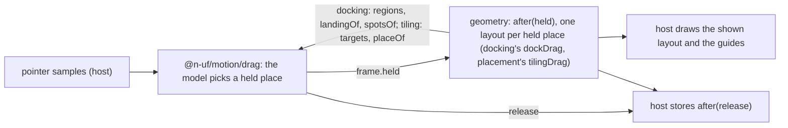

# The concept

**What this page is.** The three libraries as one system, as built: what each tier owns, the rules a drag follows across
them (one layout per held place, home, growth as spare room), and how docking and tiling each map onto the drag models of
`@n-uf/motion`. Each package's design page has its own parts and rules ([motion.md](./motion.md),
[placement.md](./placement.md), [docking.md](./docking.md)); [sdk.md](./sdk.md) lists every public type and signature;
[structure.md](./structure.md) is the project's layout; [decisions/](./decisions/) holds one record per settled rule.

Status words on this page:

- **Built**: on `live/motion` (the integration branch) or released.
- **In progress**: decided and built on a branch, not yet on `live/motion`.
- **Planned**: decided, not built.

## Three tiers

| Tier | Answers | Owns | Knows nothing of |
| --- | --- | --- | --- |
| `@n-uf/motion` | *How things move* | Time (an injected clock, a frame loop in phases), values that animate (springs, tweens, the settle curve), gestures, the drag intent and the landing model (which place a drag holds, from the pointer's path and speed), and layout motion (many rects settling, the real item held under the pointer). | Any layout: it reads rects and lanes as plain data and never asks where something fits. |
| `@n-uf/placement` | *Where things fit*, one edge or one area at a time | The shapes and their geometry, the drop-target shape (`Target`), one edge (the cut into bands, the fit of its items with their form ladders, its drop places, the float fit), panes dividing an area (order layouts, the split tree, the drop rules, and a tiling drag, `tilingDrag`: its layout half and its hit half, whose zone hold over a point's path is geometry: distances, never time), and the popup positioner. | Time, a whole window. A distance-based zone hold is geometry and placement's; a time-based gate is motion's. |
| `@n-uf/docking` | *Where panels and toolbars dock* in one window | A window as one plain-data dock state (`DockState`): its edges, items, floats and keep-clear rects; `solve`, the changes, targets and refusals, lanes, the drag's layouts (`dockDrag`), storage, and the conformance rows. | Time and pointers: the landing model that drives its drag is motion's. |

The host, the application that embeds them, draws, measures and owns the pointer events. Nothing in the three touches a
DOM, a timer or a framework, except `@n-uf/motion/browser`, the one entry that reaches a host.

**Dependencies.** Placement depends on nothing. Docking depends on placement, through its public entries only. Motion
depends on nothing but its signal runtime, and neither motion nor placement imports the other: they meet in plain data
(a `Rect` has the same shape in all three, a drop target is placement's `Target` plus the fields motion's drag intent
reads, and docking's drag fits motion's `LandingGeometry` as it is). Docking's testing entry imports motion's types,
never its code. The dependency rules that hold this are listed in [structure.md](./structure.md).

## A drag across the tiers

Every drag, docked or tiled, has the same split of work:

- **The model picks a held place.** A *held place* is where a release now lands. In a docking drag motion's landing
  model reads the pointer's path and time and names it; it does no layout. In a tiling drag it is the other way round:
  placement's hit (`drag.hit(basis)`) names it, from the pointer's path by distances alone, and motion's drag intent,
  with every time gate at zero, shows what the hit holds (or a host steps the hit's pure hold with no intent at all).
- **The geometry lays it out.** For each held place, one function gives the one layout a release there commits:
  `dockDrag(...).after(held)` in docking, `tilingDrag(...).after(held)` in placement.
- **The host draws and stores.** It draws what the draw rule names and commits `after(release)`.

## One layout per held place

**The rule.** While a place is held, a frame that draws a landed layout draws exactly what its release commits: every
item, the landing and every guide come from one function, `after(held)`, and a release commits `after(release)` and
nothing else. A frame that draws only a mark (a tiling drag on the lift basis) draws the fixed layout at the lift and a
mark that names the held place; its release commits `after(held)` all the same. There is no second
derivation of the commit (no prediction, no re-cut of guides, no host-side rebuild) and no fallback path. Hit-testing
reads one layout too, fixed for the drag, so a held place changing the drawn layout never moves what the pointer is over.

| | Docking (`dockDrag`) | Tiling (`tilingDrag`) |
| --- | --- | --- |
| A held place | `DockHeld`: a lane's spot with the pointer, `{ kind: "spot", spot, point }`, the float at the pointer, `{ kind: "float", point }`, or null (rest). | `TilingHeld`: `home`, a `swap` with a pane, `beside` a pane on a side, or a `join` to a pane's stack at an index. |
| `after(held)` | The dock state a release commits, its layout (solved with the drag's one `previous`, the layout at the lift), the landing, every lane's marks, a spot's stretches. | The tree a release commits, its layout (the adapter's `split(tree)` laid out by `layoutSplitTree`), the landing, every other pane it moves, or a refusal code. |
| Hit-testing reads | The lanes' hit rects as seen at the lift; a held lane's stretches in that spot's own layout. | One layout, laid out once at the lift and fixed for the drag (`drag.hit(basis)`): the base (the tree with the subject released) for a host that draws the landed layout, the lift (the subject's slot open) for a host that draws a mark. Built. |
| The draw rule | `shown(frame)`: `after(frame.held).layout` while the frame's room is open; a float frame whose room is not open, and the Outline mode, draw the window at rest. | Built: `hit.drawn(read)`. On the base, `after(held)` as soon as a place is held, the lift at home, the base with nothing held or a refused place; on the lift, the lift and a mark that is a region of it (`read.mark`). |
| Guarded by | docking's `test/one-layout-sweep.test.ts`, `test/drag-after.test.ts`; the lab's `one-layout-*` presets | placement's `test/tiling-drag.test.ts`, `tilingConformance`; `test/tiling-hit.test.ts`, `tilingHitConformance` |

Two exceptions are built and named: a movable grower held on a bar is drawn, with its bar's neighbors, at its natural
length; solving the state it lands in grows it (see growth, below). And a mark-only frame, above. Records: [0002](decisions/0002-held-marks-follow-the-drawn-edge.md),
[0003](decisions/0003-one-layout-per-state.md), [0009](decisions/0009-one-layout-per-tiling-place.md).

## Home

Home is the held place whose release changes nothing.

- **Tiling: home is the gap the release leaves.** It is the subject's lift rect when releasing the subject takes a drawn
  pane away (a pane alone, a whole stack), and null when it takes none (a member torn out of a stack that stays drawn).
  A torn member's own place is then an ordinary place: the join back at its index. Home lies only over base panes that
  grew when the subject was released, and `after(home).tree` is the lift tree itself, never normalized. In the hit, home wins over everything beneath it, and any place whose release has the lift's arrangement (the side of the pane beside the subject that restores its order, a torn tab's own cell) reads as home. Built.
- **Docking: home is the item's own spot at the lift** (`dockDrag(...).home`, `{ lane, spot }`; absent for a float). On
  a bar or a toolbar rail it is one landing for half a pitch around the item's place, and the landing model's lift zone
  (16 px around the press) keeps it: away and back to the press point is home. Built.
- **Motion** holds home for a docking drag and for a drag intent given a home: the intent's `home` rect and `atHome`, a
  release over home doing nothing; the landing model's `home` option and lift zone. For a tiling drag the hit holds home
  itself, as a target and a place under the one hold rule, and its intent options give the intent no home (`home` is
  optional).

## Growth is spare room

**The rule.** An item that grows owns only its natural length; the length it grows by is spare room, which a drop may
take, never squeezing the item below its natural length. Built for a growing fixed title (26.11.56) and for a movable
grower on a bar, such as a toolbar group that takes its bar's free span (on `live/motion`, unreleased). Record:
[0005](decisions/0005-growth-is-spare-room.md).

**Three layouts, one job each.** A drag reads three layouts, and each question has exactly one of them:

| Layout | Its one job | Status |
| --- | --- | --- |
| `room`: the window solved with every movable grower's growth off (once per drag) | Which places exist and fit: zone extents, slot lines, cards, the item's own place, an empty zone's probe. | Built. |
| The landings: each place's landing in its own commit layout | The aim cut: where one place meets the next lies halfway between the landings of the two adjacent places, on both paths (`targets()` and `lanes()`), at the grab where two landings overlap; a panel column cuts by halves of what it draws. Whether a pointer reaches a place is judged on these cuts, so a grower's spare room is reachable. | In progress. On `live/motion`, `lanes()` cuts by landings but `targets()` cuts a toolbar's neighbor at its middle, so the two paths can disagree on a bar. |
| `shown(frame)`: what the frame draws | Every item, the landing and the guides; the guides are cut in it. | Built, with two known gaps on `live/motion`: the held movable grower drawn at natural length (above), and a growing fixed title, whose slack the marks still treat as free room, so a box is drawn over the grown part of the title. Under the rule the guide beside a growing title is cut in the shown layout and shows a line at most; that is not built. |

Record: [0010](decisions/0010-three-layouts.md) (in progress).

## The two drag models and how each geometry maps onto them

`@n-uf/motion/drag` has two models, for two kinds of target. Both are pure (a point and a time in, a frame out), both
take `release(point, time)`, and `previewPlan` reads a frame of either.

- **The drag intent** (`createDragIntent`) works on a flat list of `DragTarget` rects, each with a priority: the most
  precise target under the pointer wins, an aiming gate keeps a fast pass from showing anything, hysteresis and a switch
  hold keep the shown target steady, and `placeOf` names the place within a target. A release lands on the shown target.
- **The landing model** (`createLandingModel`) works on regions: lanes, each with its spots in order. It holds a lane and
  a spot (gates on entry, a margin on every change, the hand rule for how far the landing may trail the pointer), names
  the held place and the guides to show, and reads every rect from a `LandingGeometry`: `regions`, `landingOf(held)` and
  `spotsOf(spot)`.

| Concept | Docking | Tiling |
| --- | --- | --- |
| The model | The landing model. `dockDrag(...)` is a `LandingGeometry` as it is: `createLandingModel({ ...drag, preview })` is the whole wiring. | The drag intent (panes are areas, not lanes of spots). `drag.hit(basis)` gives the targets in the intent's shape and `hit.intent` its options, pinned by a type check: `createDragIntent({ ...hit.intent })` is the whole wiring, and the intent only shows what the hit holds. A host with no intent steps `hit.hold(state, point)` alone. Built. |
| Places | A lane per edge that takes the item (and virtual lanes: a new column's line, a declared rail); a spot per place a drop lands, with its landing and its stretch of the lane. | One body target per pane (its five regions: the center swaps, a side splits) and a join target per pane part (a title bar, a tab strip, a slot giving the index), all on the one fixed layout; home. A side of a pane takes an insert only for a new arrangement: on a run neighbor of the subject, the sides that repeat the lift or the swap are gone and the swap spans 0.56 (`neighborSwap`) across the run ([0012](decisions/0012-one-zone-map-per-tiling-drag.md)). Built. |
| Which place the pointer is at | The aim cut along the lane (see growth), the hand rule ([0001](decisions/0001-the-hand-rule.md)), the gates. | The zone under the pointer on that one map, and one hold rule: the held place keeps its zone until the pointer is 6 px past the edge of the part of it that shows, and inside one pane until it is 24 px from where the place was taken, each at most a quarter of the zone (`cap`). Built. |
| A refusal | A refused stretch or a refused place outside every lane: "Can't go here", a release goes home. | A refusal code on `after(held)` (`self`, `still`, `missing`, `join`, `room-along`, `room-across`, `fit`). A place exists when it is not refused; a refused zone holds nothing and falls to the target beneath it, and `read(...).refused` names it, so a refused side of a pane needs no rect of its own. Built. |
| Home over other targets | The lift zone: within 16 px of the press the item's own lane holds. | Home, the subject's lift rect, wins over everything beneath it (parts included), under the same hold rule as every zone; a place whose release gives the lift's arrangement reads as home. Built. |
| Guides | `dockDrag(...).guides(frame)`: each lane's marks from the held place the frame names, through `guideRects` for cosmetics. | On the base, the landing and the panes `after(held)` moves (`moved`); on the lift, the mark (`read.mark`, a region of the lift layout: a side's half, a swap's outline and wash, a join's outline and slot). The host draws them. |

## Decisions in force

| # | Rule | Status |
| --- | --- | --- |
| [0001](decisions/0001-the-hand-rule.md) | The landing is the nearest in its lane, within `max(48, g / 2 + 6)` px of the pointer. | Built, 26.11.52 |
| [0002](decisions/0002-held-marks-follow-the-drawn-edge.md) | A held frame's marks follow the edge as drawn. | Built, 26.11.55 |
| [0003](decisions/0003-one-layout-per-state.md) | One layout per held place of a docking drag. | Built, 26.11.55 |
| [0004](decisions/0004-a-fixed-item-that-steps.md) | A fixed item may still step (`stepping`): a reserved place is not a fixed size. | Built, 26.11.56 |
| [0005](decisions/0005-growth-is-spare-room.md) | Growth is spare room. | Built: the title in 26.11.56, the movable grower on `live/motion` |
| [0006](decisions/0006-keep-clear-anchored-to-the-layout.md) | No input of a solve comes from its own output: keep-clear rects anchored to the content. | Built, 26.11.57 |
| [0007](decisions/0007-what-the-hand-does-moves-nothing-else.md) | What the hand does to a float moves nothing else. | Built, 26.11.56 |
| [0008](decisions/0008-reach-only-adds.md) | Reach only adds. | Built, 26.11.57 |
| [0009](decisions/0009-one-layout-per-tiling-place.md) | One layout per held place of a tiling drag; home is the gap the release leaves. | Built (the layout half), on `live/motion` |
| [0010](decisions/0010-three-layouts.md) | Three layouts, one job each: `room`, the landings, `shown`. | In progress |
| [0011](decisions/0011-which-item-counts-as-docked.md) | Which item counts as docked is the item's declaration (`countsAsDocked`). | Built, on `live/motion` |
| [0012](decisions/0012-one-zone-map-per-tiling-drag.md) | One zone map per tiling drag, and swap-only run neighbors. | Built (the hit half), on `live/motion` |
