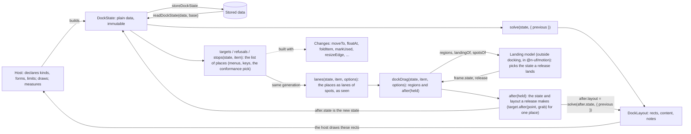

# @n-uf/docking: design

**What this page is.** The architecture of `@n-uf/docking` as it is built: what the library is for, how its parts fit, the rules a consumer can rely on, and the public SDK entry by entry. The API contract is the package's exported TypeScript types (the files its `exports` map names); where this page and those types disagree, the types win. Code comments cite this page's sections by heading, for example "docs/docking.md, Lanes". The detailed behavior, with examples, is on [docking-reference.md](./docking-reference.md), which covers behavior; the exported types are the contract. The general layer it stands on is `@n-uf/placement` ([placement.md](./placement.md)).

## Rules a consumer relies on

Each rule names the test that pins it (paths under `packages/docking`). `pnpm check` in the repo root runs them all, with the type checks, the build check and the dependency rules.

| Rule | Guarded by |
| --- | --- |
| **The preview is the result.** For every target, `after.layout` equals `solve(after.state, { previous })`, and when the target has a `slot`, the slot is the dragged item's rect in that layout. | `test/targets.test.ts` (preview = result), `test/sweep.test.ts` (every target) |
| **Every point of an edge that takes the item is exactly one target or one refusal**, in the point's own zone, with no hole and no overlap. The item's own rect maps only to home. | `test/target-model.test.ts` |
| **Nothing overlaps after a solve.** No two docked items overlap, each lies inside its edge, and each edge inside the stage. (An overlay bar that names `span: "full"` lies over the side columns by design.) | `test/sweep.test.ts` |
| **A press reshapes nothing.** Under `previous`, using an item, or any chain of presses, changes no rect and unfolds no column. | `test/sweep.test.ts` |
| **Giving way is reversible in exact order.** Room coming back brings items up the form ladder in the reverse of the order they gave way; at every length the way back holds what the way down held. | `test/fit-ladder.test.ts`; placement's `test/stack-previous.test.ts` |
| **The stored state round-trips.** `readDockState(storeDockState(state), base)` lists nothing dropped, stores to the same data, and solves to the same layout. | `test/changes.test.ts` (the stored form) |
| **Lanes are sound.** Each lane's stretches tile it in order from end to end; a spot's landing is exactly what its drop commits; spot ids are unique; spot ids survive the window growing. | `test/lanes.test.ts`, `test/lanes-landing.test.ts` (what a frame shows is what the drop commits) |
| **Away and back to the press point is home.** On a bar or a toolbar rail the item's own place is one landing for half a pitch around it. | `test/lanes-home.test.ts`, `test/lanes-landing.test.ts` |
| **Stretch positions are one rule.** `"free"` gives exactly what no option gives; each free stretch is one sliding spot flush from neighbor to neighbor, its drop lands at the pointer less the grab, clamped and snapped, with the neighbor unmoved, and a press, a ±6 px wobble and a release is home; `"pitched"` gives spots at a pitch instead. Bars and rails, start and end zones. | `test/lanes-stretch-positions.test.ts` |
| **A sliding spot's frame is its commit.** For any pointer and grab the rect a landing model's frame draws is the rect the drop commits (whole pixels, or a snap point). | `test/lanes-stretch-frame-commit.test.ts` |
| **One layout for the held frame and the commit.** For every held frame whose room is open, every item but the held one, the landing and the marks are `after(state)`'s, which is the release's commit (exactly, and after the store round trip); a float frame, whose room is not open, and the Outline mode draw the items at rest, with the float's landing still the commit's (the draw rule, "What a held frame draws"); a held lane's marks follow its edge as drawn there (decision 0002); no two lanes' guides overlap; a Near or entered lane shows its marks in the state it names, a lane the screen doesn't draw in the layout that creates it; the corner's owner by reach switches exactly at reach. | `test/one-layout-sweep.test.ts`, `test/drag-after.test.ts`, `test/lanes-held-commit.test.ts`; in the DOM, the lab's `one-layout-*` presets |
| **A snap point is keyed by what it commits.** A center dock landing a fraction of a pixel from a stretch's start keeps its own snap point and commits as a center dock. | `test/lanes-stretch-snaps.test.ts` |
| **Marks never cover an item.** No line, box or hatch lies over an item drawn on its lane or over the held item; a hatch is a cue inside its box, never a mark on a neighbor; an empty lane's marks are cut around every docked toolbar. | `test/lanes-guides.test.ts` |
| **A stretch is the room the drop makes.** Where a drop steps a neighbor down to a shorter form, the stretch runs from flush after its short form to flush before the next neighbor: one sliding spot over that whole room (pitched spots fill it under `"pitched"`), every start in it landing as aimed, and the landing stays at the hand along it; its box has a striped end facing the neighbor that steps down, naming it (`givesWay`), and a box where nothing moves, leaves or steps down is plain. | `test/lanes-stepdown-slide.test.ts`, the landing row `landing-step-down-room` |
| **The landing stays at the hand.** While a lane holds, the landing is the nearest landing in its lane to the pointer, within `max(48, g / 2 + 6)` px of it (`max(56, g / 2 + 6)` on the single frame before a hop); `g` is the gap along the lane between the facing edges of the two adjacent landings the pointer lies between, 0 over a landing. Over a docked item much longer than the held one, `g` is about its length less the held item's, plus a gutter: no landing lies inside it, so the landing trails the pointer by up to half that. | `test/landing-cases-hand.test.ts`, the landing rows (`moving.hand`); [decision 0001](decisions/0001-the-hand-rule.md) |
| **The landing rows and the conformance rows pass on the reference hosts.** | `test/landing-cases.test.ts`, `test/cases.test.ts` |
| **A drag fits motion's landing model.** `DockRegions`, `DockLane` and `DockSpot` are assignable to the shapes `@n-uf/motion/drag`'s landing model takes (`AssertLanding`), and `DockDrag` to its `LandingGeometry` (`AssertGeometry`); the model's states, releases, frames and guide refs are assignable back to `DockHeld`, `DockGuideFrame` and `DockGuideRef`. Motion has no mark shape: a mark is docking's alone. | `test/landing-check.test.ts` |
| **Docking is pure and its model imports nothing from motion.** No DOM, no timer, no global clock, no framework; one dependency, `@n-uf/placement`, through its public entries. | `pnpm check` (the `docking-not-motion`, `docking-testing-motion-types-only` and `docking-placement-entries-only` dependency rules, `scripts/check-dist.mjs` on the built package) |

## In one paragraph

Docking answers *where panels and toolbars dock*. A host describes a window as a **dock state** (`DockState`): a stage, **edges** along its sides (bars, rails, columns), **items** with **forms** that step down a ladder as room runs out, **floats** above the content, and rects the floats and drops **keep clear** of. `solve` turns the state into a **layout**: every rect the host draws. For a dragged item, `targets` gives every drop target with its **refusals**, each target carrying the state and layout a release there makes, so the preview is the result: it is the list of places for "Move to" menus, arrow keys and the conformance pick. A drag with a pointer is `dockDrag`: `lanes` arranges the same places as lanes of spots, and `dockDrag(...).after(held)` gives the one layout of each state of the drag, which a held frame draws while its room is open (see "What a held frame draws") and a release commits. The landing model of `@n-uf/motion/drag` is the docking drag: it picks the state a release lands, and `dockDrag` is the geometry it reads. Changes are pure functions from state to state, and `storeDockState` / `readDockState` keep a state across reloads. Each edge is fitted by `@n-uf/placement`'s general layer (`cutEdges`, `fitStack`, the form flags, `fitFloat`). *How* things move (the landing model's gates, springs, gliding) belongs to the sibling `@n-uf/motion`; the model imports none of it and composes with it through plain shapes: the landing model's geometry, and the drop-target shape.

## Contents

- [What docking is for](#what-docking-is-for)
- [How the parts fit](#how-the-parts-fit)
- [The dock state](#the-dock-state)
- [Solving](#solving)
- [Changes](#changes)
- [Targets and refusals](#targets-and-refusals)
- [Lanes](#lanes)
- [One layout: a drag's states (`dockDrag`)](#one-layout-a-drags-states-dockdrag)
- [Storage](#storage)
- [The landing rows](#the-landing-rows)
- [Principles](#principles)
- [The SDK by entry point](#the-sdk-by-entry-point), then one section per entry: [root](#entry-root), [testing](#entry-testing)
- [Glossary](#glossary)
- [Considered, not part of the design](#considered-not-part-of-the-design)

## What docking is for

An application window is a set of places: bars along the top and bottom, columns and rails down the sides, panels that open, fold to a header or a rail icon and fall into an overflow menu, toolbars that move between bars, windows that float. Someone drags an item and wants three answers at once: where can it go, what will the window look like if it goes there, and why can't it go somewhere else. Docking computes those answers, and only those.

- **State in, rects out.** Everything is plain data and pure functions. A dock state is an immutable value: a change returns a new state (the same object when nothing changed), nothing is module-global, so two windows on a page are two states.
- **One owner for the window.** Every rule that spans the window (which kinds an edge takes, what floats keep clear of, what fixed room an item keeps, that the preview equals the result) lives in `@n-uf/docking`, which holds the whole window in one model. What one edge needs alone (its fit, its form flags, the edge cut, the float fit) is `@n-uf/placement`'s.
- **The host draws and measures.** The library never touches a DOM. The host measures its items, declares their forms as numbers, draws the rects it gets back, and feeds pointer samples to a drag intent.
- **Composition with motion without a dependency.** The landing model is the docking drag, and `dockDrag` is its geometry, a plain shape it reads as it is. A drop target from `targets` has the shape `@n-uf/motion/drag` takes (`id`, `priority`, `hit`, `slot`, and a few optional fields), for the menus, keys and conformance pick that read the list of places. A rect has the same shape in all three packages. The pick rule (which target the pointer is over) and the landing model are motion's; where the conformance code needs them, the host passes them in (`createReferenceHost({ pick })`, `createLandingHost({ landing })`).

Nothing under `packages/docking/src` outside `src/testing` imports `@n-uf/motion`, and `src/testing` imports only its types (for `AssertLanding` and `AssertGeometry`, erased from the JavaScript). The package's one dependency is `@n-uf/placement`; `@n-uf/motion` is an optional peer dependency (for the testing entry's types) and a development dependency, and the package's tests import it to drive the pick rule and the landing model.

## How the parts fit

Every edge in the diagram is a pure function call. The state goes round the loop: a drop commits `after.state`, the host solves it with the layout it had as `previous`, draws the result, and may store it. The landing model reads the drag's geometry and gives back a state; `dockDrag` turns each state into its one layout. A pointer drag reads `lanes` and `dockDrag` (built from the same generation as `targets`); `targets` itself is the list of places for menus, keys and the conformance pick.

The code is layered the same way:

- `@n-uf/placement/stack` solves **one edge**: given items with forms and a length, it picks one form per item and places them; it also cuts the stage into bands and fits a float clear of what is docked.
- `@n-uf/docking` lays out **the window** with it and owns everything above one edge: the edges, rails, dynamic columns, floats, targets, lanes, changes and storage.
- `@n-uf/docking/testing` is **data and a runner** over the model: conformance rows that a host plays, and the reference hosts.

## The dock state

A `DockState` has a `stage` (the window's inner rect, px) and these parts.

**Edges.** A `DockEdge` lies along one `side` of the stage at a `ring` (0 is outermost on its side). Top and bottom edges are *bars* (their stack runs across); left and right edges are *columns* (they run down). An edge declares what it takes (`accepts`, deny by default; `zoneAccepts` narrows per zone; `zones` limits which of the three zones it has), the size across it (`cross`: `min`, `max`, `rail`), and its spacing (`gap`, `pad`, the » `menu` entry).

- A bar is `reserved` (it shortens the content) or `overlay` (it lies over the content), and spans the `full` width or lies `between` the side columns.
- A **dynamic column** (`column: true`) is made by a drop on a column line from the side's `DockState.columns` template, and deleted, its side's rings closed up, when it holds no item. A static column is the host's own.
- A **rail** (`DockState.rails[side]`) is a side's strip where folded columns show as segments. Without a declared rail, a column in which nothing sets the width is drawn as a rail. `DockState.railModes` says whether rails show item titles or tiles; `DockState.railDrop` gives each kind a drop strip with a dwell and a magnet.
- A **compact edge** (`compact: true`) is an icons-only thin rail of vertical toolbars along a window side.
- An **anchor** is an edge that takes nothing and holds a fixed item (a page-thumbnail strip); with `moves: "side"` the fixed item may be dragged to the other side of its axis.
- `giveWay` lets a static column or a bar shrink and fold as the content runs short; `hidden` and `showIn` keep an edge in the state without drawing it, or lend its items to another edge.

**Items.** A `DockItem` has a host-chosen `kind` (a string such as "panel" or "group"), its `forms` along a column and along a row (largest first, as `fitStack` takes them: a panel's `open`, `header`, `rail`, `menu`; a group's `row`, `stacked`, `wrap`, `icons`, `fold`, `menu`; what the model reads of a form is its flags, `body`, `folded` and `compact`), and its state: `used` (an age: the larger, the more recent), `kept` (gives way after every unkept item), `from` (folded by hand when above 0), `closed`, `align` (its zone: `start`, `center` or `end`), `space` (free length kept on its zone's open side), `priority` (its give-way priority in its edge) and float sizing (`floatSizes`, a size for each orient, `floatOrient`, `floatMin`, `floatMax`). A `fixed` item is reserved room (a title, window controls): it never changes form, is never dragged, and no target covers it. A fixed item at a zone's anchor keeps its place against a drop; with `pushable: true` (a declaration of the state, never stored) a movable item dropped after it may push it inward, so the gap after a run of such cells (a state and a page cell at a title bar's end) is a stop.

**Floats, rects kept clear, blocked.** A `DockFloat` lies above the content in stage px, or follows a side or corner of the content (`anchor`, with an optional offset); `since` orders anchored floats, the last float in the list is on top, and `floatKinds` lists the kinds that may float. `keepClear` rects (`KeepClear`, the window's chrome) are kept clear of: by default floats keep clear and no target, slot or landing lies on them; with `for: "floats"` only floats do. `blocked` rects are spots where a release cancels.

**Window-level knobs.** `contentMin` (the least the content may be, with a lower `chromeWidth` floor for toolbar chrome), `inset` and `insetWhen`, `gutter`, `handFold` (`"bar"` or `"ride"`), and three declarations that change how drops work: `foldedColumnDrop`, `sideColumns` and `barZones`.

**State and declarations.** A dock state holds two kinds of data. *State* is what a person changes: the order of items in edges, an edge's `size`, dynamic columns, each item's `used`, `kept`, `from`, `closed`, `align`, `space`, `floatSizes`, the floats, and `railModes`. *Declarations* are what the host re-declares each time it builds the state: kinds, forms, limits, templates, rails, `zoneAccepts`, `zones`, `foldedColumnDrop`, `sideColumns`, `barZones`, `hidden`, `showIn`. Only state is stored.

## Solving

`solve(state, { previous?, fresh? })` returns a `DockLayout`: `items` (each item's `rect`, the `form` it took, its edge and zone, and flags such as `inMenu`, `tab`, `rail`, `folded`, `foldedBy`, `rows`, `grip`, `hidden`), `edges` (each edge's rect, size across, » `menu`, `items`, `tabs`), the `content` rect, `floats` in stacking order, `rails`, `railPlaces`, `columnRoom`, and `notes`. The same state always lays out the same.

1. **The cut.** Reserved edges cut the stage from the outside in: full bars (top, then bottom, by ring), then the columns (left, then right), then the `between` bars. What remains is `content`. Overlay edges are cut from a copy of the content, so they lie over it without shortening it. The bars' and overlays' cut is placement's `cutEdges`.
2. **Each edge is a stack** solved by `fitStack` along its length. Items are taken in zone order; fixed items keep their form; closed items take no room.
3. **The form ladder.** An item starts at the largest form it may take (`from`). When the length runs short, one item at a time steps down to its next form that shortens the stack: an open panel folds to a header, then a rail icon, then the » menu; a group's row of words goes to stacked words or a wrap, then icons, then the menu. Who steps first: the lowest `rank` of the form it would step into (`DockItem.priority` adds to every form's rank), then unkept before kept, then the item used longest ago. Room coming back climbs the ladder in the exact reverse order; `previous` carries that history (`StackFit.steps`).
4. **Rail and size.** A column in which nothing sets the width is a rail; otherwise `DockEdge.size` (a person's drag) sets the width, clamped to the edge's limits and the widest open item's minimum.
5. **Zones.** When items leave spare length, start items pack from the start, end items from the end, and center items sit at the edge's middle, moved only as far as they must to stay between the other two.
6. **Give-way by width and height.** While the content is narrower than `contentMin.width`, dynamic columns shrink toward their minimum, then fold whole into their side's rail (unkept before kept, the oldest first, the outer first); bars with `giveWay` do the same by height. Room coming back undoes it in reverse.
7. **Floats** are fitted inside the stage, clear of every docked item, bar and kept-clear rect (placement's `fitFloat`); an anchored float sits flush with its side of the content first.

`notes` say why the layout looks as it does, coded and machine-readable: stack notes with their edge (`form-down`, `to-menu`, `too-wide`, `no-forms`, `overflow`), `unknown-item`, `twice`, float notes (`float-clamped`, `float-moved`, `float-covers`), give-way notes (`column-shrunk`, `column-folded`, `kept-folded`, `bar-shrunk`, `bar-folded`), content notes (`content-narrow`, `content-short`, `no-column-room`, `content-changed`) and a few more. A note's `code` is the contract.

`previous` (the layout before) makes a change of ages alone reshape nothing, keeps columns folded by give-way folded while the content still fits, and tells the host when the content moved (`content-changed`). `fresh` names edges or items to solve without `previous`.

## Changes

Changes are pure: each takes a dock state and returns a dock state. One that cannot apply (an unknown item or edge, a fixed item, a kind the edge does not take) returns the state it received, the same object, so `after === before` says nothing changed.

- `moveTo(state, id, place)` docks, floats or folds an item. A `Place` is a `DockPlace` (an edge, optionally a zone, and the index among that zone's items, optionally the `space` to keep), a `ColumnPlace` (a new dynamic column at a ring on a side), a `RailPlace` (a new column holding the item folded by hand, so it shows in the rail) or a `FloatPlace` (a rect, or an anchor). A zone named becomes the item's `align` only where the edge offers a choice between zones.
- `homeFor` and `dockHome` find and restore the place a start state gives an item ("Dock", "Put back", "Reset position").
- `floatAt`, `raiseFloat`, `orientFloat`, `resizeEdge` (an edge's size across), `resizeFloat` (a float's rect through `fitResize`), `liftItem` (the state with an item out of every edge and float; the room it kept, `DockItem.space`, goes to the next placed item in its zone, which stays where it is). `moveTo` docked into a placed neighbor's room consumes it, and `floatAt` lifts first. `orientFloat` turns a float and gives its frame the size the new orient draws it at (a size is kept for each orient, `DockItem.floatSizes`), so a toolbar float turned to a row is framed at its row, never at its old rect.
- `foldItem` / `canFold` (fold by hand to the item's first `folded` form), `markUsed`, `keepItem`, `openItem`, `closeItem`.
- `setSide` moves an edge to the other side of its axis; `setRailMode`; `mergeSideColumns` merges a side's columns into one for `sideColumns: "one"`.

## Targets and refusals

`targets(state, dragged, { previous, endReach, floatSize, floatFromHeld, floatOrient, fresh })` returns every `DockDrop` for one item: the list of places for menus, keys and the conformance pick (a drag with a pointer is `dockDrag`, below). A target is a motion-shaped `Target` (`id`, `priority`, `hit` and `hits`, `slot`, `free`, and flags for spring-loaded rails and rooms that open) plus `item`, `place` (a `DropPlace`), an optional `marker` (the insertion line) and `after(point, grab)`, which returns a `DropResult`, `{ state, layout }`: the state a release there commits and its layout. Only a float's `after` depends on the pointer.

One model makes every docked target and refusal: **edge, zones, slots, tiles, then one ordered filter.**

- *Edges.* Every real edge, empty or occupied, plus two virtual edges per side: the column lines and the rail.
- *Zones.* Each edge has start, center and end extents along it: thirds where items keep their length and zones only align them (bars, compact rails), or the span the solver gives each zone where items fill the edge (columns). `DockState.barZones: "nearest"` meets bar zones halfway between landing rects.
- *Slots.* A zone's insertion lines. The item's own place is an interval, home.
- *Tiles.* A zone's extent split halfway between its slots' lines.
- *Filter.* (i) the edge and zone take the kind; (ii) the drop fits: no » entry, no new overflow, every fixed item keeps its form, place and least length, a title bar's title keeps its natural width, and the slot covers no kept-clear rect; (iii) space ownership and clipping, so that every point belongs to one place (owned beats virtual beats overreach); (iv) `blocked` rects become `none` targets. A slot that (i) or (ii) removes becomes a **refusal** over its own tile.

| Id | Names | Priority |
| --- | --- | --- |
| `gap:<edge>:<zone>:<at>` | a slot before the `at`-th item of an edge's zone | 2 |
| `strip:<edge>:<zone>` | a zone's one slot on an edge with no members | 2 |
| `column:<side>:<ring>` | a new column on a side's column line | 2 |
| `rail:<side>:<ring>` | docking folded into a side's rail (a dwell-armed strip under a `railDrop` policy) | 1 |
| `side:<side>` | an anchor edge moved to the other side of its axis | 2 |
| `home:<item>` | the item's own place: a release changes nothing | 1 |
| `none:<i>` | the `i`-th `blocked` rect | 1 |
| `float:<item>` | floating anywhere in the plane | 3, free |
| `refuse:<edge>:<zone>[:<n>]` | a refusal | ranks 2.5 |

`targetId`, `parseTargetId`, `placeTargetId` and `virtualEdgeId` build and read these ids. `refusals(state, dragged)` returns each `DockRefusal`: its `edge`, `zone`, `hit` (and `hits` when targets cut it into pieces), `bounds` (the stage) and `reason`: `not-accepted` (the edge or zone does not take the kind), `no-room` (the drop would not fit along the edge: lack of length), `too-thick` (no form of the item fits across the edge: the bar is thinner than the item), `own-place` (the stretch beside an item alone in its zone). A release over a refusal commits nothing; the item goes home. `refusalTargets` turns refusals into targets for a drag intent (`refuse: true`, ranked after priority 1 and 2 and before 3 by `pickRank`). `stops(state, dragged)` orders the same targets (no home, no none) for "Move to" menus and arrow keys. Items an edge lends through `showIn` are dragged as items of the edge they show in; hidden edges have no targets.

Targets are generated with `previous` so every `after` is solved as the drop will be; a dropped item counts as just used.

## Lanes

`lanes(state, dragged, options)` arranges the same targets for a **landing model** (`@n-uf/motion/drag`'s `createLandingModel`), where the pointer picks a place by where the item would land rather than by a hit area. It returns `DockRegions`:

- `lanes`: every edge that takes the item, plus virtual lanes (a new column's line, a declared rail), each with its `rect` (its hit rect, as seen), `axis` (`"x"` or `"y"`), `spots`, `refused` stretches and `marks` (as seen, the held item drawn nowhere). A held frame's are `dockDrag`'s (below).
- a `DockSpot` is one place a drop lands: a stable `id`, its `along` stretch of the lane (the part of the lane that picks it), its `landing` rect, its `target` (the drop and its `after()`), `home` for the item's own place, `pitched` for a spot over a free stretch, `slide` for a sliding spot (`LaneSlide`: `from`, `to`, `snaps`, `snapDistance`, `step`, the grain of a start that snaps to nothing: whole pixels), and `others`, a key for where its drop draws every other item. A change between two spots with the same key moves only the held item; between different keys it reflows the window, so a model gates only those.
- A lane's `refused` stretches (`LaneRefusal`: `along` and `reason`) take no drop of the item and are at least the item's length (a shorter one joins its spots). `DockRegions.refused` holds the refused places outside every lane ("Can't go here"), and `DockRegions.refusals` the drag's refusals from the same generation as the spots (what `refusals()` gives).
- `content`, `blocked` (what the open space excludes: drawn edges, docked items, kept-clear rects, a drawn declared rail, `DockState.blocked`), `stage`, `floatRegion` (the stage less the inset at its sides, where a float may lie), `item` (the held item's size) and `float` (the float target).

How stretches are cut. In a panel column, between two spots that share a neighbor, the boundary is that neighbor's middle as drawn, so a column takes a panel by halves. On a bar or a toolbar rail, and between any two other spots, it is halfway across the gap between their landings, each in its own layout, so the pointer is at the landing it picks. Where two landings overlap (spots a pitch apart), the cut is made at the grab: `options.grab`, where the pointer holds the item (the press's, constant for the drag), makes a pointer back at its press point pick the item's own place however far from its middle it was pressed. Cuts are kept inside the lane and in order.

Spots on free stretches. `options.stretchPositions` is `"free"` by default: each free stretch of a bar or a toolbar rail is one sliding spot (id `…@slide`). A stretch is the room the drop makes: from flush after the neighbor before it to flush before the one after it in the forms a drop there leaves them in (a neighbor that steps down to a shorter form to make room counts; a push of a neighbor is no room made). With `"pitched"` they get spots at a fixed pitch instead (`SPOT_PITCH`, `options.pitch`; 0 or less turns pitched spots off, and under `"free"` it only sets the sampling step, 40 px when it is 0 or less), each a dock keeping `space`. Pitched, the item's own place is one landing for half a pitch around it: no other spot lands that near. A sliding spot's drop, `target.after(point, grab)`, lands the item's start at the pointer less the grab, clamped between flush against either neighbor and snapped within `options.snapDistance` (8 px) to the stretch's ends, the item's own place and any dock inside (a center dock's snap moves its center neighbor, by design); a release within the snap distance of the item's own place is home. A step comes only where the order changes (passing a neighbor). A spot's `target.place` is the dock at its listed landing; a sliding spot commits through `after(point, grab)`, and the landing model's release says where: its `point`, with `home` true where it lands at the item's own place. A stretch bounded on both sides by zones the held item cannot dock in gets no sliding spot; on an over-subscribed edge the solver gives fractional positions, so a frame and its commit can differ by about a pixel. See the reference's "Stretch positions".

Marks. Each lane's place guides lie in one layout: `lanes()` gives them as seen, a drag's `after(state)` in that state's layout (its room open), one at every place a drop lands but the held one's. A neighbor's giving way is judged in that same layout. So a pending or approached lane's guide before entry is its mark after it: the held item left out at the landing it takes (or would take) there, never at its floating rect. They say only "you can drop here":

- Room the item fits in is a `box`. Beside the held item, room from a pitch is a box too (`:before` or `:after` in its id).
- A room's `box` on a bar or a toolbar rail has a fixed striped end inside it (`hatch`, `HATCH_END`, the neighbor's id in its `givesWay`) at each side whose neighbor gives way when the item lands there: it moves away, leaves the lane (the menu, a float) or steps down to a shorter form than it has now. That holds whether or not the room as seen is shorter than the item; where no neighbor gives way the box is plain. Room that partly fits (from a pitch, shorter than the item) is such a box. Nothing is drawn on the neighbor.
- Room under a pitch, or none (two items that touch, a lane's end flush), is a `line`. A panel column keeps its lines: a joint between two panels, and its head and tail, are zero-thick lines (a host draws them through `guideRects`, whose `lineThickness` makes them 2 px), its room a `box`, and it has no striped ends: panels give way by halves, never by stepping down. The panel-drag rules are below.
- An empty lane (`options.emptyLanes`) is a `box` at its real size, the band it would open (`"real"`, the default), or a thin striped strip on its window side (`hatch`, `HATCH_EDGE`, `"edge"`). Either way it is cut around every item docked in a bar or a toolbar rail.
- A growing item (a title filling its bar) counts at its natural length, so its slack is free room. As seen the lifted item is drawn nowhere, so its own place is free room; in a spot's layout it is drawn where it lands, and beside it on a sliding spot (where it lands anywhere) any room from 8 px is a box.

**Place guides for a panel drag.** A panel column's marks follow the rules above and the landing model's guide rules (which lane shows, and the state it stands for: docs/motion.md, The landing model), with these particulars; they all come from `lanes()`' marks and `guideRects`, and a host adds none:

- A **line** is a panel's place between two panels in a column, a joint (also a column's head and tail). Docking gives it zero thickness, as the panels touch; it is drawn 2 px, centered on the joint.
- A **box** is the room a panel would take: its own place, or an empty column or a new column, at real size, after the room opens.
- An empty or new column's guide is the column's box in its after-entry layout (the one-layout rule: the mark before entry is the mark after it), consistent with Snap making room for a panel that moves to a new column. Where the held panel is drawn over a new column's landing, the mark is a line on the landing's far side instead.
- An emptied side column the dock state still declares as an edge is a lane of its own (its id the edge's, its one spot's target `strip:<edge>:start`, the edge's single slot, not a rail strip). Its guide is its box at real size, as a new column's is, and while the panel is held in it nothing is drawn over the panel. With `sideColumns: "one"` a side with a declared column edge, empty or not (a lone panel's lift empties it, or it was empty already), has it as its column, so it is the side's only lane and no `column:<side>:$` lane is offered for the same place and no two lanes draw one box.
- **No striped end** for panels: panels give way by halves, not by stepping down to a shorter form, so no partly-fits cue is drawn. (`emptyLanes: "edge"` draws an empty column as a thin striped strip on its window side, as for a toolbar rail.)
- **Under `"near"` and `"all"`** the rules are the toolbars': `"near"` shows the held, pending or approached lane's, `"all"` every lane's.
- **A line or strip a rect meets only at its end is shortened, not dropped.** A toolbar over the last 10 px of a column's line (or its first 10 px) costs the line those 10 px and the clearance; only a rect across its middle thins it across its thickness, as before, and a part under `minLength` is left out.
- **Ownership.** The line widening is the library's (`guideRects`' `lineThickness`, default 2 px): a host passes the lines as given and does not widen them.

No mark lies over an item, the held item or a float, or in a refused stretch. No two edge lanes' marks overlap: at a corner a lane not drawn gives way to a drawn one, and between two not drawn the bar owns it. The lanes' hit rects follow the same rule for a drawn edge that takes the held item: an empty bar's lane stops at the side of a drawn rail across its end, so a pointer on the rail is in the rail's lane; beside a drawn edge that refuses the item (a panel column, for a toolbar) the corner stays the bar's. The clip loses no landing, and the corner clip makes no zero-length stretch. A virtual lane is drawn over what it would push.

Marks have ids that stay while the items either side stay, so a host keys its drawing by them.

A declared rail is one lane with one spot, its end (`rail:<side>/end`), for an item that is not a tile of it. A column folded into it is a lane of its own for its tiles, drawn where its run of tiles lies (the hull of its rail segments), not over the whole rail: its hit rect, its spots' stretches and its marks lie in the run, its spots are the column's gaps (as for a column drawn as a rail), and the rest of the rail is the rail's: home for a tile of that column, as `targets()` says there. The lanes and `targets()` decide the same at every point of a rail (`test/one-layout-sweep.test.ts`), except the pending new-column-line cases, which are not about a column's run: `targets()` offers a new-column line over a rail (its zone starts where the rail stop ends) where the lanes stay, in a narrow window and in a narrow window whose right column also holds a tray of toolbars; and with a second column holding the held tile, the lanes' new-column lane lies over the rail's first pixels where `targets()` floats.

## One layout: a drag's states (`dockDrag`)

`dockDrag(state, dragged, options)` is a drag of one item (the options are `lanes()`'s: `previous` is the committed layout at the lift, the one every solve and the commit read; `grab` the press's). It gives:

- `regions`: `lanes()`'s, for hit-testing only (hit rects as seen, stable for the drag).
- `after(held)`: THE layout of a state. A state (`DockHeld`) is a spot with the pointer, `{ kind: "spot", spot, point }` (a sliding spot lands where the hand holds it), the float at the pointer, `{ kind: "float", point }`, or null, rest (the window as seen, the held item drawn nowhere). `after` gives the `state` a release commits, its `layout` (that state solved with the drag's `previous`, as the commit solves it), the `landing` (the held item there), every lane's `marks` in that one layout (`DockLaneMark`: a mark with its `lane`), and for a spot its lane's `spots` with their stretches cut in that layout (a panel column by halves of what it draws). Remembered per state: a fixed spot is solved once, at the lift.
- `landingOf(held)` and `spotsOf(spot)`: what a landing model reads (`@n-uf/motion/drag`'s `LandingGeometry`; the drag fits it as it is, `createLandingModel({ ...drag, home, placeGuides })`).
- `guides(frame)`: a landing frame's guides, each lane's marks from the state it names (rule B): a lane drawn on screen (the frame's state's layout) is drawn there, less the landing the pointer would take in it; a lane the screen doesn't draw (an empty edge, no band) takes the layout that creates it: for the Near lane its would-land state's, for any other its one spot's, its room whole, giving up where it meets a lane drawn on screen (between two such, the bar keeps the corner); `emptyLanes: "edge"` creates nothing. The Near lane's marks win where they meet another lane's.

A host draws every item but the held one in the layout the draw rule below names (`after(frame.state).layout` while the room is open), the held item at the pointer or gliding to `frame.landing`, the guides from `guides(frame)` through `guideRects` for cosmetics only, and stores `after(release).state`. It never passes an item's rect (a docked item, a float, the landing) as a clear rect: the marks already leave them out. It may keep a cosmetic clearance around its own held chrome, the held copy's outline as drawn (the lab keeps its guides 2 px clear of it in the held lane), which only trims a guide by a few pixels. Under "near" a rail beside refused columns shows its guide first at entry (pending or held), already at its after-entry box.

**What a held frame draws.** The rule, stated once here (motion.md, decision 0003 and the reference point to it): a held frame draws `after(held).layout` while its room is open (`frame.room`); a float frame whose room is not open, and the Outline mode (it never makes room), draw the window at rest (`after(null).layout`), and the gap closes on release. The float exception is this rule's float half, and it is decided (2026-11-21, [decision 0003](decisions/0003-one-layout-per-state.md)): `after(float)` is what the drop commits, so docked items close the gap when the item is let go, not during the drag (the one-preview rule: the dragged item is the only thing that moves). The float's landing still equals the commit. It is the one exception of the DOM sweep (the lab's `one-layout-items-landing` checks only the landing on float frames).

`guides(frame)` reads `after(frame.state)` as the screen.

Ids. A spot id is `<lane>/<zone>/<item before or ^>|<item after or $>`, an empty edge's `<lane>/<zone>`, a pitched spot's `…@<pitches from its neighbor>` (`@0` keeping no space; a stretch's end keeping some space `…@to:<neighbor>`), a spot over a neighbor itself `…@in:<neighbor>`, a sliding spot's `…@slide`, a virtual lane's `<lane>/line` or `<lane>/end`. A new column's lane is keyed by the column it lies beside, not its ring.

`owns` marks a lane whose rect is its own: a rail drop strip at the window's side (`DockState.railDrop`), which every other target of the drag gives up, so a landing model gives it the pointer inside it over any lane it overlaps.

`lanes()` is remembered per state and options (`previous` by identity); a drag's states (`dockDrag`) reuse that work.

## Storage

`storeDockState(state)` returns plain JSON-safe data carrying a format version (`v`): the edges (id, side, ring, items, `size`, `column`), the floats (rect, `orient`, `anchor`, `since`), the items' state, and `railModes`. Nothing about kinds, forms or limits is stored: those are the host's.

`readDockState(data, base)` reads it back over `base` (the host's state as it starts: its items' definitions, edges, kinds and stage) and never throws. Anything but an object of the supported version gives `base` back with the reason in `error`. Inside one, whatever cannot be used is dropped and listed in `dropped` (an unknown edge, an unknown or repeated item, an item an edge does not accept, a float of a kind that does not float, a bad field, an unknown field). An edge is matched by its id: its side, ring and limits come from `base`, its order and `size` from the store; a dynamic column the base lacks is made from the side's template. A float's rect is clamped into the stage on read. A stored state that places an item nowhere leaves it where `base` has it.

## The landing rows

`@n-uf/docking/testing` is the conformance suite of the model. A `CaseRow` is plain data: a dock state, the `settings` it runs at, the `gestures` a person makes (`press`, `move`, `release`, `key`, `click`, `resize`, `scroll`, `hold`), and the layout expected after them, with optional DOM checks, checkpoints, stored-form and stops expectations. `runCase(row, host)` plays one on a `CaseHost` (`load`, `perform`, `layout`, and optionally `root`, `stored`, `stops`) and says what differs; a check the host cannot make is skipped and listed. `createReferenceHost()` is the in-memory reference host: every row passes on it except the DOM checks and the rows that need a drag intent (a host that picks at the point alone skips those). `CASES` is every row; `CASE_GROUPS` lists the groups.

The **landing rows** (`LANDING_CASES`) are the same idea for `lanes()` with a landing model: a dock state, an item, a pointer path at a speed and what must hold on every frame (the lane held, regions never shown, the landing within a bound of the pointer, no guide where nothing lands), on the last frame and in the layout after the release; `home: true` says the item ends where it began. A host plays a path at its own frame rate and reports its frames (`LandingCaseHost.play`); `runLandingCases` judges them with `landingIssues`. `createLandingHost({ landing, stretchPositions })` is the reference host. Every landing row runs on every host: a row carries no library version.

A row's `moving.hand` checks the hand rule ([decision 0001](decisions/0001-the-hand-rule.md)): while a lane holds, the landing is the nearest landing in its lane to the pointer, and lies within `handBound(g)` px of it, `max(48, g / 2 + 6)` (`max(56, g / 2 + 6)` on the single frame before a hop). `g` is the gap along the lane between the facing edges of the two adjacent landings the pointer lies between, 0 over a landing. The floor and the margin are `HAND_TRAIL`, `HAND_TRAIL_BEFORE_HOP` and `HAND_MARGIN`; a hand faster than `HAND_FAST` px/ms may leave a hop that reflows the window for later.

The pick rule is an input, never an import: `createReferenceHost({ pick: targetAt })`, `resolvePlace(…, targetAt)`. `AssertLanding<R>` is a compile-time check that a host's or the library's lane shapes fit the landing model's (`AssertLanding<DockRegions>` compiles only while they do), and `AssertGeometry<G>` the same for a whole drag (`AssertGeometry<DockDrag>`).

## Principles

| Principle | Enforced by |
| --- | --- |
| **Pure.** State in, rects out; no DOM, timer, global clock or framework in either entry. | `scripts/check-dist.mjs` checks the built package for host globals and DOM types, and that it imports only its own chunks and `@n-uf/placement` |
| **Apart from motion.** Docking and motion compose through the shared target shape; the model imports nothing from motion, and the testing entry only its types. | dependency rules `docking-not-motion`, `docking-testing-motion-types-only`, `motion-not-docking` |
| **On the general layer, through its entries.** Docking stands on `@n-uf/placement`'s public entries; placement never imports docking. | dependency rules `docking-placement-entries-only`, `placement-not-docking`; `cross-folder-via-index`, `no-circular` |
| **One owner per rule.** A window-level rule is written once, in `@n-uf/docking`. | `test/target-model.test.ts` and `test/sweep.test.ts` sweep random windows against the one model |
| **A change that cannot apply returns its input.** `after === before` says nothing changed. | `test/changes.test.ts` |
| **Reads never throw.** A stored form that cannot be read gives the base back with a reason. | `test/changes.test.ts` |

## The SDK by entry point

Two entry points ship, each a file the `exports` map names. Both are pure ES modules and share `@n-uf/placement`'s shapes.

| Entry | Role |
| --- | --- |
| `@n-uf/docking` | One model of a whole window: solve, changes, targets, refusals, lanes, storage. A host that docks and floats starts and stays here. |
| `@n-uf/docking/testing` | Conformance rows, runners and reference hosts that a host's test suite plays against the model, and the `AssertLanding` and `AssertGeometry` checks. |

A host writes its items' forms in `@n-uf/placement/stack`'s vocabulary (the type `StackForm`), and adds `@n-uf/placement/tiling` to tile documents or panes and `@n-uf/placement/popup` to place a popup.

### Entry: root

`import { solve, targets, lanes, … } from "@n-uf/docking"`. One model of a whole window. Pure; nothing is module-global.

| Export | What it gives | The rule a consumer relies on |
| --- | --- | --- |
| `DockState`, `DockEdge`, `DockItem`, `DockFloat`, `KeepClear`, `ColumnTemplate`, `RailSpec`, `RailDropPolicy`, `ZoneAccepts`, `Kind`, `Side`, `Zone`, `Orient`, `RailMode`, `RailVisibility`, `FloatAnchor`, `FloatAnchorAt`, `FloatAnchorOffset` | The dock state (see The dock state). | Plain data; a state is never mutated; declarations are the host's, state is stored. |
| `SIDES`, `ZONES`, `FLOAT_ANCHORS`, `RAIL_MODES`, `RAIL_VISIBILITIES` | The sides, zones, anchors, rail modes and rail visibilities, in order. | Closed lists. |
| `DEFAULT_FLOAT_SIZE`, `DEFAULT_HIT_BAND`, `DEFAULT_STRIP`, `DEFAULT_RAIL_MAGNET`, `RAIL_STRIP_MIN`, `EDGE_ROOM_HOLD` | The defaults for a float's size, a column's gap band, an empty edge's drop strip, a rail strip's magnet and least width, and a room's hold. | Each is the value used when the state leaves its field out. |
| `solve`, `SolveOptions`, `DockLayout`, `DockItemLayout`, `DockEdgeLayout`, `DockRailLayout`, `DockNote`, `DockNoteCode` | The layout of a dock state: every rect, form and the axis each item lies along (`axis`), rail, the content and coded notes. | Pure; same state, same layout; `previous` makes a press reshape nothing; nothing overlaps. |
| `fitResize`, `FloatResize`, `ResizeEdges`, `ResizeLimit` | The rect a float takes when a person drags some of its edges, with the limits that bound it. | `resizeFloat(state, id, rect, moving)` commits the same rect, so the preview is the commit. |
| `heldRect` | Where a held item lies: its grip under the pointer, kept in the float region. | The same rule the float target uses. |
| `anchorName`, `floatOrientOf`, `floatSizeOf`, `declaresFloatSizes` | An anchor's name; which axis and what size an item's float takes; whether the item declares `floatSizes` (only then are its floats sized per orient; one that declares none keeps the stored rect). | The model's own reading, for hosts that draw floats. |
| `moveTo`, `homeFor`, `dockHome`, `floatAt`, `foldItem`, `canFold`, `markUsed`, `keepItem`, `openItem`, `closeItem`, `raiseFloat`, `orientFloat`, `resizeEdge`, `resizeFloat`, `liftItem`, `setSide`, `setRailMode`, `mergeSideColumns` | The changes (see Changes). | Pure; an inapplicable change returns the same state object. |
| `dividers`, `resizeBetween`, `resetBetween`, `resetLengths`, `DockDivider`, `DockItem.lengths` | The dividers of an edge and the changes on them: an item's asked length (per axis) traded between neighboring open growing items, reset to the natural split, or cleared; stored with the state. | Additive: a state that declares no length lays out exactly as before; a change that does nothing returns the same state object. |
| `Place`, `DockPlace`, `ColumnPlace`, `RailPlace`, `FloatPlace` | Where `moveTo` puts an item. | A `kind` discriminates; a dock place's `at` counts the zone's items without the moved one. |
| `targets`, `DockDrop`, `DropResult`, `DropPlace`, `DockDropOptions` | Every drop target for one item, each with the state and layout of its drop. | Preview equals result; every point of an accepting edge is one target or one refusal. |
| `refusals`, `refusalTargets`, `DockRefusal`, `DockRefusalTarget` | The places a drop is refused, and those as targets for a drag intent. | A release over a refusal commits nothing; the item goes home. |
| `stops` | The same targets in reading order, for "Move to" menus and arrow keys. | No home, no none; remembered per state. |
| `reservedRect` | What a fixed item keeps clear (a growing title: its natural rect). | The slot of a target never covers it. |
| `targetId`, `parseTargetId`, `placeTargetId`, `virtualEdgeId`, `TargetIdParts` | Build and read the id scheme of targets and refusals. | `targetId(parseTargetId(id)) === id` for every id it reads; a real edge may not take a virtual edge's id. |
| `lanes`, `DockRegions`, `DockLane`, `DockSpot`, `DockMark`, `LaneRefusal`, `LaneSlide`, `DockLaneOptions`, `EmptyLanes`, `SPOT_PITCH`, `HATCH_END`, `HATCH_EDGE` | The geometry of a docking drag as seen, for hit-testing (see Lanes); `EmptyLanes` (`"real"` or `"edge"`) is how an empty lane's marks draw. | A spot's landing is what its drop commits; stretches tile the lane; ids are unique and survive resizing. |
| `dockDrag`, `DockDrag`, `DockAfter`, `DockHeld`, `DockLaneMark`, `DockGuide` (the same type as `DockLaneMark`), `DockGuideFrame`, `DockGuideRef` | A drag of one item: `regions` (as seen), `after(held)` (THE layout of a state: the state a release commits, its layout, the landing, every lane's marks, a spot's stretches), `landingOf`, `spotsOf` and `guides(frame)` (see One layout). | A held frame and its commit read one layout, with the draw rule's two cases ("What a held frame draws"); a release commits exactly `after(release).state`; the drag fits the landing model's `LandingGeometry` as it is. |
| `storeDockState`, `readDockState`, `StoredDockState`, `StoredDockStateEdge`, `StoredDockStateFloat`, `StoredDockStateItem`, `DockStateRead` | The stored form and its lenient reader (see Storage). | Round-trips; `readDockState` never throws; what it drops it lists. |
| `edgeTakes`, `zoneTakes`, `zonesTaking`, `namesZone`, `zoneIn` | Whether an edge takes a kind anywhere, in a zone, in which zones; whether a drop on it names a zone; the zone an item lies in on an edge. | The one test targets and refusals ask. |
| `railModeOf`, `isSideBar`, `isOutsideSideBar`, `isSideColumn` | How a side's rails show items; whether a side edge is a toolbar bar, one outside the inset, or a panel column. | An edge is a toolbar bar only on a side that has a column template or a rail to tell it from a panel column. |

`fitFloat` and `FloatFit` are placement's (`@n-uf/placement/stack`); the model calls them for every float.

### Entry: testing

`import { CASES, createReferenceHost, runCase, LANDING_CASES, … } from "@n-uf/docking/testing"`. The conformance rows and runners (see The landing rows). Pure data and logic.

| Export | What it gives | The rule a consumer relies on |
| --- | --- | --- |
| `CASES`, `CASE_GROUPS`, `caseById`, `CaseRow`, `CaseGroup`, `CaseSettings`, `CaseRequires`, `Gesture`, `GestureType`, `Checkpoint`, `DomCheck`, `DomRoot`, `LayoutExpect`, `ItemExpect`, `EdgeExpect`, `StoredExpect` | Every row, the groups, and the row shapes. | Row ids are stable, generic and unique; an integrating suite names rows by them. |
| `runCase`, `runCases`, `runCaseAsync`, `runCasesAsync`, `CaseHost`, `AsyncCaseHost`, `CaseResult`, `defaultItemSelector`, `layoutIssues` | Play rows on a host and say what differs. | A check the host cannot make is skipped and listed, never silently passed. |
| `createReferenceHost`, `ReferenceHost`, `ReferenceHostOptions`, `LIFT_THRESHOLD`, `END_REACH` | The in-memory reference host. | Every row passes on it except DOM checks and rows that need a drag intent. |
| `resolvePlace`, `resizeStep`, `withRefusals`, `AimArea`, `PickRule`, `PickCandidate` | The pure steps a host needs: aim a gesture's place with `targets()`, play a `resize` gesture, add the state's refusals to a pick rule. | The pick rule is an input (`@n-uf/motion/drag`'s `targetAt`), never an import. |
| `g` | A short constructor for gestures in rows. | |
| `idRenames`, `mapGesture`, `mapLayout`, `mapPlace`, `mapState`, `mapStored`, `IdMap`, `Rename` | Map a row's ids to a host's own names and back. | Mapping is one to one; the row's expectations stay as written. |
| `WINDOW_A`, `WINDOW_B`, `WINDOW_BARE`, `winState`, `WinSpec`, `WinOptions` | The two reference windows the rows use, and the function that makes their dock states. | |
| `LANDING_CASES`, `LandingCase`, `LandingCaseFrame`, `LandingCaseGuide`, `LandingCaseHost`, `LandingCaseResult`, `LandingPlay`, `LandingModelLike`, `LandingRegionName`, `LandingRule`, `runLandingCases`, `landingIssues`, `createLandingHost` | The landing rows and their runner and reference host. | The landing model comes in as an input (`createLandingHost({ landing })`); every row runs on every host. |
| `handBound`, `HAND_TRAIL`, `HAND_TRAIL_BEFORE_HOP`, `HAND_MARGIN`, `HAND_FAST` | The hand rule a row's `moving.hand` checks: the bound `max(48, g / 2 + 6)` px (56 on the frame before a hop), its floor and margin, and the speed past which a hop may wait. | [Decision 0001](decisions/0001-the-hand-rule.md). |
| `nearGuideIssues(row, frames, before?, stretchPositions?)`, `NEAR_REACH` (12) | The Near guides' rule as a check over a row's frames: on every frame that shows a guide of lane L, L holds the pointer, or L is pending, or the pointer is in open space within `NEAR_REACH` of L. A row asks for it with `moving.nearGuides`. | A host reports `pending` on its frames (the landing model's `pending`) for the rule's second clause. |
| `AssertLanding`, `AssertGeometry` | Type checks: `AssertLanding<R>` compiles only when `R` fits `@n-uf/motion/drag`'s `LandingRegions`, `AssertGeometry<G>` only when `G` fits its `LandingGeometry`. | `AssertLanding<DockRegions>` and `AssertGeometry<DockDrag>` compile (`test/landing-check.test.ts`). |

## Glossary

The repo's glossary page (`apps/lab/src/pages/glossary.html`) fixes the words; this page uses them.

| Term | Meaning |
| --- | --- |
| **stage** | The window's inner rectangle in px: the area everything is laid out in. |
| **content** | What is left of the stage after bars, columns, rails and reserved space: where documents are drawn. |
| **dock state** | The whole window as one plain-data model (`DockState`): the stage, its edges, the items on them, the floats and the rects kept clear. |
| **edge** | A stack of items along one side of the stage: a bar (runs across) or a column (runs down). |
| **ring** | An edge's distance from the window's side: 0 is outermost. |
| **bar**, **column** | A horizontal edge holding toolbar groups; a vertical edge holding panels and toolbar groups, with its own width. |
| **rail** | A thin strip along a side with one tile or title per collapsed panel or column. |
| **chrome** | Window UI that is not content (title bar, toolbars, controls). Floats and drop targets keep clear of the rects the host lists for it (`DockState.keepClear`). |
| **host** | The app that embeds the library and feeds it input. |
| **item**, **kind** | Something placed on an edge; the host's category for it (panel, group, title). An edge accepts only the kinds it lists. |
| **form**, **form ladder** | One size and shape an item can take; an item's forms, largest first. As room runs out it steps down one rung at a time, and climbs back in the exact reverse order. |
| **give way** | To yield space in a fixed order when the stage is too small. It never writes the user's own collapsed state. |
| **fold** / **collapse**, **expand** | The reversible act of shrinking an item to a smaller form and back (`foldItem`, `canFold`, `foldedBy`). |
| **kept** | An item marked to give way after every unkept one. |
| **zone** | One third of an edge's length where items align: `start`, `center`, `end`. |
| **float** | An item that is not docked: drawn above the content at its own rect. |
| **drop target** | Any place a dragged item can land. |
| **hit** | The region where the pointer counts as being over a target. |
| **slot** | The rect the dropped item will occupy: the landing rect. |
| **insertion point** | The position between two items where a drop inserts. |
| **refusal** | A place that cannot take the item; a release over it goes home. |
| **home** | The item's own place when a drag starts. Dropping there changes nothing. |
| **grip** | The control you press to move a panel or toolbar group. |
| **lane**, **spot**, **landing**, **grab**, **mark** | A lane is one edge (or a virtual one) that takes the held item; a spot is a place a drop there lands, with its landing rect; the grab is where the pointer holds the item; a mark is a place guide drawn in a lane (`line`, `box`, `hatch`). |
| **pane** | One item of a tiling. Not a "tile", which is a rail's icon form. |

## Considered, not part of the design

- **Importing motion for the pick rule.** The dependency rules and the build check forbid it (`docking-not-motion`, `scripts/check-dist.mjs`). The pick rule and the landing model come into the conformance code as inputs; the reference host's default pick is its own copy of the rule, held equal to motion's `targetAt` by a test.
- **Release bookkeeping in the testing entry.** Library versions a row requires, a deadline and a ratchet on the skipped count were considered and left out: every row runs on every host, and a host that can't play one says so as a skipped check.
- **Cutting lanes at the item's middle, with no grab.** `test/lanes-landing.test.ts` shows that without the grab the press point can miss the item's own place when the item was pressed near an end; that is why `lanes()` takes `grab`.
