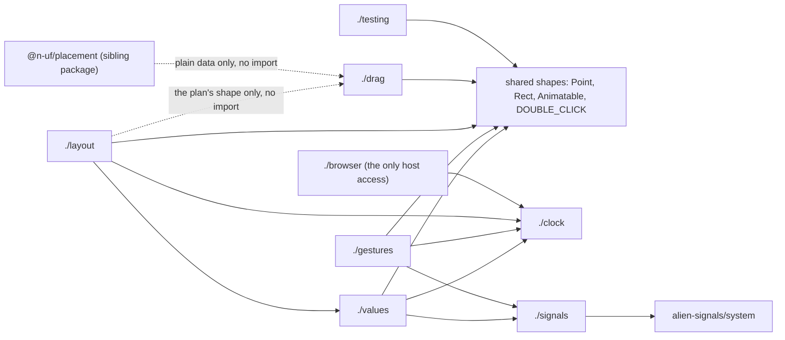
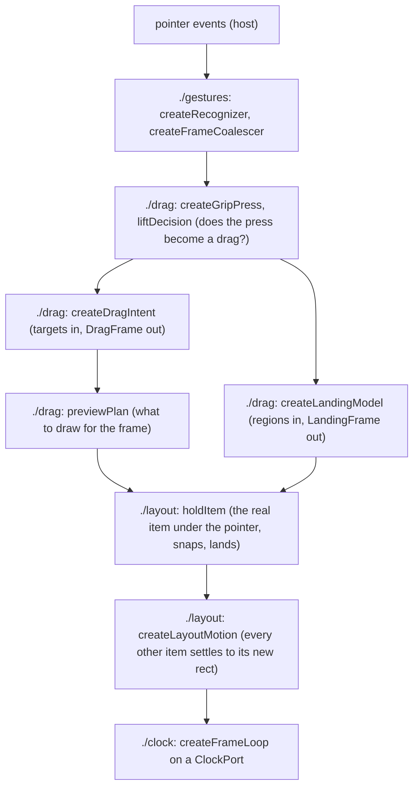

# @n-uf/motion: design

**What this page is.** The design of `@n-uf/motion` as built: what the library is for, the rules its users rely on, its parts and how they fit, and its public SDK as a consumer sees it. The API contract is the package's exported TypeScript types (the entry files named in `packages/motion/package.json` under `exports`); where this page and the types disagree, the types win. The package README has install steps and examples; [motion-reference.md](./motion-reference.md) has the reference per export. Code comments cite sections of this page by heading, for example "docs/motion.md, The landing model".

**In one paragraph.** Motion is *how things move* in an interface. It covers time (a clock and a frame loop that runs work in phases), signals (reactive values that recompute only what changed), values that animate (springs, tweens and the settle curve), gestures (raw pointer and wheel events turned into one gesture stream, plus small timed state machines), pointer intent in a drag (when a drop indicator shows, which target it shows, when the others make room, what a release lands on), the landing model (lanes and spots, held as state), and layout motion (the same rules applied to many rects at once, and a real item held under the pointer). It touches no DOM, no framework and no global clock: the host passes in a clock and plain event objects, and reads plain numbers, rects and frames back. *Where* things go (tiling, docks, toolbars, drop targets) belongs to the sibling package `@n-uf/placement`. Motion reads placement's output only as plain data, the shapes of `LandingRegions`, `LandingLane`, `LandingSpot` and `DragTarget`, and never imports it (nor placement motion): the `motion-not-placement` and `placement-not-motion` rules in `.dependency-cruiser.cjs` fail the dirt check if an import appears.

## Contents

- [Rules a consumer relies on](#rules-a-consumer-relies-on)
- [Parts and how they fit](#parts-and-how-they-fit)
- [The SDK, entry by entry](#the-sdk-entry-by-entry): [The root entry](#the-root-entry), [Clock](#clock), [Signals](#signals), [Values](#values), [Gestures](#gestures), [Layout motion](#layout-motion), [Testing checks](#testing-checks), [Browser](#browser)
- [The drag and landing model](#the-drag-and-landing-model)
- [Shape notes for review](#shape-notes-for-review)
- [Considered, not part of the design](#considered-not-part-of-the-design)
- [Words](#words)

## Rules a consumer relies on

Each rule names what guards it. `pnpm check` (the repo root script) runs the type checks, the tests, the build with its dist check, the dirt ratchet, `scripts/public-words.mjs` and `scripts/terminology.mjs`.

| Rule | Guarded by |
| --- | --- |
| The core has no host: no DOM, no timers, no global clock, no framework import. Only `./browser` reaches the host, and the root entry does not export it. | `test/guard.test.ts` reads every source file outside `src/browser` for host globals, `Date.now` and framework imports; `scripts/check-dist.mjs` (run by `pnpm build`) repeats the check on the built files and on their types. |
| Time is injected. On the fake clock, frames, timers, springs and machine deadlines move only when the test moves the clock, so motion is exact and repeatable. | `test/clock.test.ts` ("moves only when told", the frame loop on it); `test/one-frame.test.ts` (a whole frame, input to write, on the fake clock); `test/browser.test.ts` (the browser clock drives a frame loop). |
| A frame loop requests a frame only while it has work, runs the phases in the order input, update, layout, write, and goes idle when nothing is left. | `test/clock.test.ts` ("runs the phases in order", "requests a frame only while it has work, and goes idle after"); `test/values.test.ts` ("steps once per frame until it settles, then the loop goes idle"). |
| One signal graph per package: importing several entries never gives two graphs that cannot see each other. | `scripts/check-dist.mjs` (the graph's code is in exactly one built file; the built code imports only its own chunks and `alien-signals/system`). |
| Animated values end exactly on their target, and a spring step is exact for any step length, so the curve does not depend on the frame rate. | `test/values.test.ts` (critically damped and underdamped springs "settle exactly on the target", the overdamped one never overshoots; "one 160 ms step lands where ten 16 ms steps do"). |
| A settle never passes its target, whatever the retargets and velocities, and a rect's position and size arrive together. | `test/settle.test.ts` (the fuzz test over 2000 random settles; "a rect's position and size arrive together, size never wobbles"). |
| Content is never stretched: a size change is revealed (the content is laid out at the target size, the frame is drawn at the drawn size, the content is clipped), and appearing is a uniform scale. | `test/settle.test.ts` (`reveal`, `popIn`); `test/layout.test.ts` ("reveals a size change", "draws a DOM box with one move, the frame at the drawn size and the content clipped: no non-uniform scale"). |
| A directly dragged item is drawn exactly where the pointer puts it, and its landing starts from the rect it was let go at. | `test/layout.test.ts` ("holds the real item 1:1 from the grab offset, and lands from the release rect (exactly)"). |
| What a drag draws is what a release lands on: on every frame, the frame's landing is the answer of a release at that point. | `test/drag.test.ts` ("frame.landing is what a release there lands on"); `test/landing.test.ts` ("every frame, the landing is what a release lands"). |
| A fly-through of a thin lane never enters it, so it opens no room. | `test/landing.test.ts` ("a fly-through of the 32 px bar or the 30 px rail at 1.5–5 px/ms opens no room; a slow hand inside does at once"). |
| Going from lane to lane never passes through the float. | `test/landing.test.ts` ("lane to lane at the corner never passes through the float; the new lane takes it once its gate passes"). |
| Away and back to where the item was lifted is home, wherever an owning lane lies over it. | `test/landing.test.ts` ("never within the lift zone: …"); placement's `test/scene-lanes.test.ts` (pressed inside the strip, away and back, after a `hide()` and with `lift` given: home). |
| A wobble within the spot margin never flips a spot. | `test/landing.test.ts` ("a wobble of up to ±6 px across any boundary flips no spot, a far one too"). |
| Over a sliding spot the landing is at the hand: it starts at the pointer less the grab (distance 0) with no steps, snaps to the stretch's ends and the item's own place within the snap distance, and a press, a ±6 px wobble and a release is home. | `test/landing-slide.test.ts`; placement's `test/scene-lanes-stretch-positions.test.ts`. |
| Motion never imports `@n-uf/placement`, and placement never imports motion. | The `motion-not-placement` and `placement-not-motion` rules in `.dependency-cruiser.cjs`, run by `pnpm dirt` (`scripts/dirt.mjs`) against a zero ceiling. |
| Public copy uses no private names and the glossary's words. | `scripts/public-words.mjs` and `scripts/terminology.mjs` (`pnpm public-words`, `pnpm terminology`). |

## Parts and how they fit

The package is one library with nine entry points. Each folder under `packages/motion/src` is one entry; the root entry re-exports the first four.

| Entry | For | Builds on |
| --- | --- | --- |
| `@n-uf/motion` | clock, signals, values and gestures in one import, plus the shared shapes | the four folders below |
| `./clock` | the `ClockPort` interface, the fake clock, the frame loop | nothing |
| `./signals` | `signal`, `computed`, `effect`, `batch` | `alien-signals/system` (the one runtime dependency) |
| `./values` | springs, tweens, the settle curve, easing, `reveal`, `popIn`, and `motionValue` (an animator stepped on a frame loop, readable as a signal) | `./clock` (the loop type), `./signals` |
| `./gestures` | the gesture recognizer, wheel rules, the frame coalescer, the machine runner, the dwell, touch-press and paged-swipe machines | `./clock` (the port types), `./signals` (a machine's state is reactive) |
| `./drag` | drag intent, lift and grip rules, preview plans, the landing model | nothing but the shared shapes |
| `./layout` | layout motion (many rects settling on one loop), the held drag, `anchoredMorph`, FLIP, DOM drawing | `./clock` (the loop type), `./values` (`createSettle`, `reveal`, `popIn`) |
| `./testing` | frame-sampled checks of the motion rules | nothing but the shared shapes |
| `./browser` | `ClockPort` on `requestAnimationFrame`, and the reduced-motion query | `./clock` (the port type) |

Three facts about this graph are worth stating, because a consumer's bundle follows them.

- **The edges are the imports between folders**, read from the source. `./drag` and `./testing` import no other folder. `./drag` does not use the clock, the loop or the gesture recognizer: a host calls it with a point and a time.
- **The dotted edges are not imports.** `holdItem(...).preview(plan, slot)` in `./layout` accepts any `{ snapItem: boolean }`, which is what `previewPlan` in `./drag` returns; it does not import `./drag`. The drag and landing types are written to match what `@n-uf/placement` produces (its `lanes()` result and its drop targets), and are plain objects a host can also build by hand.
- **One graph, one host edge.** All signal state lives in `./signals`; the built package keeps it in one file. Every entry except `./browser` is free of host globals.

A drag, end to end, shows how the parts meet. The host owns the pointer events, the layout and the drawing; motion owns the decisions and the motion.

## The SDK, entry by entry

Every table has the same columns: the export (grouped by job), what it gives, and the rule a consumer relies on. Type names are listed with the function or value they describe. Defaults are in the code (`*_DEFAULTS` constants); the numbers quoted here are those defaults. Time is in milliseconds everywhere, except that velocities are in units per second and the landing model's step gates are in pixels per 8 ms (see The landing model).

### The root entry

`@n-uf/motion` exports everything of `./clock`, `./signals`, `./values` and `./gestures`, and these shared names. `./drag`, `./layout`, `./testing` and `./browser` are not in the root.

| Export | What it gives | The rule a consumer relies on |
| --- | --- | --- |
| `Point`, `Rect`, `Vector`, `Animatable`, `Widen` | The value shapes: `{ x, y }`, `{ x, y, width, height }`, a readonly array of numbers, their union, and the type that widens a literal number to `number`. | Values are plain numbers in plain objects; an animator always returns a fresh object after a change. These types are exported from the root entry only. |
| `shapeEquals(a, b)` | Component-wise equality of two values of the same shape. | The equality `motionValue` uses to skip a notification. |
| `DOUBLE_CLICK`, `DoubleClick` | `{ ms: 500, px: 5 }`: two presses within 500 ms and 5 px. | The package's one double click: the recognizer's `clickCount` and a grip's double-activate both default to it. Also exported by `./drag`. |

### Clock

| Export | What it gives | The rule a consumer relies on |
| --- | --- | --- |
| `ClockPort` | `{ now, requestFrame, cancelFrame, setTimer, clearTimer }`. `FrameSource` is its frame half, `TimerSource` its time-and-timer half. | Nothing in the package reads a global clock; every consumer is handed a port, or a half of one. Timer and frame handles are numbers. |
| `createFakeClock({ now?, frameMs? })`, `FakeClock`, `FakeClockOptions` | A clock that moves only when told: `tick(ms)`, `spend(ms)` (time passes, nothing fires), `frame(dt?)`, `frames(n, dt?)`, `runUntilIdle({ maxFrames?, dt? })`, `pendingFrames`, `pendingTimers`. | Timers fire in time order (ties in the order set), each with `now()` at its due time. A frame callback requested during a frame waits for the next one. `runUntilIdle` throws after `maxFrames` (1000). |
| `createFrameLoop({ clock, budgetMs?, frameMs?, maxDeltaMs?, maxRounds?, onError?, onOverBudget? })`, `FrameLoop`, `FrameLoopOptions` | The loop. `schedule(phase, task, { deferrable? })`, `repeat(phase, task)`, `scheduler(phase)` (for `effect`), `frames(phase)` (a `FrameSource` for a coalescer), `stats()`, `resetStats()`, `dispose()`, `active`, `phase`. Defaults: budget 10 ms, first-frame delta 1000/60, delta clamp 64 ms, 8 drain rounds. | It requests a frame only while it has work. A one-shot task runs this frame if its phase is still ahead, else next frame; scheduling the same function twice before it runs does nothing. In a phase: one-shots, then repeating tasks, then one-shots they queued. A `deferrable` task waits when the budget is spent; others never do. A task that throws does not stop the frame: with `onError` the error goes there, without it the first one is rethrown after the frame; a repeating task that throws is stopped. |
| `PHASES`, `Phase` | `["input", "update", "layout", "write"]`, in run order. | Input: coalesced pointer and wheel samples. Update: state changes. Layout: derived geometry, then motion values step. Write: the host writes results out. |
| `FrameInfo`, `FrameTask`, `RepeatingTask`, `ScheduleOptions`, `FrameStats` | What a task sees (`time`, `delta`, `index`, `phase`, `budgetMs`, `elapsed()`, `remaining()`), the task types, and the counters (frames, over budget, deferred, errors, last, max and mean ms, ms per phase, repeating and queued tasks). | `delta` is the time since the previous frame clamped to `maxDeltaMs`; the first frame after the loop was idle gets `frameMs`, never the idle gap. |

### Signals

| Export | What it gives | The rule a consumer relies on |
| --- | --- | --- |
| `signal(value, { equals? })`, `Signal`, `ReadonlySignal`, `SignalOptions`, `Equals` | A writable reactive value: `.value`, `peek()`. | A write of an equal value (`Object.is`, or `equals`; `equals: false` notifies on every write) notifies nobody. |
| `computed(fn, { equals? })` | A derived value; `fn` receives the previous value. | Lazy and cached: it recomputes only on read, and only when a source really changed. A thrown error is kept and rethrown until a source changes. Writing to it is refused. |
| `effect(fn, { schedule? })`, `EffectOptions`, `EffectCleanup` | Runs now and on every change; `fn` may return a cleanup; returns dispose. | Without `schedule`, runs synchronously at the end of the outermost batch. With it, every run is handed to `schedule(run)`, the same function each time, so a deduping scheduler (`loop.scheduler(phase)`) runs it once per frame. An effect's own writes do not re-run it; effects that keep re-triggering each other throw instead of hanging. |
| `batch(fn)`, `untracked(fn)`, `isSignal(x)` | Hold effects until `fn` returns (nested batches flush at the outermost end); read without tracking; test for a signal or computed made here. | `batch` returns `fn`'s result. |

### Values

An *animator* holds a value, a target and a velocity, and moves when stepped; it knows nothing about clocks. `motionValue` steps one on a frame loop and exposes it as a signal.

| Export | What it gives | The rule a consumer relies on |
| --- | --- | --- |
| `Animator`, `AnimatorValue` | The shared interface: `value`, `velocity`, `target`, `settled`, `setTarget`, `setVelocity?`, `jumpTo`, `snap`, `step(dtMs)`. | `step` returns true while still moving. Targets and velocities must have the shape of the initial value, else a `TypeError`. |
| `createSpring(initial, config)`, `Spring`, `SpringConfig`, `SpringParams`, `SPRING_DEFAULTS`, `resolveSpring`, `springStep`, `SpringState` | A spring over a number, point, rect or vector, with `setVelocity`, `configure`, `params`. `resolveSpring` fills a config; `springStep` is one pure scalar step. Defaults: stiffness 300, mass 1, critically damped, rest within 0.1 and slower than 1 per second (tuned for pixels). | Each step is the closed-form solution, so the curve is the same at any step length. A retarget keeps position and velocity. A damping given outright wins over `dampingRatio`; a non-positive setting throws. At rest the value is placed on the target exactly. |
| `createTween(initial, config)`, `Tween`, `TweenConfig` | A timed run (default 250 ms, `easeOutCubic`) with `progress`. | A new target starts a new run from the current value. `setVelocity` is ignored. Duration 0 reaches the target on the next step. |
| `createSettle(initial, config)`, `Settle`, `SettleConfig`, `SETTLE_DEFAULTS`, `SETTLE_TEMPO` | The one curve for moving to a new place: a critically damped spring with a launch, clamp and carry rule on its velocity. `omega` is the tempo in 1/s (`calm` 20, `default` 25, `quick` 37; 90 % of the way in ln(10)/omega seconds). `hold(value)`, `configure`. | On a new target every component gets velocity `omega · distance` toward it, from where it is drawn, so it follows `distance · e^(−omega·t)`. It never passes its target and never wobbles in size, however it is retargeted. A velocity set toward the target is capped at that speed; one away from it is kept, and the value turns without crossing. `hold` pins the value exactly there, at rest, for a direct drag. |
| `reveal(drawn, target)`, `RevealFrame` | How to draw a window gliding at `drawn` whose content is laid out at `target`: move by `dx, dy`, frame at `width × height`, content clipped by `clipRight, clipBottom`. | Never a scale, never a layout per frame. |
| `popIn(progress, from = 0.87)`, `PopIn` | A uniform scale about the center and an opacity. | `progress` is clamped to 0 to 1; scale is the same on both axes. |
| `motionValue(loop, animator, { phase?, reducedMotion? })`, `springValue`, `settleValue`, `tweenValue`, `MotionValue`, `MotionOptions`, `SetOptions` | An animator on a loop: `value` (a signal), `target`, `velocity`, `moving`, `animator`, `set(target, { velocity? })`, `jump`, `snap`, `follow(() => target)`, `onSettle(fn)`, `dispose()`. | Steps in the `layout` phase by default, after that phase's one-shots, so a target set in input, update or layout moves the value in the same frame and `write` sees it. The loop idles when the value settles. With `reducedMotion` (a boolean, or a function read on every `set` and every frame) a target is reached at once. `onSettle` fires once per rest, also when `set` (reduced), `snap` or `jump` leaves it at rest. |
| `linear`, `ease`, `easeIn`, `easeOut`, `easeInOut`, `easeOutCubic`, `easeInOutCubic`, `cubicBezier(x1, y1, x2, y2)`, `Easing` | Easing functions from progress 0..1 to eased progress. | Functions, not CSS strings. `cubicBezier` throws unless `x1` and `x2` are in 0..1. |

### Gestures

| Export | What it gives | The rule a consumer relies on |
| --- | --- | --- |
| `createRecognizer(options, emit)`, `Recognizer`, `RecognizerOptions`, `RecognizerTimers`, `RECOGNIZER_DEFAULTS` | Raw events in (`feed`), `InputGesture`s out. Also `cancel(reason)`, `reset()`, `active()`, `pinching()`, `setDragModifier`, `dispose()`. Defaults: drag thresholds 4 / 6 / 8 px (mouse / pen / touch), long press after 500 ms for touch and pen, double click as `DOUBLE_CLICK`, pinch at 5 % scale or 10 px pan, stale press after 1000 ms. | No DOM and no clock: the host copies fields out of DOM events and passes timestamps; only the long press uses a timer (`timers`), and without timers there is none. One press at a time; a second finger cancels it (`"multitouch"`) and starts a pinch. A press becomes a drag only past its device's threshold, so a modifier+click stays a click. It recovers releases that never arrive. Hit testing and routing are the host's. |
| `InputGesture`, `InputGestureType`, `GesturePointer`, `CancelReason`, `ModifierDrag` | The stream: `press`, `dragStart`, `move`, `longPress`, `release` (with `click`, `clickCount`, `dragged`), `cancel` (with a reason), `hover`, `pinch`, `scroll`, `zoom`. | A `release` has `click: true` only when the press never crossed the threshold and no long press fired; `clickCount` 2 is a double click. A `pinch` carries the scale and pan change since the last update. |
| `RawInputEvent`, `RawPointerEvent`, `RawPointerType`, `RawWheelEvent`, `RawSafariGestureEvent`, `PointerKind` | The plain objects the host feeds in. | An unknown `pointerType` is treated as a mouse. |
| `Modifiers`, `ModifierKey`, `Platform`, `NO_MODIFIERS`, `toModifiers`, `resolveDragModifier`, `defaultDragModifier`, `isHeld`, `modHeld`, `platformButton` | Modifier keys in one shape (`shift`, `alt`, `meta`, `ctrl`), and the drag modifier resolved per platform (Cmd on `"mac"`, Alt on `"other"`; `null` turns it off). | On macOS a primary mouse press with Ctrl held is button 2, unless Ctrl is the drag modifier. |
| `wheelDeltaPx`, `classifyWheel`, `dampWheelPan`, `WheelIntent`, `WheelOptions`, `WheelPanOptions`, `WHEEL_DEFAULTS`, `WHEEL_PAN_DEFAULTS` | Wheel rules: lines (40 px) and pages (800 px) to pixels; Ctrl or Meta plus wheel zooms by 2^(−dy/300); Shift turns a vertical wheel horizontal; a pan damped per event (speed 0.65, linear to 30 px, capped at 60 px). | Non-finite deltas read as 0. |
| `createFrameCoalescer(onFrame, frames, { merge? })`, `FrameCoalescer`, `CoalescerOptions` | `schedule(sample)`, `flush()`, `cancel()`, `pending`. | At most one delivery per frame of `frames` (a clock, or `loop.frames(phase)`), with the latest sample (or the `merge` of them) and how many were folded. `flush` delivers before a pointer-up so the last move is seen first. |
| `createMachine({ reducer, initial, clock, deadline? })`, `Machine`, `MachineOptions`, `Deadline` | Runs a pure reducer on a `TimerSource`: `state` (reactive), `peek`, `send`, `subscribe`, `dispose`. | A state's `deadline` is armed after every transition, as a timer that sends an event. An event sent from a listener waits until the current one is handled. Returning the same state means no change. |
| `createDwellMachine`, `dwellReducer`, `dwellDeadline`, `DWELL_IDLE`, `DWELL_DEFAULTS`, `DwellState`, `DwellInput`, `DwellConfig`, `DwellMachineOptions` | `idle → dwelling → fired` for spring-loaded targets: hold over the same key for 500 ms and it fires once. | `fired` holds until `reset`; a late tick or a hover change neither re-fires nor clears it. |
| `createTouchPress`, `touchPressReducer`, `touchPressDeadline`, `TOUCH_PRESS_IDLE`, `TOUCH_PRESS_DEFAULTS`, `TouchPressState`, `TouchPressInput`, `TouchPressConfig`, `TouchPressOptions` | A touch on something draggable inside a scrolling page: `idle → pressed → lifted \| scrolled`. | Before the 220 ms hold, travel mostly along the scroll direction past 10 px is a scroll and never lifts (short of 10 px it waits); travel past 6 px mostly across it lifts there; a still finger lifts where it was pressed after the hold. |
| `createPagedSwipe`, `pagedSwipeReducer`, `pagedSwipeDeadline`, `swipeProgress`, `PAGED_SWIPE_IDLE`, `PAGED_SWIPE_EMPTY_CONTEXT`, `PAGED_SWIPE_DEFAULTS`, `PagedSwipeState`, `PagedSwipeInput`, `PagedSwipeConfig`, `PagedSwipeContext`, `PagedSwipeOptions`, `SwipeSide` | Swiping between pages by trackpad wheel or finger: `idle → armed → tracking → settling → lockout`. | Arms only along the swipe (more than twice the cross movement), without Ctrl, with the configured modifier, when nothing under the pointer scrolls further, and when a page lies on that side. Tracks past 24 px; `progress` is travel over page size, −1 to 1, held at 0 toward a missing page. Commits at 35 % of the page or a peak of 0.6 px/ms toward it. The host sends `settled` after its transition; a 350 ms lockout swallows momentum. Every phase has a way back to idle. |

### Layout motion

`./layout` applies the window motion rules to a whole layout. It animates the rects it is given and nothing else: which item goes where is the caller's layout.

| Export | What it gives | The rule a consumer relies on |
| --- | --- | --- |
| `createLayoutMotion({ loop, omega?, phase?, popFrom?, reducedMotion?, onDraw?, onActiveChange? })`, `LayoutMotion`, `LayoutMotionOptions`, `LayoutTask` | Items on one frame loop: `add(id, drawable, at, { shown? })`, `get`, `remove`, `retain(ids)`, `items`, `task(fn)` (before items step each frame), `onFrame(fn)` (after), `onIdle`, `idle()`, `running`, `wake()`, `configure({ omega })`, `flush()`, `dispose()`. | The loop runs only while something moves or a task asks for frames, and stops by itself. With `onDraw`, every item that moved is drawn in one pass per frame; a change made between frames waits for the next frame, or `flush()` draws it at once (a host calls it right after committing a layout). An item at rest is not drawn. Under `reducedMotion` items are placed and shown at once. |
| `LayoutItem` | `moveTo(rect)`, `retarget?(rect)`, `jumpTo`, `hold`, `glideFrom(from, to)`, `show(on, { now? })`, `redraw`, and `drawn`, `target`, `box`, `settled`, `shown`, `showing`, `shownSettled`. | `moveTo` settles from where the item is drawn (a retarget mid-flight goes on from the drawn rect); the content is laid out at the new box once, so no frame shows the old offset from the new box. A size change is revealed, never scaled. `retarget` is `moveTo` that keeps the content laid out while the size is unchanged, for chasing a pointer. |
| `Drawable`, `DrawFrame`, `DrawEntry` | How an item reaches the screen: `layOut(box)` once per new box, `draw(frame)` once per frame. A frame carries `drawn`, `box`, `reveal`, `pop`, `shown`, `gone`. | The layout motion never measures or touches anything itself. |
| `holdItem(item, grab)`, `HeldDrag` | A direct drag of the real item, no copy: `move(pointer)`, `snapTo(slot \| null)`, `follow()`, `preview(plan, slot)`, `resize(size)`, `land(slot)`, `cancel(home)`, and `pointer`, `held`, `snapped`, `returning`. | `move` draws the item 1:1 from the grab offset. `land` and `cancel` settle from the release rect, which they return, never from the old home; snapped into the slot already, a landing finishes that glide. Leaving a slot glides back to the pointer, then holds 1:1 again (within 0.5 px). `resize` keeps the grab point's share of the item and reveals the new size. |
| `anchoredMorph(size, anchor, config?)`, `AnchoredMorph`, `BoxSize`, `MORPH_TEMPO` | A box held at a point that changes size about an anchor: `to`, `jumpTo`, `step(dt)`, `rectAt(point)`, `size`, `anchor`, `target`, `settled`, `progress`. Tempo `SETTLE_TEMPO.quick`. | `rectAt(point)` has the anchor exactly on the point at every step, so content drawn with its own anchor never moves from under the pointer. A retarget turns at once, with no jump and no overshoot. Stepped by hand, not by the loop. |
| `flip(entries, change)`, `FlipEntry`, `Measurable`, `RectLike`, `rectOf` | FLIP for DOM groups: measure each node, run `change`, glide each item from its old rect. | A settle from the rect it was drawn at: no jump, no overshoot. |
| `domDrawable({ node, frame?, content? })`, `layOutBox`, `drawBox`, `BoxNodes`, `StyleLike`, `Styled` | A `Drawable` that writes DOM styles: the node laid out at the box, moved by one transform, the frame at the drawn size, the content clipped, hidden when gone. | Structural types: the library needs no DOM types. Any `{ layOut, draw }` works (a canvas, a test). |

### Testing checks

`./testing` checks recorded frames against the motion rules. Record what was drawn each frame (on the fake clock, or once per animation frame in a browser spec). Each check returns `{ ok, failures }`, a failure naming the frame and the component.

| Export | What it gives | The rule a consumer relies on |
| --- | --- | --- |
| `checkNoOvershoot(samples, from, to, tolerance?)` | No component leaves its start-to-end range. | Tolerance defaults to 0.5 px. Size passing is "no wobble". |
| `checkMonotonic(samples, to, tolerance?)` | The distance to the target never grows. | Catches a bounce or a slow drift away. |
| `checkNoJumps(samples, omega, slack?)` | No frame moves further than a settle at `omega` could. | Sample times are the stepped time (the loop's deltas), not wall-clock timestamps. |
| `checkHeld(samples, tolerance?)` | A directly dragged rect is where the pointer puts it. | |
| `checkContentScale(samples, { uniformOnly?, tolerance? })` | Content's transform is never non-uniform; with `uniformOnly: false`, never scaled. | |
| `checkTempo(samples, from, to, t90, tolerance?, startT?)`, `TempoResult` | 90 % of the way within `t90` ms of `startT`. | Also returns the measured time. |
| `CheckResult`, `RectSample`, `TargetSample`, `HeldSample`, `ScaleSample` | The result and sample types. | |

### Browser

| Export | What it gives | The rule a consumer relies on |
| --- | --- | --- |
| `createBrowserClock({ host?, fallbackFrameMs? })`, `BrowserClockOptions`, `BrowserHost` | A `ClockPort` on `requestAnimationFrame`, `performance.now` and `setTimeout`. | The host is typed by its shape, so tests, workers and servers pass their own. Without `requestAnimationFrame`, timeouts at `fallbackFrameMs` stand in for frames; without `performance`, time is `Date.now`. Timer handles are always numbers. |
| `prefersReducedMotion(host?)` | A function that reads `(prefers-reduced-motion: reduce)` on each call. | For the `reducedMotion` option; without `matchMedia` it returns `false`. |

## The drag and landing model

This is the largest part of the library and the one with the most rules. A drag has two cooperating questions. *Intent*: from the pointer's path, is the pointer meant to be somewhere, which target does that mean, and what does a release land on? *Landing*: for a docking drag over lanes of spots, which lane and spot is held, where does the item land, and are the others making room? Both are pure: the host feeds a point and a time, and draws what comes back. Neither reads the DOM or a clock; time is the `time` argument.

There are two models because they model two kinds of target. `createDragIntent` works on a flat list of `DragTarget` rects, each with a priority; it is the general model (tab strips, insertion points, panes, a float, spring-loaded rails, refusals). `createLandingModel` works on *regions* (lanes, each with its spots in order) and holds a lane and a spot as state, so a drag along a toolbar or a column stays in it. A host uses either, or both for different drags. `previewPlan` and `createGripPress` serve the intent; the landing model carries its own guides and room.

### Targets and the pick

| Export | What it gives | The rule a consumer relies on |
| --- | --- | --- |
| `DragTarget` | Plain data: `id`, `priority` (1, 2 or 3), `hit` (the zone the pointer can be in), and optional `hits` (the zone as several rects), `slot` (where the item would land), `label`, `free` (the float: no slot, no room), `arm: "dwell"` with `armedHit`, `refuse: true`, `bounds`, `opensRoom` with `roomHold` and `roomHit`. | The model reads neither `slot` nor `label`; they are the host's. Targets may be rebuilt between calls: the model follows them by `id`. |
| `targetAt(targets, point)`, `pickRank(target)`, `REFUSAL_RANK`, `inRect(rect, point, margin?)` | The pick: the lowest rank wins, then the smaller zone. A rank is the priority, or 2.5 for a refusal. | A real target of priority 1 or 2 beats a refusal where they meet or overlap; a refusal beats the float (priority 3). A zone holds its edges (a closed rect), except toward the outside of its `bounds`, which is half-open: a point on `bounds`' edge or past it is never in the zone. `hits` zones count as one zone of their combined area. |

### Drag intent

`createDragIntent({ home, lift?, liftRect?, floating?, earlyRelease?, tuning?, placeOf? })` returns a `DragIntent` with `update(point, time, targets, keys?)`, `release(point, targets, keys?)`, `hide(time)`, `moveHome(dx, dy)`, `state` and `tuning`. Types: `DragIntent`, `DragIntentOptions`, `DragIntentState`, `DragFrame`, `DragKeys`, `DragModifiers`, `DragTuning`, `ModifierKey` (this entry's own type, with `"Mod"`), `DRAG_DEFAULTS`.

`update` is called once a frame while an item is held, also when the pointer does not move: a dwell is time passing. It returns a `DragFrame`:

| Field | Meaning |
| --- | --- |
| `shown` | The target the drop indicator shows, or null. |
| `room`, `roomPlace` | The others make room for the shown target, and for which place in it. |
| `aiming` | The pointer is slow, or nearly still for a moment. |
| `atHome` | The pointer is back inside `home` after having been outside `home` itself. Never true at the press or while it only moves about inside `home`. |
| `arming` | The spring-loaded target the pointer dwells on, not armed yet (a host highlights it). |
| `forced` | `"float"` or `"rail"` when a held key won, else null. |
| `refused` | The refusal under the pointer when it is the pick there: nothing shows, and a release lands nowhere. A host never draws a refused place; it may say "Can't go here" at the pointer. |
| `refusedSinceShown` | No target shows, and the pointer has been over a refusal since one last did: a quick drag across a refusal let go beyond it has no indicator drawn, but a release still lands on what is under the pointer. A host that commits only what it drew commits that release. Read it from an `update` at the release point, called before `release`. |
| `landing` | What a release at this frame's point lands on, by the one check `release` makes. Always set by `createDragIntent`; optional in the type so a host or test can build a frame. |

The rules (each is pinned in `test/drag.test.ts`):

- **Aiming gates the indicator.** It shows only after the pointer has left home, a target is under it, and it is aiming: smoothed speed below 0.45 px/ms over 50 ms, or within 12 px of one spot for 90 ms. Crossing targets at speed shows nothing.
- **The most precise target wins** (priority, then the smaller zone).
- **Hysteresis.** The current target holds while the pointer is within `band` (10 px) of its zone, unless a more precise target is `breakthrough` (4 px) inside it. Both are at most `bandShare` (a fifth) of the held zone's and of the entered zone's extent along each axis, so a small zone (a 28 px row) is entered by a direct glide, and large zones keep the whole band. Leaving a `free` target for a tile, or for nothing, switches at once. A target kept only by the gap grace (120 ms, for an aiming pointer, across a gap between zones) keeps the indicator but never shows it.
- **Switching.** Flying out hides the indicator at once. Aiming, it moves to a new target only after that target has held `switchHold` (150 ms), so no indicator shows for less, except on a breakthrough.
- **Room.** Made once the shown target, and the place in it, have held `roomAfter` (160 ms); never for a `free` target; closed at once when the target changes. A target with `opensRoom` (a side rail that pushes a column aside) holds that long, or its own `roomHold`, *before* it shows, and its first shown frame already has `room`. With its room open, a target with `roomHit` holds wherever the pointer is in `hit ∪ roomHit`, over a refusal or a target no more precise than it; a more precise target past the breakthrough, and a held key, still win.
- **Places.** `placeOf(target, point, previous)` names the place within a target (a tab index, a pane edge); default the target's id. `previous` is the place it gave last sample, so a place can hold near its boundary. A null place means no drop there: nothing shows, no room opens, and a release lands on a target beneath, else goes home. It is also asked about the current target just outside its zone (answer the nearest place; return null only for a part that takes no drop), and runs on every sample for each target under the pointer: keep it cheap.
- **Drop equals shown.** A release lands on the shown target whenever one shows, else on the target under the pointer, else nowhere. A release over home does nothing. `earlyRelease` decides a release before the room is open: `"target"` (default) lands on the shown target or else the one under the pointer, drawn or not; `"float"` makes what shows what lands (for a host whose dragged item is the only preview).
- **Spring-loading.** A target marked `arm: "dwell"` is no target until the pointer has rested in its zone for `railArmDwellMs` (200 ms); a faster pass, or a drop before then, lands on what lies beneath. Armed, it shows at once with its room, its zone is `armedHit` (the magnet), moving out past that zone disarms it, and re-entering needs a new full dwell. It arms only after the pointer has entered its zone during the drag (the lift point counts as not entered; entering from over home counts), and never within `liftZone` (16 px) of the lift point (`lift`, else the first sample), or inside `liftRect` when the host gives one: back where it was lifted, a pause is "changed my mind" and commits nothing.
- **Keys win over geometry.** `tuning.modifiers` (on; float key Shift; rail key `"Mod"`, meaning Meta or Ctrl) says which key does what; Alt is left free for the host. The float key shows and lands on the `free` target over a dock target, a spring-loaded one or open space inside the float's `bounds`; over a refusal the frame is refused and outside the float's `bounds` nothing shows. The rail key goes to the nearest `arm` target from anywhere, over home too. The float key wins when both are held.
- **Refusals.** A target with `refuse: true` takes part in the pick but never becomes the current or shown target, and a release over it lands nowhere. Where the pick is a refusal, no held target's band or grace keeps it.
- **A floating item's home** (`floating: true`, `home` its box) is a free placement, ranked like the float: it holds only where the pick there, home ignored, is no refusal and the point lies inside the window. A docked item's home holds wherever it lies.
- **Coordinates.** The intent works in the one space its targets and `home` are in. On a scaled page the host converts each pointer sample to page coordinates first; margins stay page px.

`DRAG_DEFAULTS` holds every number: `lift` 5, `touchHold` 180, `touchLift` 8, `speedWindow` 50, `aimSpeed` 0.45, `still` 12, `dwell` 90, `band` 10, `breakthrough` 4, `bandShare` 0.2, `gapGrace` 120, `switchHold` 150, `roomAfter` 160, `homeInset` 6, `railArmDwellMs` 200, `liftZone` 16, `modifiers` `{ on: true, floatKey: "Shift", railKey: "Mod" }`. Each is overridable per intent through `tuning`.

### Lift and grip

| Export | What it gives | The rule a consumer relies on |
| --- | --- | --- |
| `liftDecision({ touch, distance, elapsed }, tuning?)`, `LiftDecision` | `"wait"`, `"lift"` or `"refuse"`. | A mouse or pen lifts at 5 px. A touch lifts only after the 180 ms hold and then 8 px; moving 8 px before the hold is over refuses the drag (the finger is scrolling). |
| `createGripPress({ tuning?, double? })`, `GripPress`, `GripRelease` | A press on a grip, start to end: `down(point, time, { touch?, clicks? })`, `move(point, time)`, `up(point, time)` giving `"click"`, `"doubleActivate"` or null, `cancel()`. | Two unmoved presses within `DOUBLE_CLICK` give one click, then one double-activate, never a second click and never a lift. The first click of a double is delivered as `"click"` before the double is known, so a grip's click must be harmless. `clicks` (a `mousedown`'s `detail`) overrides the interval. |

### Preview plans

`previewPlan(frame, preview, slotted?)` says what to draw for a frame. It reads only `frame.shown` and `frame.room`, and returns a `PreviewPlan`: `{ showIndicator, makeRoom, snapItem, guides?, emptyLanes? }`. `slotted` defaults to "the shown target is not `free`"; only a slotted target snaps.

| `DragPreview` | Plan |
| --- | --- |
| `"indicator"` | The indicator; never room, never a snap. |
| `"gap"` | The indicator, and room when the intent makes it; the item stays under the pointer. |
| `"snap"` (the default, `DRAG_PREVIEW_DEFAULT`) | Room when the intent makes it, and the item glides into a slotted target's room; the indicator only for a target without a slot. |
| `"item"` | As `"snap"` with no indicator at all: the dragged item is the only preview. Pair it with `earlyRelease: "float"`. |

The object form `DropPreviewMode` is `{ mode: "outline" | "placeholder" | "snap", placeGuides?, emptyLanes? }`; it draws with the plan of `"indicator"`, `"gap"` and `"item"` respectively and adds the guides. `PlaceGuides` is `"off"`, `"near"` or `"all"`, defaulting per mode (`PLACE_GUIDES_DEFAULT`: outline off; placeholder and snap near); the string forms always give `"off"`. `EmptyLanes` is `"real"` (the default: an empty lane drawn at the size it will take) or `"edge"` (a thin striped strip), for the host to hand to placement's `lanes()`.

Rules: every preview mode follows the same intent, so a drop lands where the preview showed it. `guides` is the mode's `placeGuides` only while no landing shows (no indicator, no room, no item in its slot) and `"off"` whenever one does: the screen shows where the item can go or where it will land, never both. Absent `guides` reads as `"off"`.

### The landing model

`createLandingModel({ regions, regionsFor?, floatLanding?, home?, lift?, grab?, margins?, gates?, approach?, placeGuides? })` returns a `LandingModel`: `update(point, time, keys?)` giving a `LandingFrame`, `release()`, `setRegions(regions, regionsFor?)`, `hide()`, and `frame`.

**Inputs, as plain data.**

| Type | Holds |
| --- | --- |
| `LandingRegions` | `lanes`, `refused` (rects that take nothing), `content` (where a float can land; placement's `lanes()` gives its float region), `blocked` (rects on it that block), `stage` (the window), `item` (the held item's size). |
| `LandingLane` | `id`, `rect`, `axis` (`"x"` or `"y"`), `spots`, `refused` (stretches along the lane that take nothing), optional `marks` (the guides), `entry` (its marks while it is the lane the pointer picks, where they differ: placement's prediction of an empty lane's marks once entered, owning the corners `marks` gives up), `corners` (the lanes `entry` overlaps) and `owns`. |
| `LandingSpot` | `id` (stable across solves), `along` (its stretch of the lane), `landing` (the rect the item lands in), optional `others` (a key for how the drop draws every other item), optional `slide` (`LandingSlide`: a sliding spot). |
| `LandingSlide` | A free stretch as one spot: `from` and `to` (where the landing's start may lie along the lane, flush against either neighbor), `snaps` (the starts it snaps to: its ends, the item's own place, a dock inside), optional `snapDistance` (`SNAP_DISTANCE`, 8 px), optional `step` (the grain of a start that snaps to nothing, px: default 1, whole pixels; 0 for none). |
| `LandingMark` | A guide mark: `kind` `"line"`, `"box"` or `"hatch"`, `rect`, optional `id`. |
| options | `regionsFor(spot)` gives the regions with that spot held, room open; `floatLanding(point)` gives the float's rect for a point over open space, or null; `home` is `{ lane, spot }`, the item's own place at the lift, where the drag starts with the room open; `lift` is where the item was lifted (default the first point); `grab` is where the pointer holds the item, from its top left corner (the press's; default the middle of `regions.item`), which a sliding spot's landing reads. |

**Outputs.**

| Type | Holds |
| --- | --- |
| `LandingFrame` | `region` (`LandingRegion`: `"lane"`, `"open"`, `"refused"` or `"nowhere"`), `lane`, `spot`, `landing` (where a release lands now, or null), `room` (a spot is held in a lane, no Shift), `guides`, `shift`, and `pending`. |
| `LandingGuide` | `id` (stable while its neighbors stay; key a drawing by it), `lane`, `kind` (`"line"`, `"box"`, `"hatch"`), `rect`. A hatch is a striped cue, never a measure of the landing. |
| `LandingRelease` | `{ kind: "spot", lane, spot, home, at? }`, `{ kind: "float", rect }`, or null. `home` is true when the spot is the item's own place; on a sliding spot `at` is where the landing starts along the lane, as the frame shows it (a snap point, else a whole px, `step`), and `home` holds only at the item's own place. |

**The rules.** Every change comes from where the pointer is and how it moved (a margin, a path length, a step size). The model has no waits of its own.

- **The stage's edge is the easiest place to dock.** A pointer up to `edge` (48 px) past the stage counts as on its edge, deep inside the lane drawn there; beyond that it is nowhere.
- **A held lane holds** while the pointer is within `exit` (12 px) of its rect, whatever lies under it. Inside it, over a spot's stretch the pointer is at that spot; over a refused stretch it is refused ("Can't go here"). Past its rect, where it refuses and the pointer is inside another lane not entered yet, the frame also names that lane `pending`, so a host shows no "Can't go here" in a lane's first pixels. Placement's `lanes()` joins a stretch shorter than the item to its neighbor spots.
- **Entering a lane takes one of two gates.** Either `path` (40 px) of slow pointer path along the lane inside it, counting only steps of at most `step` (3 px per 8 ms, 0.375 px/ms; the step that enters does not count), or a still step (at most `still`, 1.5 px per 8 ms) once `depth` (8 px) inside it, the depth measured across the lane: only from its two sides parallel to its axis (a rail's long sides) and only those facing into the stage (on the stage's edge the depth is unlimited), never from its ends along its axis, so a rail's end that meets a bar is no wall and the depth is the same all along the lane. A fly-through of a thin bar or rail meets neither, so it opens no room. The first point of a drag (the lift) is never still.
- **Over a place that takes nothing** (a lane's band lying over a column or a blocked area, in no other lane) a lane is entered on the first slow step there, never on the lift: nothing else can be meant there. A fly-through still opens no room.
- **Lane to lane never passes through the float.** Inside a lane that touches the held one, past the held lane's exit margin, the held lane holds until that lane's gate passes, or until the pointer has slid `path` px along it with at most a third as much movement across it, at a brisk hand: no step above `slide` (16 px per 8 ms, 2 px/ms). Then that lane takes the pointer. A fast crossing of the touching lane opens no room, and neither does a fling along it above 2 px/ms (the slide rule is capped there): the lane is then entered only by its own gate, the slow path or a rest past `pause`. The cost: above 2 px/ms, a hand sliding along a corner lane keeps the previous lane's end spot until it slows or rests. The hold is for crossing a corner: more than `path` (40 px) past the held lane's exit margin, the frame is held but refused (the lane kept, so its guides stay; no spot, no landing, nothing pending), so the host shows its tag and a release goes home. The refusal is sticky, as the lift zone is: it lets go only within `exit + path - spot` (46 px), so a wobble at its edge never flips lane and refused.
- **A lane that `owns` its rect** (a rail drop strip at the window's side) takes the pointer inside it from any lane it overlaps, a held one too, once its own gate passes and only if the pointer has been outside it since the lift. Within `lift` (16 px) of the lift point it takes the pointer by no gate, so a pointer brought straight back there is in the item's own lane (see the lift zone, below): away and back lands home, wherever the strip lies. Elsewhere in the strip it takes the pointer, so a lone panel reaches its own side's rail; a slow slide along the strip toward the lift point can be taken before it gets there. The lift point is `options.lift` (the press, for a host whose first `update` comes late), else the first point, fixed for the drag, `hide()` included.
- **The lift zone.** Within `lift` (16 px) of the lift point the lane is the home lane whenever the pointer lies in it, and the spot is `home.spot`. The zone is held: the drag starts in it, leaves it past `lift` and re-enters only within `lift − spot`.
- **Along a lane the spot changes** once the pointer is `spot` (6 px) past the held spot's stretch: the same margin everywhere, so a wobble within it never flips the spot. Where the change reflows the window (the two spots' `others` keys differ, or either has none) it is also taken only on a step of at most `step`, or once the held landing trails the pointer by more than `trail` (40 px); a change that moves only the held item follows the hand at any speed. With `regionsFor`, a reflowing change is kept only if, in the new spot's own regions (its room open), the pointer still lies in that spot's stretch, so room shifting the boundary never bounces it. `regionsFor` is called once per spot until `setRegions`.
- **A sliding spot** (`slide`) lands where the hand holds the item: the frame's `landing` is the spot's landing moved along the lane so it starts at the pointer less the grab (along the item's own length; across it, and in a lane across its length, the middle), clamped to `[from, to]` and snapped to the nearest of `snaps` within `snapDistance`, else on the spot's `step` (whole pixels), so the frame draws what the drop commits. Nothing reflows inside it, so there are no steps there; a step comes only where the order changes (passing a neighbor), by the rule above. `release()` reads the start once, exactly as the frame shows it (`at`: a snap point, else a whole px), so a wobble never stores a jitter; a press, a wobble of ±6 px and a release is home.
- **Outside every lane.** Over a refused place: refused. Over `content` not covered by `blocked`: open (`"open"`, where the float lands, from `floatLanding`). Inside a lane not yet entered: what it was on the way in (the float, if it came from a lane), and `pending` names that lane, so a host shows no "Can't go here" while it is set, though a release lands nowhere. Inside two such lanes (a corner where they overlap), the pending lane holds while the pointer stays inside it, and the other takes over only once it is deeper by `spot` (6 px): a wobble at the corner never flips the pending lane or its guides. Past the stage by more than `edge`: nowhere. Anything else: refused.
- **Shift** turns a lane or open space into open space (the float) and hides the guides.
- **Guides** follow `placeGuides` (`"off"` by default). A lane's guides are its `marks`, else a box per spot landing. `"near"` shows a lane only where the pointer can enter it: the held lane's (also over its own refused stretch); else the pending lane's (the pointer is inside it and hasn't entered: a release floats or goes home); else, with the pointer in open space, the approached lane's (the nearest within `reach`, 12 px, the entry margin: acquired within `max(reach - margins.spot, reach / 2)` (6 px) and kept until another is `nearer` (16 px) closer or the kept one is past `keep` (12 px, never less than `reach`), so a pointer wobbling at the reach's edge never blinks the guide; a release floats). Over a refused place outside every lane no guide shows, however near the lane behind it lies; a host that wants the early guide sets `approach.reach`, which brings it back in open space only (over a refused place none shows at any reach). The lane the Near rule picks shows its `entry` marks where it has them (placement's prediction of an empty lane's marks once entered), so its guide before entry is its mark after it, the held item aside. `"all"`: every lane's; the lane the Near rule picks (held, pending or approached) shows its `entry` and owns every corner it shares: each lane it names in `corners` is cut where it overlaps it, by `guideRects`' interval subtraction. With no such lane, every lane's `marks`, where the bar keeps a shared corner. No two lanes' guides overlap on any frame. None with Shift.
- **Time.** Steps are measured between points that differ, normalized to 125 Hz (distance × 8 / max(1, ms since the last distinct point)), so the gates read the same at any input rate. A repeated point keeps the last step; it counts as still only once the pointer has stayed put for `rest` (22 ms) after a slow step or on the stage's edge, else for `pause` (60 ms), so a fast hand with samples far apart is never still between them.
- **Margins, gates and approach, with their defaults.** `LANDING_MARGINS` `{ exit: 12, spot: 6, edge: 48, lift: 16 }`; `LANDING_TOUCH_MARGINS` `{ exit: 16, spot: 8, edge: 48, lift: 16 }` (wider, for a finger's jitter; the host picks which to pass); `LANDING_GATES` `{ path: 40, depth: 8, still: 1.5, step: 3, trail: 40, rest: 22, pause: 60, slide: 16 }`; `LANDING_APPROACH` `{ reach: 12, keep: 12, nearer: 16 }` (`reach` and `keep` are `LANDING_MARGINS.exit`, the entry margin). Types: `LandingMargins`, `LandingGates`, `LandingApproach`, `LandingOptions`, `LandingModel`.

**Release.** `release()` answers from the last frame, so what the frame's `landing` showed is what a release lands: a held lane with a spot gives `{ kind: "spot", lane, spot, home }` (with `at` on a sliding spot); open space with a landing gives `{ kind: "float", rect }`; everything else gives null (the item goes home).

**The host's part.**

- Call `update` whenever convenient: per pointer sample, per animation frame, or both. Call it again after the pointer stops (every frame does) so the model can become still, and again with the same point when a key changes.
- `setRegions(regions, regionsFor?)` after a resize, a store change or a scroll: spots map by id, a lost spot goes to its lane's spot under the pointer, a lost lane is let go. Pass the `regionsFor` that answers for the new state; without one the old one stays and must read live state.
- `hide()` when the view moves under the pointer: the gates start again and the lane is let go.
- Clamp the pointer into the stage before `update` and `release`, so a drop target at the window's edge stays under a hand that overshoots it (this applies to the drag intent as well). Draw the dragged item at the pointer itself. While a drag is in progress, suppress the context menu and the browser shortcuts of the rail key (`preventDefault` on `contextmenu`, and on the `keydown` of Meta or Control); the models do not see DOM events, and the recognizer has no hook for this.

## Shape notes for review

Facts about the SDK's shape that a reviewer may want to weigh. No proposals.

1. **`ModifierKey` is two different types.** `./gestures` (and the root) exports `ModifierKey` as a key of `Modifiers`: `"shift" | "alt" | "meta" | "ctrl"`. `./drag` exports `ModifierKey` as `"Shift" | "Alt" | "Control" | "Meta" | "Mod"`. Held keys have three shapes: `Modifiers` (four required booleans, gestures), `DragKeys` (four optional booleans, drag) and `DragModifiers` (which key floats and which rails, drag). `NO_MODIFIERS` exists only for the first.
2. **The shared value types are exported only from the root.** `Point`, `Rect`, `Vector`, `Animatable`, `Widen` and `shapeEquals` come from `@n-uf/motion`; the signatures of `./values`, `./drag`, `./layout` and `./testing` use them, and those entries do not re-export them.
3. **`DOUBLE_CLICK` and `DoubleClick` are exported from the root and from `./drag`, not from `./gestures`,** although `RECOGNIZER_DEFAULTS.multiClick` is that value.
4. **`./gestures` also holds general tools.** `createFrameCoalescer` (a frame-source utility) and `createMachine` with `Machine`, `MachineOptions` and `Deadline` (a reducer runner on a timer source) live in `./gestures`; they depend only on clock types and signals, and are used by the machines there and by the README's one-frame example.
5. **Two dwell implementations.** `createDwellMachine` (`./gestures`, default 500 ms, key-based, `idle → dwelling → fired`) and the drag intent's spring-loading (`arm: "dwell"`, `railArmDwellMs` default 200 ms, inside `createDragIntent`) are separate code; the intent does not use the dwell machine.
6. **Timers enter in two forms.** The dwell, touch-press and paged-swipe states are pure reducers run by `createMachine` with a `deadline`; the recognizer takes `timers` (`RecognizerTimers`, the `setTimer`/`clearTimer` pair) directly for its long press and is not a machine.
7. **The preview mode names overlap.** `DragPreview` is `"indicator" | "gap" | "snap" | "item"`; `DropPreviewMode.mode` is `"outline" | "placeholder" | "snap"`. `"snap"` means a different plan in each (in `DragPreview`, room plus an item that glides into a slotted target; in `DropPreviewMode`, the plan of `"item"`).
8. **`previewPlan` and the landing model do not meet in the types.** `previewPlan` reads `shown` and `room` from a `DragFrame`; a `LandingFrame` has `room` but no `shown` (it has `lane`, `spot`, `landing`) and carries its own `guides`. They share only the `PlaceGuides` and `DragKeys` types. `createLandingModel`'s `placeGuides` defaults to `"off"`, not to a `PLACE_GUIDES_DEFAULT` entry.
9. **Units differ across the drag types.** `aimSpeed` is in px/ms; the landing gates `still` and `step` are in px per 8 ms; settle `omega` is in 1/s; animator velocity is in units per second; times are in ms.
10. **`DragTarget` has 14 fields,** of which seven matter only to spring-loading, refusals or room (`arm`, `armedHit`, `refuse`, `bounds`, `opensRoom`, `roomHold`, `roomHit`).
11. **Redundant or optional members.** `Settle.hold(value)` is `jumpTo` under another name. `Animator.setVelocity` is optional on the interface, required on `Spring` and `Settle`, absent on `Tween`. `DragFrame.landing`, `PreviewPlan.guides`, `PreviewPlan.emptyLanes` and `LayoutItem.retarget` are optional in the types although the factories always set them (`holdItem` falls back to `moveTo` for an item without `retarget`).
12. **Three ways to learn that layout motion is active or idle:** the `onActiveChange` option, the `onIdle` listener and the `idle()` promise; plus `onFrame` for every frame.
13. **Stepping differs.** `motionValue` and `createLayoutMotion` step on a frame loop; `anchoredMorph`, the animators and `createGripPress` are stepped by hand (`step(dt)`, or call per event). `anchoredMorph` has no loop-driven wrapper like `settleValue`.
14. **Naming of factories.** Most are `createX`; `holdItem`, `anchoredMorph`, `flip`, `reveal`, `popIn` and the `check*` functions are not. `rectOf` (a DOM-rect converter) is exported next to `flip` from `./layout`.
15. **`REFUSAL_RANK` (2.5) is a constant that `@n-uf/placement` also exports** (a comment in `./drag` says it is the same value for its reference pick); the two packages do not import each other, so the value is stated twice.
16. **Two models for two target kinds.** `createDragIntent` (flat `DragTarget` list with priorities) and `createLandingModel` (lanes of spots) both answer "where does a release land", with different input types, different frames and different hysteresis; the host chooses per drag.

## Considered, not part of the design

These come from the code, the tests and the benchmark notes, not from a plan.

- **A hand-written signal graph, and `@preact/signals-core`.** Both were measured against alien-signals' core (`bench/RESULTS.md`, `pnpm bench`). The shipped signals use alien-signals' published core under motion's own API, because effects must run in a frame-loop phase once per frame and `@preact/signals-core` has no hook to defer an effect's re-run. The hand-written graph is kept in `bench/` and not shipped.
- **Scaling content to animate a size change.** Rejected by the rules: a size change is revealed (frame at the drawn size, content laid out at the target size and clipped), and `checkContentScale` fails any non-uniform scale.
- **A drag proxy or copy.** The held item is the real item (`holdItem`), drawn exactly under the pointer; there is no copy to reconcile.
- **Timed waits inside the landing model.** It has none: every change comes from where the pointer is and how it moved, normalized to 125 Hz.
- **Alt as a drag key.** `DRAG_DEFAULTS.modifiers` leaves Alt unused so a host can keep it for its own meaning.
- **CSS string easings.** Easings are functions of progress; `cubicBezier` builds the CSS curves as functions.

## Words

The terms this page uses, in the words of the repository's glossary (the lab's Glossary page) where it has them.

| Word | Meaning |
| --- | --- |
| host | The app that embeds the library and feeds it input. |
| stage | The window's inner rectangle in px: the area everything is laid out in. |
| home | The item's own place when a drag starts. Dropping there changes nothing. |
| grip | The control you press to move a panel or toolbar group. |
| lift | The drag threshold: a mouse press becomes a drag after a few px; a touch press after a hold and a few px. |
| aiming, travelling | Aiming: the pointer is slow or still enough to mean it. Travelling: moving fast across targets, so no indicator shows. |
| hysteresis | The current target keeps the pointer until it is clearly in another one. |
| switch delay | While aiming, the shown target changes only after the new target has held this long (`switchHold`). |
| spring-loading | A target that acts when the pointer rests on it during a drag. |
| drop target, hit area, slot | Any place a dragged item can land; the region where the pointer counts as over it; the rect the dropped item will occupy. |
| refusal | A place that cannot take the item. A release over it goes home. |
| drop preview | Everything drawn while dragging to show the result. The preview equals the result. |
| direct drag | The real item, not a copy, follows the pointer 1:1. |
| settle | Motion toward a new target on one fast-then-gentle curve that never passes it. |
| reveal | Drawing a gliding window without stretching its content. |
| reduced motion | The user's OS-level preference for less animation; targets are reached at once. |
| lane | A line the landing model holds the pointer in: a bar, a column or a rail drop strip, with its spots in order. |
| spot | A place in a lane where the item can land, with a stretch along the lane and a landing rect. |
| region | What the pointer is over in the landing model: a lane, open space, a refused place or nowhere. |
| gate | A condition on the pointer's path that must pass before a lane is entered (a path length, or a still step at a depth). |
| guide | A faint mark (line, box or hatch) on a place that takes the held item, shown only while no landing shows. |
| animator | A value with a target and a velocity that moves when stepped, with no clock of its own (spring, tween, settle). |
