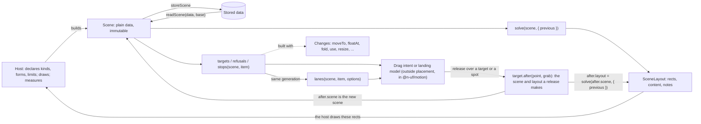

# @n-uf/placement: design

**What this page is.** The architecture of `@n-uf/placement` as it is built: what the library is for, how its parts fit, the rules a consumer can rely on, and the public SDK entry by entry. The API contract is the package's exported TypeScript types (the files its `exports` map names); where this page and those types disagree, the types win. Code comments cite this page's sections by heading, for example "docs/placement.md, Lanes".

## Rules a consumer relies on

Each rule names the test that pins it. `pnpm check` in the repo root runs them all, with the type checks, the build check and the dependency rules.

| Rule | Guarded by |
| --- | --- |
| **The preview is the result.** For every target, `after.layout` equals `solve(after.scene, { previous })`, and when the target has a `slot`, the slot is the dragged item's rect in that layout. | `test/scene-targets.test.ts` (preview = result), `test/scene-sweep.test.ts` (every target) |
| **Every point of an edge that takes the item is exactly one target or one refusal**, in the point's own zone, with no hole and no overlap. The item's own rect maps only to home. | `test/scene-target-model.test.ts` |
| **Nothing overlaps after a solve.** No two docked items overlap, each lies inside its edge, and each edge inside the stage. (An overlay bar that names `span: "full"` lies over the side columns by design.) | `test/scene-sweep.test.ts` |
| **A press reshapes nothing.** Under `previous`, using an item, or any chain of presses, changes no rect and unfolds no column. | `test/scene-sweep.test.ts` |
| **Giving way is reversible in exact order.** Room coming back brings items up the form ladder in the reverse of the order they gave way; at every length the way back holds what the way down held. | `test/scene-fit-ladder.test.ts`, `test/stack-previous.test.ts` |
| **The stored scene round-trips.** `readScene(storeScene(scene), base)` lists nothing dropped, stores to the same data, and solves to the same layout. | `test/scene-changes.test.ts` (the stored form) |
| **Lanes are sound.** Each lane's stretches tile it in order from end to end; a spot's landing is exactly what its drop commits; spot ids are unique; spot ids survive the window growing. | `test/scene-lanes.test.ts`, `test/scene-lanes-landing.test.ts` (what a frame shows is what the drop commits) |
| **Away and back to the press point is home.** On a bar or a toolbar rail the item's own place is one landing for half a pitch around it. | `test/scene-lanes-home.test.ts`, `test/scene-lanes-landing.test.ts` |
| **Stretch positions are one rule.** `"free"` gives exactly what no option gives; each free stretch is one sliding spot flush from neighbor to neighbor, its drop lands at the pointer less the grab, clamped and snapped, with the neighbor unmoved, and a press, a ±6 px wobble and a release is home; `"pitched"` gives spots at a pitch instead. Bars and rails, start and end zones. | `test/scene-lanes-stretch-positions.test.ts` |
| **A sliding spot's frame is its commit.** For any pointer and grab the rect a landing model's frame draws is the rect the drop commits, and `release().at` is where both start (whole pixels, or a snap point). | `test/scene-lanes-stretch-frame-commit.test.ts` |
| **A snap point is keyed by what it commits.** A center dock landing a fraction of a pixel from a stretch's start keeps its own snap point and commits as a center dock. | `test/scene-lanes-stretch-snaps.test.ts` |
| **Marks never cover an item.** No line, box or hatch lies over an item drawn on its lane or over the held item; a hatch is a cue inside its box, never a mark on a neighbor; an empty lane's marks are cut around every docked toolbar. | `test/scene-lanes-guides.test.ts` |
| **A stretch is the room the drop makes.** Where a drop steps a neighbor down to a shorter form, the stretch runs from flush after its short form to flush before the next neighbor: one sliding spot over that whole room (pitched spots fill it under `"pitched"`), every start in it landing as aimed, and the landing stays at the hand along it; its box has a striped end facing the neighbor that steps down, naming it (`givesWay`), and a box where nothing moves, leaves or steps down is plain. | `test/scene-lanes-stepdown-slide.test.ts`, the landing row `landing-step-down-room` |
| **The landing stays at the hand.** While a lane holds, the landing is the nearest landing in its lane to the pointer, within `max(48, g / 2 + 6)` px of it (`max(56, g / 2 + 6)` on the single frame before a hop); `g` is the gap along the lane between the facing edges of the two adjacent landings the pointer lies between, 0 over a landing. Over a docked item much longer than the held one, `g` is about its length less the held item's, plus a gutter: no landing lies inside it, so the landing trails the pointer by up to half that. | `test/cases-landing-hand.test.ts`, the landing rows (`moving.hand`); [decision 0001](decisions/0001-the-hand-rule.md) |
| **The landing rows pass on the reference host**, none skipped, and so do the scene's conformance rows. | `test/cases-landing.test.ts`, `test/scene-cases.test.ts` |
| **Placement is pure and imports nothing from motion.** No DOM, no timer, no global clock, no framework, no dependency. | `test/guard.test.ts`; `pnpm check` (the `placement-not-motion` dependency rule, `scripts/check-dist.mjs` on the built package) |

## In one paragraph

Placement answers *where things go*. A host describes a window as a **scene**: a stage, **edges** along its sides (bars, rails, columns), **items** with **forms** that step down a ladder as room runs out, **floats** above the content, and **chrome** that floats and drops keep clear of. `solve` turns the scene into a **layout**: every rect the host draws. For a dragged item, `targets` gives every drop target with its **refusals**, each target carrying the scene and layout a release there makes, so the preview is the result; `lanes` arranges the same targets for a landing model. Changes are pure functions from scene to scene, and `storeScene` / `readScene` keep a scene across reloads. *How* things move (the drag intent, springs, gliding) belongs to the sibling `@n-uf/motion`; placement imports none of it and composes with it through one shared target shape.

## Contents

- [What placement is for](#what-placement-is-for)
- [How the parts fit](#how-the-parts-fit)
- [The scene model](#the-scene-model)
- [Solving](#solving)
- [Changes](#changes)
- [Targets and refusals](#targets-and-refusals)
- [Lanes](#lanes)
- [Storage](#storage)
- [The landing rows](#the-landing-rows)
- [Principles](#principles)
- [The SDK by entry point](#the-sdk-by-entry-point), then one section per entry: [scene](#entry-scene), [stack](#entry-stack), [scene/cases](#entry-scenecases), [tiling](#entry-tiling), [root](#entry-root), [dock](#entry-dock), [toolbar](#entry-toolbar), [targets](#entry-targets), [panels](#entry-panels), [desk](#entry-desk), and [Shape notes for review](#shape-notes-for-review)
- [Glossary](#glossary)
- [Considered, not part of the design](#considered-not-part-of-the-design)

## What placement is for

An application window is a set of places: bars along the top and bottom, columns and rails down the sides, panels that open, fold to a header or a rail icon and fall into an overflow menu, toolbars that move between bars, windows that float. Someone drags an item and wants three answers at once: where can it go, what will the window look like if it goes there, and why can't it go somewhere else. Placement computes those answers, and only those.

- **State in, rects out.** Everything is plain data and pure functions. A scene is an immutable value: a change returns a new scene (the same object when nothing changed), nothing is module-global, so two windows on a page are two scenes.
- **One owner for the window.** Every rule that spans the window (which kinds an edge takes, what chrome floats avoid, what fixed room an item keeps, that the preview equals the result) lives in `./scene`, which holds the whole window in one model.
- **The host draws and measures.** The library never touches a DOM. The host measures its items, declares their forms as numbers, draws the rects it gets back, and feeds pointer samples to a drag intent.
- **Composition with motion without a dependency.** A drop target has the shape `@n-uf/motion/drag` takes (`id`, `priority`, `hit`, `slot`, and a few optional fields). A rect has the same shape in both packages. The pick rule (which target the pointer is over) and the landing model are motion's; where placement's conformance code needs them, the host passes them in (`createSceneHost({ pick })`, `createLandingHost({ landing })`).

Nothing under `packages/placement/src` or `packages/placement/index.ts` imports `@n-uf/motion`. The package has no dependencies; `@n-uf/motion` is a development dependency only, and the package's tests import it to drive the pick rule and the landing model.

## How the parts fit

Every edge in the diagram is a pure function call. The scene goes round the loop: a drop commits `after.scene`, the host solves it with the layout it had as `previous`, draws the result, and may store it.

The code is layered the same way:

- `./stack` solves **one edge**: given items with forms and a length, it picks one form per item and places them.
- `./scene` lays out **the window** with `./stack` and owns everything above one edge: the cut of the stage into edges, rails, dynamic columns, floats, targets, lanes, changes and storage.
- `./scene/cases` is **data and a runner** over `./scene`: conformance rows that a host plays.
- `./tiling` divides an **area between panes**; it stands on the root alone.
- The root holds the shapes every entry shares.
- The five legacy entries (`./dock`, `./toolbar`, `./targets`, `./panels`, `./desk`) are the per-concern models that `./scene` replaces. They ship and are tested, and they are described last.

## The scene model

A `Scene` has a `stage` (the window's inner rect, px) and these parts.

**Edges.** An `Edge` lies along one `side` of the stage at a `ring` (0 is outermost on its side). Top and bottom edges are *bars* (their stack runs across); left and right edges are *columns* (they run down). An edge declares what it takes (`accepts`, deny by default; `zoneAccepts` narrows per zone; `zones` limits which of the three zones it has), the size across it (`cross`: `min`, `max`, `rail`), and its spacing (`gap`, `pad`, the » `menu` entry).

- A bar is `reserved` (it shortens the content) or `overlay` (it lies over the content), and spans the `full` width or lies `between` the side columns.
- A **dynamic column** (`column: true`) is made by a drop on a column line from the side's `Scene.columns` template, and deleted, its side's rings closed up, when it holds no item. A static column is the host's own.
- A **rail** (`Scene.rails[side]`) is a side's strip where folded columns show as segments. Without a declared rail, a column in which nothing sets the width is drawn as a rail. `Scene.railModes` says whether rails show item titles or tiles; `Scene.railDrop` gives each kind a drop strip with a dwell and a magnet.
- A **compact edge** (`compact: true`) is an icons-only thin rail of vertical toolbars along a window side.
- An **anchor** is an edge that takes nothing and holds a fixed item (a page-thumbnail strip); with `moves: "side"` the fixed item may be dragged to the other side of its axis.
- `giveWay` lets a static column or a bar shrink and fold as the content runs short; `hidden` and `showIn` keep an edge in the scene without drawing it, or lend its items to another edge.

**Items.** A `SceneItem` has a host-chosen `kind` (a string such as "panel" or "group"), its `forms` along a column and along a row (largest first, as `./stack` takes them: a panel's `open`, `header`, `rail`, `menu`; a group's `row`, `stacked`, `wrap`, `icons`, `fold`, `menu`), and its state: `used` (an age: the larger, the more recent), `kept` (gives way after every unkept item), `from` (folded by hand when above 0), `closed`, `align` (its zone: `start`, `center` or `end`), `space` (free length kept on its zone's open side), `priority` (its give-way priority in its edge) and float sizing (`floatSizes`, a size for each orient, `floatOrient`, `floatMin`, `floatMax`; the single `floatSize` is deprecated). A `fixed` item is reserved room (a title, window controls): it never changes form, is never dragged, and no target covers it.

**Floats, chrome, blocked.** A `SceneFloat` lies above the content in stage px, or follows a side or corner of the content (`anchor`, with an optional offset); `since` orders anchored floats, the last float in the list is on top, and `floatKinds` lists the kinds that may float. `chrome` rects are kept clear of: by default floats keep clear and no target, slot or landing lies on them; with `for: "floats"` only floats do. `blocked` rects are spots where a release cancels.

**Window-level knobs.** `contentMin` (the least the content may be, with a lower `chromeWidth` floor for toolbar chrome), `inset` and `insetWhen`, `gutter`, `handFold` (`"bar"` or `"ride"`), and three declarations that change how drops work: `foldedColumnDrop`, `sideColumns` and `barZones`.

**State and declarations.** The scene holds two kinds of data. *State* is what a person changes: the order of items in edges, an edge's `size`, dynamic columns, each item's `used`, `kept`, `from`, `closed`, `align`, `space`, `floatSizes`, the floats, and `railModes`. *Declarations* are what the host re-declares each time it builds the scene: kinds, forms, limits, templates, rails, `zoneAccepts`, `zones`, `foldedColumnDrop`, `sideColumns`, `barZones`, `hidden`, `showIn`. Only state is stored.

## Solving

`solve(scene, { previous?, fresh? })` returns a `SceneLayout`: `items` (each item's `rect`, the `form` it took, its edge and zone, and flags such as `inMenu`, `tab`, `rail`, `folded`, `foldedBy`, `rows`, `grip`, `hidden`), `edges` (each edge's rect, size across, » `menu`, `items`, `tabs`), the `content` rect, `floats` in stacking order, `rails`, `railPlaces`, `columnRoom`, and `notes`. The same scene always lays out the same.

1. **The cut.** Reserved edges cut the stage from the outside in: full bars (top, then bottom, by ring), then the columns (left, then right), then the `between` bars. What remains is `content`. Overlay edges are cut from a copy of the content, so they lie over it without shortening it.
2. **Each edge is a stack** solved by `fitStack` along its length. Items are taken in zone order; fixed items keep their form; closed items take no room.
3. **The form ladder.** An item starts at the largest form it may take (`from`). When the length runs short, one item at a time steps down to its next form that shortens the stack: an open panel folds to a header, then a rail icon, then the » menu; a group's row of words goes to stacked words or a wrap, then icons, then the menu. Who steps first: the lowest `rank` of the form it would step into (`SceneItem.priority` adds to every form's rank), then unkept before kept, then the item used longest ago. Room coming back climbs the ladder in the exact reverse order; `previous` carries that history (`StackFit.steps`).
4. **Rail and size.** A column in which nothing sets the width is a rail; otherwise `Edge.size` (a person's drag) sets the width, clamped to the edge's limits and the widest open item's minimum.
5. **Zones.** When items leave spare length, start items pack from the start, end items from the end, and center items sit at the edge's middle, moved only as far as they must to stay between the other two.
6. **Give-way by width and height.** While the content is narrower than `contentMin.width`, dynamic columns shrink toward their minimum, then fold whole into their side's rail (unkept before kept, the oldest first, the outer first); bars with `giveWay` do the same by height. Room coming back undoes it in reverse.
7. **Floats** are fitted inside the stage, clear of every docked item, bar and chrome rect (`fitFloat`); an anchored float sits flush with its side of the content first.

`notes` say why the layout looks as it does, coded and machine-readable: stack notes with their edge (`form-down`, `to-menu`, `too-wide`, `no-forms`, `overflow`), `unknown-item`, `twice`, float notes (`float-clamped`, `float-moved`, `float-covers`), give-way notes (`column-shrunk`, `column-folded`, `kept-folded`, `bar-shrunk`, `bar-folded`), content notes (`content-narrow`, `content-short`, `no-column-room`, `content-changed`) and a few more. A note's `code` is the contract.

`previous` (the layout before) makes a change of ages alone reshape nothing, keeps columns folded by give-way folded while the content still fits, and tells the host when the content moved (`content-changed`). `fresh` names edges or items to solve without `previous`.

## Changes

Changes are pure: each takes a scene and returns a scene. One that cannot apply (an unknown item or edge, a fixed item, a kind the edge does not take) returns the scene it received, the same object, so `after === before` says nothing changed.

- `moveTo(scene, id, place)` docks, floats or folds an item. A `Place` is a `DockPlace` (an edge, optionally a zone, and the index among that zone's items, optionally the `space` to keep), a `ColumnPlace` (a new dynamic column at a ring on a side), a `RailPlace` (a new column holding the item folded by hand, so it shows in the rail) or a `FloatPlace` (a rect, or an anchor). A zone named becomes the item's `align` only where the edge offers a choice between zones.
- `homeFor` and `dockHome` find and restore the place a start scene gives an item ("Dock", "Put back", "Reset position").
- `floatAt`, `raise`, `orient`, `resize` (an edge's size across, or a float's rect through `fitResize`), `lift` (the scene with an item out of every edge and float; the room it kept, `SceneItem.space`, goes to the next placed item in its zone, which stays where it is). `moveTo` docked into a placed neighbor's room consumes it, and `floatAt` lifts first. `orient` turns a float and gives its frame the size the new orient draws it at (a size is kept for each orient, `SceneItem.floatSizes`), so a toolbar float turned to a row is framed at its row, never at its old rect.
- `fold` / `canFold` (fold by hand to the item's folded form), `use`, `keep`, `open`, `close`.
- `setSide` moves an edge to the other side of its axis; `setRailMode`; `mergeSideColumns` merges a side's columns into one for `sideColumns: "one"`.

## Targets and refusals

`targets(scene, dragged, { previous, endReach, floatSize, floatFromHeld, floatOrient, fresh })` returns every `SceneTarget` for one item. A target is a motion-shaped `Target` (`id`, `priority`, `hit` and `hits`, `slot`, `free`, and flags for spring-loaded rails and rooms that open) plus `item`, `place` (a `ScenePlace`), an optional `marker` (the insertion line) and `after(point, grab)`, which returns `{ scene, layout }`: the scene a release there commits and its layout. Only a float's `after` depends on the pointer.

One model makes every docked target and refusal: **edge, zones, slots, tiles, then one ordered filter.**

- *Edges.* Every real edge, empty or occupied, plus two virtual edges per side: the column lines and the rail.
- *Zones.* Each edge has start, center and end extents along it: thirds where items keep their length and zones only align them (bars, compact rails), or the span the solver gives each zone where items fill the edge (columns). `Scene.barZones: "nearest"` meets bar zones halfway between landing rects.
- *Slots.* A zone's insertion lines. The item's own place is an interval, home.
- *Tiles.* A zone's extent split halfway between its slots' lines.
- *Filter.* (i) the edge and zone take the kind; (ii) the drop fits: no » entry, no new overflow, every fixed item keeps its form, place and least length, a title bar's title keeps its natural width, and the slot covers no chrome; (iii) space ownership and clipping, so that every point belongs to one place (owned beats virtual beats overreach); (iv) `blocked` rects become `none` targets. A slot that (i) or (ii) removes becomes a **refusal** over its own tile.

| Id | Names | Priority |
| --- | --- | --- |
| `gap:<edge>:<zone>:<at>` | a slot before the `at`-th item of an edge's zone | 2 |
| `strip:<edge>:<zone>` | a zone's one slot on an edge with no members | 2 |
| `column:<side>:<ring>` | a new column on a side's column line | 2 |
| `rail:<side>:<ring>` | docking folded into a side's rail (a dwell-armed strip under a `railDrop` policy) | 1 |
| `side:<side>` | an anchor edge moved to the other side of its axis | 2 |
| `home:<item>` | the item's own place: a release changes nothing | 1 |
| `none:<i>` | the `i`-th `blocked` rect | 1 |
| `float:<item>` | floating anywhere in the plane | 3, free |
| `refuse:<edge>:<zone>[:<n>]` | a refusal | ranks 2.5 |

`targetId`, `parseTargetId`, `placeTargetId` and `virtualEdgeId` build and read these ids. `refusals(scene, dragged)` returns each `SceneRefusal`: its `edge`, `zone`, `hit` (and `hits` when targets cut it into pieces), `bounds` (the stage) and `reason`: `not-accepted` (the edge or zone does not take the kind), `no-room` (the drop would not fit along the edge: lack of length), `too-thick` (no form of the item fits across the edge: the bar is thinner than the item), `own-place` (the stretch beside an item alone in its zone). A release over a refusal commits nothing; the item goes home. `refusalTargets` turns refusals into targets for a drag intent (`refuse: true`, ranked after priority 1 and 2 and before 3 by `pickRank`). `stops(scene, dragged)` orders the same targets (no home, no none) for "Move to" menus and arrow keys. Items an edge lends through `showIn` are dragged as items of the edge they show in; hidden edges have no targets.

Targets are generated with `previous` so every `after` is solved as the drop will be; a dropped item counts as just used.

## Lanes

`lanes(scene, dragged, options)` arranges the same targets for a **landing model** (`@n-uf/motion/drag`'s `createLandingModel`), where the pointer picks a place by where the item would land rather than by a hit area. It returns `Regions`:

- `lanes`: every edge that takes the item, plus virtual lanes (a new column's line, a declared rail), each with its `rect`, `axis` (`"x"` or `"y"`), `spots`, `refused` stretches and `marks`.
- a `LaneSpot` is one place a drop lands: a stable `id`, its `along` stretch of the lane (the part of the lane that picks it), its `landing` rect, its `target` (the drop and its `after()`), `home` for the item's own place, `pitched` for a spot over a free stretch, `slide` for a sliding spot (`LaneSlide`: `from`, `to`, `snaps`, `snapDistance`, `step`, the grain of a start that snaps to nothing: whole pixels), and `others`, a key for where its drop draws every other item. A change between two spots with the same key moves only the held item; between different keys it reflows the window, so a model gates only those.
- A lane's `refused` stretches (`LaneRefusal`: `along` and `reason`) take no drop of the item and are at least the item's length (a shorter one joins its spots). `Regions.refused` holds the refused places outside every lane ("Can't go here"), and `Regions.refusals` the drag's refusals from the same generation as the spots (what `refusals()` gives).
- `content`, `blocked` (what the open space excludes: drawn edges, docked items, chrome, a drawn declared rail, `Scene.blocked`), `stage`, `floatRegion` (the stage less the inset at its sides, where a float may lie), `item` (the held item's size) and `float` (the float target).

How stretches are cut. In a panel column, between two spots that share a neighbor, the boundary is that neighbor's middle as drawn, so a column takes a panel by halves. On a bar or a toolbar rail, and between any two other spots, it is halfway across the gap between their landings, each in its own layout, so the pointer is at the landing it picks. Where two landings overlap (spots a pitch apart), the cut is made at the grab: `options.grab`, where the pointer holds the item (the press's, constant for the drag), makes a pointer back at its press point pick the item's own place however far from its middle it was pressed. Cuts are kept inside the lane and in order.

Spots on free stretches. `options.stretchPositions` is `"free"` by default: each free stretch of a bar or a toolbar rail is one sliding spot (id `…@slide`). A stretch is the room the drop makes: from flush after the neighbor before it to flush before the one after it in the forms a drop there leaves them in (a neighbor that steps down to a shorter form to make room counts; a push of a neighbor is no room made). With `"pitched"` they get spots at a fixed pitch instead (`SPOT_PITCH`, `options.pitch`; 0 or less turns pitched spots off, and under `"free"` it only sets the sampling step, 40 px when it is 0 or less), each a dock keeping `space`. Pitched, the item's own place is one landing for half a pitch around it: no other spot lands that near. A sliding spot's drop, `target.after(point, grab)`, lands the item's start at the pointer less the grab, clamped between flush against either neighbor and snapped within `options.snapDistance` (8 px) to the stretch's ends, the item's own place and any dock inside (a center dock's snap moves its center neighbor, by design); a release within the snap distance of the item's own place is home. A step comes only where the order changes (passing a neighbor). A spot's `target.place` is the dock at its listed landing; a sliding spot commits through `after(point, grab)`, and the release's `home` and `at` say where. A stretch bounded on both sides by zones the held item cannot dock in gets no sliding spot; on an over-subscribed edge the solver gives fractional positions, so a frame and its commit can differ by about a pixel. See the reference's "Stretch positions".

Marks. Each lane carries its place guides in the layout as drawn (with `options.spot`, in that spot's own layout, its room open), one at every place a drop lands but the held one's. They say only "you can drop here":

- Room the item fits in is a `box`. Beside the held item, room from a pitch is a box too (`:before` or `:after` in its id).
- A room's `box` on a bar or a toolbar rail has a fixed striped end inside it (`hatch`, `HATCH_END`, the neighbor's id in its `givesWay`) at each side whose neighbor gives way when the item lands there: it moves away, leaves the lane (the menu, a float) or steps down to a shorter form than it has now. That holds whether or not the room as seen is shorter than the item; where no neighbor gives way the box is plain. Room that partly fits (from a pitch, shorter than the item) is such a box. Nothing is drawn on the neighbor.
- Room under a pitch, or none (two items that touch, a lane's end flush), is a `line`. A panel column keeps its lines.
- An empty lane (`options.emptyLanes`) is a `box` at its real size, the band it would open (`"real"`, the default), or a thin striped strip on its window side (`hatch`, `HATCH_EDGE`, `"edge"`). Either way it is cut around every item docked in a bar or a toolbar rail.
- A growing item (a title filling its bar) counts at its natural length, so its slack is free room. As seen (no `spot`) the lifted item is drawn nowhere, so its own place is free room.

No mark lies over an item, the held item or a float, or in a refused stretch. No two edge lanes' marks overlap: at a corner a lane not drawn gives way to a drawn one, and between two not drawn the bar owns it. The lanes' hit rects follow the same rule for a drawn edge that takes the held item: an empty bar's lane stops at the side of a drawn rail across its end, so a pointer on the rail is in the rail's lane; beside a drawn edge that refuses the item (a panel column, for a toolbar) the corner stays the bar's. The clip loses no landing and leaves no spot without a stretch. A virtual lane is drawn over what it would push. Marks have ids that stay while the items either side stay, so a host keys its drawing by them.

Ids. A spot id is `<lane>/<zone>/<item before or ^>|<item after or $>`, an empty edge's `<lane>/<zone>`, a pitched spot's `…@<pitches from its neighbor>` (`@0` keeping no space; a stretch's end keeping some space `…@to:<neighbor>`), a spot over a neighbor itself `…@in:<neighbor>`, a sliding spot's `…@slide`, a virtual lane's `<lane>/line` or `<lane>/end`. A new column's lane is keyed by the column it lies beside, not its ring.

`owns` marks a lane whose rect is its own: a rail drop strip at the window's side (`Scene.railDrop`), which every other target of the drag gives up, so a landing model gives it the pointer inside it over any lane it overlaps.

`lanes()` is remembered per scene and options (`previous` by identity); a call with `spot` reworks only the held lane's stretches.

## Storage

`storeScene(scene)` returns plain JSON-safe data carrying a format version (`v`): the edges (id, side, ring, items, `size`, `column`), the floats (rect, `orient`, `anchor`, `since`), the items' state, and `railModes`. Nothing about kinds, forms or limits is stored: those are the host's.

`readScene(data, base)` reads it back over `base` (the host's scene as it starts: its items' definitions, edges, kinds and stage) and never throws. Anything but an object of the supported version gives `base` back with the reason in `error`. Inside one, whatever cannot be used is dropped and listed in `dropped` (an unknown edge, an unknown or repeated item, an item an edge does not accept, a float of a kind that does not float, a bad field, an unknown field). An edge is matched by its id: its side, ring and limits come from `base`, its order and `size` from the store; a dynamic column the base lacks is made from the side's template. A float's rect is clamped into the stage on read. A stored scene that places an item nowhere leaves it where `base` has it.

## The landing rows

`./scene/cases` is the conformance suite of the scene. A `CaseRow` is plain data: a scene, the `settings` it runs at, the `gestures` a person makes (`press`, `move`, `release`, `key`, `click`, `resize`, `scroll`, `hold`), and the layout expected after them, with optional DOM checks, checkpoints, stored-form and stops expectations. `runCase(row, host)` plays one on a `CaseHost` (`load`, `perform`, `layout`, and optionally `root`, `stored`, `stops`) and says what differs; a check the host cannot make is skipped and listed. `createSceneHost()` is the in-memory reference host: every row passes on it except the DOM checks and the rows that need a drag intent (a host that picks at the point alone skips those). `CASES` is every row; `CASE_GROUPS` lists the groups.

The **landing rows** (`LANDING_CASES`) are the same idea for `lanes()` with a landing model: a scene, an item, a pointer path at a speed and what must hold on every frame (the lane held, regions never shown, the landing within a bound of the pointer, no guide where nothing lands), on the last frame and in the layout after the release; `home: true` says the item ends where it began. A host plays a path at its own frame rate and reports its frames (`LandingCaseHost.play`); `runLandingCases` judges them with `landingIssues`. `createLandingHost({ landing })` is the reference host. Each landing row carries `requires.lanes.since`, the first library version with the behavior it needs (`LANES_SINCE`, `GRAB_SINCE`, `GRIP_SINCE`, `ROOM_SINCE`, `STEP_SINCE`, `NEAR_SINCE`); a host that runs an older library skips it, and the skipped count is a ratchet (`lanesRatchet`): it may only fall, and from `LANES_DEADLINE` every row runs.

The pick rule is an input, never an import: `createSceneHost({ pick: targetAt })`, `resolvePlace(…, targetAt)`.

## Principles

| Principle | Enforced by |
| --- | --- |
| **Pure.** State in, rects out; no DOM, timer, global clock or framework in any entry. | `test/guard.test.ts` scans every source file and every entry in `exports`; `scripts/check-dist.mjs` checks the built package for host globals and DOM types |
| **No dependencies, and apart from motion.** Placement and motion compose through the shared target shape, in neither direction by import. | `test/guard.test.ts` (no dependencies, no motion import); dependency rules `placement-not-motion` and `motion-not-placement` |
| **Entries layer downward.** `./scene` stands on `./stack` and the root; `./tiling` on the root alone; folders reach each other only through an `index.ts`; apps use public entries only and never the legacy ones. | dependency rules `cross-folder-via-index`, `tiling-root-only`, `apps-public-entries-only`, `no-legacy-folders`, `no-circular` |
| **One owner per rule.** A window-level rule is written once, in `./scene`. | `test/scene-target-model.test.ts` and `test/scene-sweep.test.ts` sweep random windows against the one model |
| **A change that cannot apply returns its input.** `after === before` says nothing changed. | `test/scene-changes.test.ts` |
| **Reads never throw.** A stored form that cannot be read gives the base back with a reason. | `test/scene-changes.test.ts` |

## The SDK by entry point

Ten entry points ship, each a file the `exports` map names (`./index.ts` for the root). All are pure and ES modules; all share the root's shapes.

| Entry | Role |
| --- | --- |
| `@n-uf/placement/scene` | **The main entry.** One model of a whole window: solve, changes, targets, refusals, lanes, storage. A host that docks and floats starts and stays here. |
| `@n-uf/placement/stack` | Lower-level building block: the solver of one edge, and the form vocabulary every item declares its forms in. `./scene` lays out each edge with it. |
| `@n-uf/placement/scene/cases` | Conformance rows and runners that a host's test suite plays against `./scene`. |
| `@n-uf/placement/tiling` | Panes that divide an area: order layouts and the split tree, with their drop targets. Independent of `./scene`. |
| `@n-uf/placement` (root) | The shapes and geometry every entry shares, the `Target` shape, and a popup positioner. |
| `./dock`, `./toolbar`, `./targets`, `./panels`, `./desk` | Legacy entries: the per-concern models that `./scene` and `./tiling` replace. |

### Which entry a host starts from

A host that has docks, toolbars, panels and floats in one window starts from `./scene`: it needs `./stack` only for the type of a form (`StackForm`) to write its items' forms, and `./scene/cases` only in its test suite. A host that tiles documents or panes adds `./tiling`. A host that only needs a popup placed or a rect clamped uses the root. The legacy entries are not needed for any of these.

### Entry: scene

`import { solve, targets, lanes, … } from "@n-uf/placement/scene"`. One model of a whole window. Pure; nothing is module-global.

| Export | What it gives | The rule a consumer relies on |
| --- | --- | --- |
| `Scene`, `Edge`, `SceneItem`, `SceneFloat`, `SceneChrome`, `ColumnTemplate`, `RailSpec`, `RailDropPolicy`, `ZoneAccepts`, `Kind`, `Side`, `Zone`, `Orient`, `RailMode`, `RailVisibility`, `FloatAnchor`, `FloatAnchorAt`, `FloatAnchorOffset` | The scene model (see The scene model). | Plain data; a scene is never mutated; declarations are the host's, state is stored. |
| `SIDES`, `ZONES`, `FLOAT_ANCHORS`, `RAIL_MODES`, `RAIL_VISIBILITIES` | The sides, zones, anchors, rail modes and rail visibilities, in order. | Closed lists. |
| `DEFAULT_FLOAT_SIZE`, `DEFAULT_HIT_BAND`, `DEFAULT_STRIP`, `DEFAULT_RAIL_MAGNET`, `RAIL_STRIP_MIN`, `EDGE_ROOM_HOLD` | The defaults for a float's size, a column's gap band, an empty edge's drop strip, a rail strip's magnet and least width, and a room's hold. | Each is the value used when the scene leaves its field out. |
| `solve`, `SolveOptions`, `SceneLayout`, `SceneItemLayout`, `SceneEdgeLayout`, `SceneRailLayout`, `SceneNote`, `SceneNoteCode` | The layout of a scene: every rect, form and the axis each item lies along (`axis`), rail, the content and coded notes. | Pure; same scene, same layout; `previous` makes a press reshape nothing; nothing overlaps. |
| `fitFloat`, `FloatFit` | The rect a float gets: moved inside the stage and clear of docked content. | Moves, never resizes; finds a clear place whenever one exists. |
| `fitResize`, `FloatResize`, `ResizeEdges`, `ResizeLimit` | The rect a float takes when a person drags some of its edges, with the limits that bound it. | `resize(scene, id, rect, moving)` commits the same rect, so the preview is the commit. |
| `heldRect` | Where a held item lies: its grip under the pointer, kept in the float region. | The same rule the float target uses. |
| `anchorName`, `floatOrientOf`, `floatSizeOf` | An anchor's name; which axis and what size an item's float takes. | The scene's own reading, for hosts that draw floats. |
| `moveTo`, `homeFor`, `dockHome`, `floatAt`, `fold`, `canFold`, `use`, `keep`, `open`, `close`, `raise`, `orient`, `resize`, `lift`, `setSide`, `setRailMode`, `mergeSideColumns` | The scene's changes (see Changes). | Pure; an inapplicable change returns the same scene object. |
| `Place`, `DockPlace`, `ColumnPlace`, `RailPlace`, `FloatPlace` | Where `moveTo` puts an item. | A `kind` discriminates; a dock place's `at` counts the zone's items without the moved one. |
| `targets`, `SceneTarget`, `SceneAfter`, `ScenePlace`, `SceneTargetOptions` | Every drop target for one item, each with the scene and layout of its drop. | Preview equals result; every point of an accepting edge is one target or one refusal. |
| `refusals`, `refusalTargets`, `SceneRefusal`, `SceneRefusalTarget` | The places a drop is refused, and those as targets for a drag intent. | A release over a refusal commits nothing; the item goes home. |
| `stops` | The same targets in reading order, for "Move to" menus and arrow keys. | No home, no none; remembered per scene. |
| `reservedRect` | What a fixed item keeps clear (a growing title: its natural rect). | The slot of a target never covers it. |
| `targetId`, `parseTargetId`, `placeTargetId`, `virtualEdgeId`, `TargetIdParts` | Build and read the id scheme of targets and refusals. | `targetId(parseTargetId(id)) === id` for every id it reads; a real edge may not take a virtual edge's id. |
| `lanes`, `Regions`, `Lane`, `LaneSpot`, `LaneMark`, `LaneRefusal`, `LaneOptions`, `SPOT_PITCH`, `HATCH_END`, `HATCH_EDGE` | The geometry of a docking drag for a landing model (see Lanes). | A spot's landing is what its drop commits; stretches tile the lane; ids are unique and survive resizing. |
| `storeScene`, `readScene`, `StoredScene`, `StoredSceneEdge`, `StoredSceneFloat`, `StoredSceneItem`, `SceneRead` | The stored form and its lenient reader (see Storage). | Round-trips; `readScene` never throws; what it drops it lists. |
| `edgeTakes`, `zoneTakes`, `zonesTaking`, `namesZone`, `zoneIn` | Whether an edge takes a kind anywhere, in a zone, in which zones; whether a drop on it names a zone; the zone an item lies in on an edge. | The one test targets and refusals ask. |
| `railModeOf`, `isSideBar`, `isOutsideSideBar`, `isSideColumn` | How a side's rails show items; whether a side edge is a toolbar bar, one outside the inset, or a panel column. | An edge is a toolbar bar only on a side that has a column template or a rail to tell it from a panel column. |

### Entry: stack

`import { fitStack, type StackForm } from "@n-uf/placement/stack"`. The items along one edge, a column or a bar. `./scene` solves each of its edges with `fitStack`. The entry also still exports window-level parts that `./scene` replaces; its header marks them deprecated.

| Export | What it gives | The rule a consumer relies on |
| --- | --- | --- |
| `fitStack`, `StackInput`, `StackItem`, `StackFit`, `PlacedStackItem`, `StackMenu`, `StackStep`, `StackNote`, `StackNoteCode`, `FitOptions`, `StackAxis` | One form and rect per item for a length, giving way by rank, kept and age, spare room to the forms that grow; the » entry; coded notes. | Pure; same input, same fit; growing back is the exact reverse of giving way (`previous`, `steps`). |
| `StackForm`, `StackFormKind`, `PanelFormKind`, `GroupFormKind`, `MainSize`, `CrossLimits`, `WrapSpec` | The form vocabulary: kind, size along (`main`) and across (`cross`), `rank`, `wrap`, `grip`, `hides`, `title`. | The solver reads only `menu` (a form with no room of its own) and, for the cross size, whether a form sets it (`setsCross`, true for a panel's `open` by default). |
| `formMain`, `formCrossMin`, `formFitsCross`, `formSetsCross`, `wrapCross`, `wrapLines`, `wrapRows`, `withItem` | The form helpers: a form's length and least cross size, whether a wrap form fits a cross size, its rows, and an input with an item inserted. | A wrap form that fits a cross size fits every wider one. |
| `DEFAULT_MENU`, `DEFAULT_RAIL` | The » entry's length and an empty stack's width. | Used when the input leaves them out. |
| `stackTargets`, `StackTarget`, `StackPlace`, `StackTargetOptions` | A drop target for every gap of one stack, each with the exact solve a drop makes. Deprecated: `targets(scene, id)`. | |
| `createStack`, `storeStack`, `readStack`, `StackState`, `StoredStack`, `StackRead` | The stack's order, kept and closed items, use order and chosen forms, with a stored form. Deprecated: `storeScene` / `readScene`. | |
| `stackFloatTarget`, `StackFloatTargetInput`, `FloatTarget`, `FloatDrop`, `storeFloats`, `readFloats`, `StoredFloats`, `FloatsRead`, `StackFloat`, `fitFloat`, `FloatFit` | Floats above a stack's pages with their drop target and stored form. Deprecated: the `float:<id>` target and the stored scene; `fitFloat` and `FloatFit` are the same names `./scene` exports. | |

### Entry: scene/cases

`import { CASES, createSceneHost, runCase, LANDING_CASES, … } from "@n-uf/placement/scene/cases"`. The conformance rows and runners (see The landing rows). Pure data and logic.

| Export | What it gives | The rule a consumer relies on |
| --- | --- | --- |
| `CASES`, `CASE_GROUPS`, `caseById`, `CaseRow`, `CaseGroup`, `CaseSettings`, `CaseRequires`, `Gesture`, `GestureType`, `Checkpoint`, `DomCheck`, `DomRoot`, `LayoutExpect`, `ItemExpect`, `EdgeExpect`, `StoredExpect` | Every row, the groups, and the row shapes. | Row ids are stable, generic and unique; an integrating suite names rows by them. |
| `runCase`, `runCases`, `runCaseAsync`, `runCasesAsync`, `CaseHost`, `AsyncCaseHost`, `CaseResult`, `defaultItemSelector`, `layoutIssues` | Play rows on a host and say what differs. | A check the host cannot make is skipped and listed, never silently passed. |
| `createSceneHost`, `SceneHost`, `SceneHostOptions`, `LIFT_THRESHOLD`, `END_REACH` | The in-memory reference host. | Every row passes on it except DOM checks and rows that need a drag intent. |
| `resolvePlace`, `resizeStep`, `withRefusals`, `pickTarget`, `AimArea`, `PickRule`, `PickCandidate` | The pure steps a host needs: aim a gesture's place with `targets()`, play a `resize` gesture, add the scene's refusals to a pick rule. `pickTarget` is the deprecated default pick. | The pick rule is an input (`@n-uf/motion/drag`'s `targetAt`), never an import. |
| `g` | A short constructor for gestures in rows. | |
| `idRenames`, `mapGesture`, `mapLayout`, `mapPlace`, `mapScene`, `mapStored`, `IdMap`, `Rename` | Map a row's ids to a host's own names and back. | Mapping is one to one; the row's expectations stay as written. |
| `WINDOW_A`, `WINDOW_B`, `WINDOW_BARE`, `winScene`, `WinSpec`, `WinOptions` | The two reference windows the rows use, and their scene builder. | |
| `LANDING_CASES`, `LandingCase`, `LandingCaseFrame`, `LandingCaseGuide`, `LandingCaseHost`, `LandingCaseResult`, `LandingPlay`, `LandingModelLike`, `LandingRegionName`, `LandingRule`, `runLandingCases`, `landingIssues`, `createLandingHost` | The landing rows and their runner and reference host. | The landing model comes in as an input (`createLandingHost({ landing })`). |
| `LANES_SINCE`, `GRAB_SINCE`, `GRIP_SINCE`, `ROOM_SINCE`, `STEP_SINCE`, `NEAR_SINCE`, `LAST_WITHOUT_LANES`, `LANES_DEADLINE`, `lanesRatchet` | The library versions landing rows require, the deadline, and the check that the skipped count only falls. | A row needing a later version than the host's is skipped and counted. |
| `nearGuideIssues(row, frames, before?, stretchPositions?)`, `NEAR_REACH` (12) | The Near guides' rule as a check over a row's frames: on every frame that shows a guide of lane L, L holds the pointer, or L is pending, or the pointer is in open space within `NEAR_REACH` of L. A row asks for it with `moving.nearGuides`. | A host reports `pending` on its frames (the landing model's `pending`) for the rule's second clause. |

### Entry: tiling

`import { layoutSplit, paneTargets, … } from "@n-uf/placement/tiling"`. Panes that divide an area with no overlap and no hole. Stands on the root alone. Targets are root `Target`s.

| Export | What it gives | The rule a consumer relies on |
| --- | --- | --- |
| `masterStack`, `columns`, `grid`, `OrderLayout`, `TileOptions` | Order layouts: a rect per pane, in order, for an area (`gap`, `ratio`). | Panes divide the area exactly. |
| `orderTargets`, `OrderTarget` | One target per index (`at:<index>`): its slot is the dragged pane's rect there, `layout` every pane's rect with it there. | A drop reorders. |
| `Split`, `layoutSplit`, `splitFromOrder`, `splitPane`, `removePane`, `swapPanes`, `panesOf`, `dropOnPane` | The split tree: each node is a pane or a split of its rect in two along an axis at a ratio; layout, dwindle from an order, and the changes. | The ratio is clamped to 0..1 and no size is negative; the tree keeps its set of panes (plus the dragged one when missing). |
| `paneRegion`, `paneCenter`, `PaneRegion`, `PaneCenter`, `PaneRegionOptions`, `PaneSide`, `PANE_SIDES`, `PANE_REGION_DEFAULTS` | Which of a pane's five drop regions a point is in: the center, or one of four side trapezoids; the previous region holds a few px past its boundary. | A center drop swaps; a side drop splits on that side, so a side means the same on any pane. |
| `paneTargets`, `PaneTarget`, `PaneTargetsOptions` | One target per pane (`pane:<key>`), its place the pane's region. | Keys must be unique: a drag intent follows targets by id. |
| `giveWay` | Floats the newest pane while any pane is laid out below its minimum. | Stops when every pane keeps its minimum or one pane is left. |

### Entry: root

`import { positionPopup, type Rect } from "@n-uf/placement"`. What every entry shares.

| Export | What it gives | The rule a consumer relies on |
| --- | --- | --- |
| `Rect`, `Size`, `Point` | The shapes: a rect is a top-left corner and a size, in whatever px the consumer lays out in. | The same shape as `@n-uf/motion`'s, so the two compose without either importing the other. |
| `rect`, `overlap`, `overlaps`, `contains`, `clamp`, `clampInto`, `centre`, `area`, `subtract`, `EPS`, `PLANE` | The geometry: build a rect, the area two rects share, whether they share more than a tolerance (touching edges do not overlap), whether a rect holds a point (its edges included), clamping a number or moving a rect inside an area, a rect's center (`centre` is the exported name), a rect's area, a rect less another as disjoint rects, the comparison tolerance, a rect covering any point. | Pure; `clampInto` moves, never resizes, and a rect larger than the area keeps its top-left corner on the area's. |
| `COLUMN_REACH`, `RAIL_EDGE` | How far a column line's hit reaches on each side, and how deep a side takes a rail drop while it shows no rail, px. | Shared by the targets of `./scene` and `./panels`. |
| `Target`, `pickRank`, `REFUSAL_RANK` | The drop-target shape `@n-uf/motion/drag` takes, and the rank a pick orders by. | A refusal ranks after every priority 1 and 2 target and before priority 3; lower wins. |
| `positionPopup`, `PositionerRule`, `Positioned`, `Align`, `BELOW_LEFT` | Place a popup (a drop label, a menu, a tooltip) as Wayland's xdg-positioner does: an anchor point, a gravity, an offset, then flip, slide and resize, each only when the rule allows. | Adjustments are tried in that order per axis; `Positioned` says which happened. |

### Entry: dock

`import { createDesk } from "@n-uf/placement/dock"`. Legacy. A desk of documents and tool panels: side docks and a bottom dock, rails, natural-height sections, collapse and expand, give-way, floating panels with corner stacks, tear-off and dock-back; nine constructions built from these parts.

| Export | What it gives | The rule a consumer relies on |
| --- | --- | --- |
| `createDesk`, `Desk`, `Construction`, `ConstructionId`, `draggable` | A desk for a set of panels: the nine constructions, each a pure layout over a shared state; which items a construction lets the pointer drag. | A note's `code` is the contract; its `text` is English for people and may change. |
| `DeskSpec`, `DeskStart`, `DeskState`, `PanelSpec`, `Catalog`, `Options`, `DEFAULT_OPTIONS`, `Free`, `Side` | What a desk is made of, where panels start, the state every construction reads, and the toolbar and bottom-dock options. | |
| `Layout`, `Placed`, `Look`, `Note`, `NoteCode`, `LAYER`, `G`, `stripGeometry`, `StripGeometry` | The layout: each item's rect, look and layer, how it gave way, the stacking layers, the gap between items, the scrolling strip's extent. | |
| `panelKey`, `docKey`, `isPanelKey`, `isDocKey`, `idOf` | Items are keyed `panel:<id>` and `doc:<id>`. | |
| `touch`, `toggleFold`, `toggleClosed`, `withActive`, `withDocs`, `liftOut` | The state's changes: a use, fold by hand, close a dock, show a tab, open documents, lift an item out. | Pure. |

### Entry: toolbar

`import { arrangement, layoutHost } from "@n-uf/placement/toolbar"`. Legacy. Toolbar groups as a pure model: five toolbar areas (title, top, bottom, left, right), three zones, floating groups.

| Export | What it gives | The rule a consumer relies on |
| --- | --- | --- |
| `Arrangement`, `Zones`, `HostId`, `ZoneId`, `Place`, `Floating`, `HOSTS`, `ZONES`, `HOST_LABEL`, `zoneLabel`, `vertical`, `GAP`, `ZONE_GAP`, `arrangement` | The arrangement shapes, the hosts and zones in order, default labels, and the constructor. | A toolbar is a slot: it never moves itself, its groups do. |
| `hostOf`, `withoutGroup`, `insertGroup`, `floatGroup`, `dockGroup`, `resetGroup`, `moveToHost`, `moveBar`, `toggleCollapsed`, `isEmptyHost`, `sameArrangement`, `isOwnPlace` | Where a group is, and the pure changes of an arrangement. | A group's home is its own place: a drop there changes nothing. |
| `storeArrangement`, `readArrangement`, `StoredArrangement`, `ArrangementRead` | A versioned stored form and its reader. | Reading never throws; it returns `{ ok: false, error }`. |
| `HostSpec`, `GroupSize`, `HostLayout`, `hostNeed`, `layoutHost`, `Insertion`, `insertions` | Lay a host out along its length (groups collapse to their grip and » when room runs out) and its insertion points. | Toolbars never wrap; the lowest keep collapses first, trailing groups first among equal keeps. |

### Entry: targets

`import { deskTargets, hostTargets } from "@n-uf/placement/targets"`. Legacy. Drop-target lists for the desk and toolbar groups, in the shape `@n-uf/motion/drag` takes.

| Export | What it gives | The rule a consumer relies on |
| --- | --- | --- |
| `deskTargets`, `deskDrop`, `DeskTarget`, `DeskTargetInput`, `DeskDrop`, `Made`, `SNAP` | Targets for dragging an item in a desk construction, and the drop at a pointer; how close a free drop must come to an edge to snap. | Each target carries its `slot`. |
| `hostTargets`, `floatTarget`, `HostTargetsInput`, `FloatTargetInput`, `ToolbarTarget`, `ToolbarFloatTarget`, `Allows`, `LINE_REACH`, `ZONE_REACH` | A toolbar area's lines and empty zones for a dragged group (its home left out), and a float target. | `allows(group, place)` leaves out places a group may not take; add `floatTarget` only when `allows(group, "float")`. |
| `keyboardStops`, `KeyboardStop`, `KeyboardStopsOptions`, `HOST_READING_ORDER` | One ordered list of places for arrow keys and "Move to" menus. | Reading order: title, top, left, right, bottom; start, center, end. |
| `paneZone`, `paneCentre`, `PaneZone`, `PaneCentre`, `PaneZoneOptions`, `PANE_EDGES`, `PANE_ZONE_DEFAULTS` | Pane drop regions under their older names, as wrappers of `./tiling`'s. Deprecated: `./tiling`. | |
| `Target` | The root's `Target`. | |

### Entry: panels

`import { createPanels, layoutPanels } from "@n-uf/placement/panels"`. Legacy. Tool panels with string ids: several full-height columns per side, each with its own width, as a stack of sections or tabs; folding to a title bar or a rail; give-way by age; resizable floats, some pinned to the view; opt-in top and bottom bands; room kept clear for a toolbar; drop targets; a stored form.

| Export | What it gives | The rule a consumer relies on |
| --- | --- | --- |
| `createPanels`, `PanelsState`, `PanelsStart`, `PanelDef`, `PanelsOptions`, `DEFAULT_PANELS_OPTIONS`, `GiveWay`, `Clock`, `Column`, `Band`, `BandOption`, `Reserve`, `DockOptions`, `FloatAt`, `View`, `Where`, `Place`, `Edge`, `Side`, `SIDES`, `EDGES`, `BAND_SIZE`, `FLOAT_HEIGHT`, `FLOAT_MIN`, `IDENTITY_VIEW` | The state, its definitions and options, and the constants. | Pure: state, a stage and options in; geometry out. |
| `open`, `close`, `focus`, `keep`, `toggleFold`, `activate`, `showTabs`, `dock`, `dockBand`, `float`, `pin`, `liftPanel`, `resizeColumn`, `resizeBand`, `resizeFloat`, `tick`, `whereIs`, `samePlaces`, `columnWidth`, `ownWidth`, `bandSize`, `bandHeight`, `floatSize`, `defOf`, `toPage`, `toView` | The pure changes and readings of the state. | Give-way never writes `folded`, so widening the stage brings a column back. |
| `layoutPanels`, `giveWayOrder`, `PanelsLayout`, `PlacedPanel`, `PlacedColumn`, `PlacedRail`, `PlacedBand`, `PanelKind`, `ReserveEdge`, `PanelsNote`, `PanelsNoteCode` | The layout: each panel's rect, layer, kind and flags, the columns, rails, the pages' rect and coded notes; the order columns give way in. | A note's `code` is the contract. |
| `panelTargets`, `panelDrop`, `panelStops`, `homePlace`, `placeRank`, `PanelTarget`, `PanelTargetInput`, `PanelDrop`, `PanelPlace`, `PanelStop`, `PanelStopsOptions`, `COLUMN_REACH`, `RAIL_EDGE` | Drop targets for a panel, the drop at a pointer, keyboard stops, and where a panel currently is, as a place. | Targets are in reading order. |
| `storePanels`, `readPanels`, `StoredPanels`, `PanelsRead` | A versioned stored form and its reader. | Reading never throws. |

### Entry: desk

`import { PRESETS, presetLayout } from "@n-uf/placement/desk"`. Legacy. Desk presets as data on `./panels`: options and a start state; no titles, no words, no toolbar wiring. It imports only the panels entry's public index.

| Export | What it gives | The rule a consumer relies on |
| --- | --- | --- |
| `PRESETS`, `PresetId`, `DeskPreset`, `DeskHint` | Four presets (`docks`, `docksFull`, `dockTear`, `navigator`): the panels options and a start state for a set of defs, with an optional hint of which panels start where. | A preset carries no words. |
| `presetLayout`, `presetTargets`, `presetDrop`, `presetInput` | `layoutPanels`, `panelTargets` and `panelDrop` with the preset's options under the caller's, offering only the places the preset allows. | A preset without floats offers no float target. |

### Shape notes for review

Facts only, as the repository stands.

1. **Ten entries, one main.** `./scene` is the entry the repo's apps build on (ten files in `apps/lab/src/docwin` and four files in `apps/web` import it, and three lab files import `./scene/cases`). Five entries (`./dock`, `./toolbar`, `./targets`, `./panels`, `./desk`) are called older (replaced) entries in the package README, and legacy in the build config and the dependency rules. No file under `apps/` imports them (the `no-legacy-folders` rule forbids it). Only the package's own tests (3 to 8 test files each) and the README examples use them.
2. **Layering among the legacy entries.** `./targets` imports from `./dock`, `./toolbar`, `./panels` and `./tiling`; `./desk` imports `./panels`; `./dock` imports from `./tiling`. `./scene` imports `./stack` and the root only.
3. **`./stack` holds two things.** The edge solver and form vocabulary (`fitStack`, `StackForm` and friends) that `./scene` is built on, and window-level parts its header marks deprecated: `stackTargets` and its types, `createStack` / `storeStack` / `readStack`, `stackFloatTarget`, `storeFloats` / `readFloats`. The lab imports one type from `./stack` (`StackForm`); no file under `apps/` names another `./stack` export. Test files exercise the deprecated parts (`stack-targets`, `stack-store`, `stack-floats`).
4. **Same name, two entries.** `fitFloat` and `FloatFit` are exported by both `./scene` and `./stack` (the `./stack` type is a deprecated alias). `COLUMN_REACH` and `RAIL_EDGE` are exported by the root and by `./panels`. `Target` is exported by the root and by `./targets`. The pane drop regions are `./tiling`'s `paneRegion`, `paneCenter` and their types; `./targets` exports older-named wrappers (`paneZone`, `paneCentre`, `PaneZone`, `PaneCentre`, `PaneZoneOptions`, `PANE_EDGES`, `PANE_ZONE_DEFAULTS`), which the README marks deprecated.
5. **Same name, different meaning across entries.** `Side` is `"left" | "right"` in `./dock` and the four sides in `./scene`; `Edge` is a band's top or bottom in `./panels` and an edge of the scene in `./scene`; `Place` is a host, zone and index in `./toolbar`, a panel place in `./panels` and a union of dock, column, rail and float in `./scene`; `SIDES` is exported by `./panels` and `./scene`; `ZONES` by `./toolbar` (type `ZoneId`) and `./scene` (type `Zone`), with the same three values.
6. **Spelling.** The repo's glossary uses "center" (US spelling). The exported function `centre` (root), `paneCentre`, `PaneCentre` and the `centre` option of `PaneZoneOptions` keep the other spelling as API names; `./tiling` spells it `paneCenter`. The default label `zoneLabel` gives a horizontal toolbar area's middle zone is the string "centre".
7. **Release bookkeeping in a public entry.** `./scene/cases` exports `LANES_SINCE`, `GRAB_SINCE`, `GRIP_SINCE`, `ROOM_SINCE`, `STEP_SINCE`, `NEAR_SINCE`, `LAST_WITHOUT_LANES` (library versions), `LANES_DEADLINE` (a calendar date) and `lanesRatchet`; each landing row carries `requires.lanes.since`. `pickTarget` is exported as a deprecated default pick, kept equal to motion's `targetAt` by a test.
8. **Helpers named by tests only.** Inside `./scene`, `DEFAULT_HIT_BAND`, `DEFAULT_STRIP`, `RAIL_MODES`, `SIDES`, `zonesTaking`, `isSideBar` and `isSideColumn` are exported and used inside the package, and no app and no test names them.
9. **Large single-entry surface.** `./scene` exports about 110 names (59 values, 52 types) from one entry; its section of the reference ([placement-reference.md](./placement-reference.md)) is about 800 lines.

## Glossary

The repo's glossary page (`apps/lab/src/pages/glossary.html`) fixes the words; this page uses them.

| Term | Meaning |
| --- | --- |
| **stage** | The window's inner rectangle in px: the area everything is laid out in. |
| **content** | What is left of the stage after bars, columns, rails and reserved space: where documents are drawn. |
| **scene** | The whole window as one plain-data model: the stage, its edges, the items on them, the floats and the chrome. |
| **edge** | A stack of items along one side of the stage: a bar (runs across) or a column (runs down). |
| **ring** | An edge's distance from the window's side: 0 is outermost. |
| **bar**, **column** | A horizontal edge holding toolbar groups; a vertical edge holding panels and toolbar groups, with its own width. |
| **rail** | A thin strip along a side with one tile or title per collapsed panel or column. |
| **chrome** | Window UI that is not content (title bar, toolbars, controls). Floats and drop targets keep clear of it. |
| **host** | The app that embeds the library and feeds it input. |
| **item**, **kind** | Something placed on an edge; the host's category for it (panel, group, title). An edge accepts only the kinds it lists. |
| **form**, **form ladder** | One size and shape an item can take; an item's forms, largest first. As room runs out it steps down one rung at a time, and climbs back in the exact reverse order. |
| **give way** | To yield space in a fixed order when the stage is too small. It never writes the user's own collapsed state. |
| **fold** / **collapse**, **expand** | The reversible act of shrinking an item to a smaller form and back (`fold`, `canFold`, `foldedBy`). |
| **kept** | An item marked to give way after every unkept one. |
| **zone** | One third of an edge's length where items align: `start`, `center`, `end`. |
| **float** | An item that is not docked: drawn above the content at its own rect. |
| **drop target** | Any place a dragged item can land. |
| **hit** | The region where the pointer counts as being over a target. |
| **slot** | The rect the dropped item will occupy: the landing rect. |
| **insertion point** | The position between two items where a drop inserts. |
| **refusal** | A place that cannot take the item; a release over it goes home. |
| **home** | The item's own place when a drag starts. Dropping there changes nothing. |
| **grip** | The control you press to move a panel or toolbar group. |
| **lane**, **spot**, **landing**, **grab**, **mark** | A lane is one edge (or a virtual one) that takes the held item; a spot is a place a drop there lands, with its landing rect; the grab is where the pointer holds the item; a mark is a place guide drawn in a lane (`line`, `box`, `hatch`). |
| **pane** | One item of a tiling. Not a "tile", which is a rail's icon form. |

## Considered, not part of the design

- **Importing motion for the pick rule.** The code and the build forbid it (`test/guard.test.ts`, the `placement-not-motion` rule). The pick rule and the landing model come into the conformance code as inputs, and `pickTarget` is only the reference host's default, held equal to motion's `targetAt` by a test.
- **Cutting lanes at the item's middle, with no grab.** `test/scene-lanes-landing.test.ts` shows that without the grab the press point can miss the item's own place when the item was pressed near an end; that is why `lanes()` takes `grab`.
- **Reordering tiles inside a declared rail as a lane's job.** A declared rail is one lane with one spot, its end (`rail:<side>/end`); the rail keeps its own tile order.
