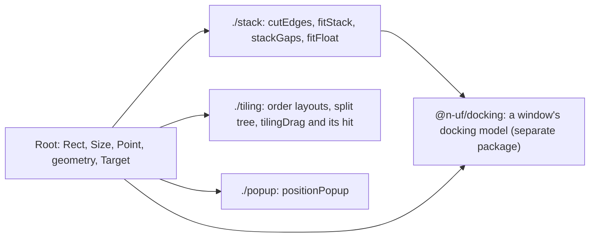

# @n-uf/placement: design

**What this page is.** The architecture of `@n-uf/placement` as it is built: what the library is for, the rules a consumer can rely on, and the public SDK entry by entry. The API contract is the package's exported TypeScript types (the files its `exports` map names); where this page and those types disagree, the types win. Code comments cite this page's sections by heading, for example "docs/placement.md, Entry: stack". The detailed behavior, with examples, is on [placement-reference.md](./placement-reference.md), which covers behavior; the exported types are the contract. The rules a drag follows across the three packages (one layout per held place, home, growth as spare room) are stated once on [concept.md](./concept.md); every exported type and signature is listed on [sdk.md](./sdk.md).

## In one paragraph

Placement answers *where things fit*, one edge or one area at a time. `cutEdges` cuts a stage into bands along its sides; `fitStack` fits the items along one band, each with forms that step down a ladder as room runs out; `stackGaps` gives one band's drop places for an item, each with the fit its drop makes; `fitFloat` keeps a float inside the stage and clear of what is docked; `./tiling` divides an area among panes and lays out each held place of a tiling drag and reads which place the pointer is over (`tilingDrag`, its `hit`); `./popup` positions a popup. All of it is pure: geometry in, rects out. A whole window's docking model (edges, rails, floats, targets, lanes, storage) is built on this layer in `@n-uf/docking`; *how* things move belongs to `@n-uf/motion`. Placement imports neither.

## Rules a consumer relies on

Each rule names the test that pins it. `pnpm check` in the repo root runs them all, with the type checks, the build check and the dependency rules.

| Rule | Guarded by |
| --- | --- |
| **The cut tiles the stage.** The reserved bands and the leftover lie inside the stage and overlap nothing; each corner belongs to the band cut first along either side of it. | `test/stack-cut.test.ts` |
| **Giving way is reversible in exact order.** Room coming back brings items up the form ladder in the reverse of the order they gave way; at every length the way back holds what the way down held. | `test/stack-previous.test.ts` |
| **A press reshapes nothing.** Under `previous`, a change of ages alone changes no form. | `test/stack-previous.test.ts` |
| **A gap's fit is its drop.** Each gap `stackGaps` gives is the solve of the stack with the item inserted there, and a gap takes the item exactly when that fit passes the fit-only rule. | `test/stack-gaps.test.ts`, `test/stack-gaps-fits.test.ts` (a sweep) |
| **Form flags default from the kind**, and a flag the host sets wins. | `test/stack-form-flags.test.ts` |
| **Older inputs fit as they did.** An input with none of the later options gives the fit of the earlier solvers. | `test/stack-compat.test.ts` |
| **Panes divide the area exactly**, and a side drop means the same on any pane. | `test/tiling.test.ts` |
| **A split puts the middle of its gutter at its ratio.** The first side is the extent times the ratio less half the gutter, the second starts half a gutter past that; no size is negative, and a ratio that is not finite is 0.5. | `test/tiling-gap.test.ts` (with a sweep) |
| **A gutter is the gap plus the handle**; a split's own gap replaces the layout's gap, the handle stays global, and a split with an id reports its box, ratio and divider. | `test/tiling-tree.test.ts` (with a sweep) |
| **Master and stack divide their area exactly**: a count of panes on a side, the ratio within 0.05 to 0.95, no overlap, and with no gap the area covered. | `test/tiling-master.test.ts` (with sweeps) |
| **A floor holds where both fit, else the ratio is 0.5**; a fixed length that fits is the pane's length, and the first fixed child decides. | `test/tiling-floors.test.ts` (with sweeps) |
| **A drop is judged by the layout it makes.** A side drop needs room for two panes at least `min` each, measured without the dragged pane, and leaves both at least `min` wide and high. | `test/tiling-drop.test.ts` (with a sweep) |
| **The neighbor is the lowest score**, over the panes whose center lies strictly that way. | `test/tiling-neighbor.test.ts` (with a sweep) |
| **A tiling drag's held place draws its commit.** `tilingDrag(...).after(held)` is the tree a release there commits, laid out; home commits the lift tree itself; a swap gives the partner the subject's old place; a side or a join releases the subject first. | `test/tiling-drag.test.ts` (with a sweep through `tilingConformance`) |
| **A tiling drag has one zone map, fixed at the lift.** The targets are built once from the lift or the base and never change; a place exists when its `after` is not refused; one hold rule (edge, travel, cap) keeps the held place; every zone is convex. | `test/tiling-hit.test.ts` (with `tilingHitConformance` over generated trees) |
| **A side of a pane takes an insert only for a new arrangement.** On a run neighbor of the subject the sides whose insert gives the lift's arrangement or the swap's are gone and their strips belong to the center, which spans 0.56 across the run; every other pane keeps five regions. | `test/tiling-hit.test.ts` (the `new-arrangement-sides` and `zones-convex` properties) |
| **Placement is pure and imports nothing from motion or docking.** No DOM, no timer, no global clock, no framework, no dependency. | `test/guard.test.ts`; `pnpm check` (the `placement-not-motion` and `placement-not-docking` dependency rules, `scripts/check-dist.mjs` on the built package) |

## How the parts fit



- The root holds the shapes and the geometry every entry shares, and the drop-target shape.
- `./stack` is **one edge**: the cut of a stage into bands, the fit of the items along one band, one band's drop places, and the float fit. It never imports a window model: it stands on the root alone (the `stack-root-only` rule), and placement never imports docking (`placement-not-docking`).
- `./tiling` divides an **area between panes**; it stands on the root alone.
- `./popup` places a **popup** inside its bounds; it stands on the root alone.
- `@n-uf/docking` lays out a whole window with `./stack` and owns everything above one edge. Placement never imports it.

## The edge cut

`cutEdges(stage, bands)` lays bands along the stage's sides in list order; the order decides the corners. A `reserve` band shortens what is left, an `over` band lies over it. The result is each band's rect and the leftover (`rest`).

## The edge fit

`fitStack(input, { previous })` fits the items along one edge, a column or a row. Each item declares its forms, largest first; the solver picks one per item and places them.

- **The form ladder.** Every item starts in its largest form (or at `from`). While the length runs short, one item at a time steps to its next form that shortens the stack: the lowest `rank` of the form it would step into, then unkept before `kept`, then the item used longest ago. A `menu` form takes no room of its own: the » entry does.
- **Fixed items** (`fixed`: a title, window controls) never give way; a growing title holds its natural length until the others have taken their steps within a step group (`stepGroup`, a compact variant), then shrinks toward its minimum. A fixed item with `stepping` (a page readout) keeps only its reserved place: it steps through its forms and into the » like an item that isn't fixed, and never holds. The solver reads "takes no steps" (`itemSteps`), never `fixed` itself.
- **Asked lengths and dividers.** An item may carry the length a person asked for, per axis (`StackItem.lengths`). The solver reads it in place of the natural of a growing form; the least stays the form's `main.min` and there is no new formula, so spare length is shared in proportion to the lengths and a short stack interpolates toward the least. `dividers`, `resizeBetween`, `resetBetween` and `resetLengths` trade length between the nearest open growing items; a collapsed item between two open ones gives one divider, on its far edge. A stack that declares no length is laid out exactly as before.
- **Spare length** goes to the forms that `grows` (on a bar, `@n-uf/docking` then gives each free stretch between its zones to the movable growers beside it, and counts them at their natural length for drop room and landing); the cross size is the widest form that sets it (`setsCross`, by default a form with `body`).
- **Under `previous`**, a change of ages alone reshapes nothing, and room coming back undoes the give-way steps (`StackFit.steps`) in exact reverse.
- **Coded notes** say why: `form-down`, `to-menu`, `too-wide`, `no-forms`, `overflow`. A note's `code` is the contract.

A form's `kind` is the host's label. What the solver and a window model read is said by fields that default from the kind: `menu` (no room of its own, the » entry stands for it: in the fit, in `stackGaps` and in the dividers; default the kind `menu`), `ownCross` (with the stack's `ownCross`, drawn at its own size across; default the group kinds `row`, `stacked`, `wrap`, `icons`, `fold`), `stepGroup` (forms with one key are variants of one form, the steps a growing title's hold lets come first; default the kind), `body` (an open panel; sets the cross size), `folded` (only its bar shows), `compact` (icons only), `setsCross`, `wrap`, `grip`, `hides`, `title`, `rank`. A form that sets none reads as before. Under `previous` a form is kept at its index only while its kind is the one the fit placed there: the label compared as given, never read as a word.

## One edge's drop places

`stackGaps(input, item, { previous, allows })` gives every gap of the stack, the item lifted out first, in order. A gap that takes the item carries the stack after the drop, its fit and the item's slot: the preview is the result. A gap that doesn't carries a reason: `no-forms`, `fixed`, `not-accepted`, `not-allowed`, `to-menu`, `overflow`, `too-wide`, `squeezes-fixed`. The item counts as just used, so the others give way before it; a fixed item may shrink to its minimum to make room, never further, and one with `stepping` may also step to a later form, as a movable item may.

`stackGaps` has no hit zones and no time. Where the pointer is, and how a flicker between two gaps is calmed, is the host's (`@n-uf/motion/drag`). The root's `Target` shape carries no time and no timing: it is a shape of places. The spring-loading and room fields a drag intent reads (`arm`, `armedHit`, `opensRoom`, `roomHold` in ms, `roomHit`) are `@n-uf/docking`'s `DockDrop` fields and `@n-uf/motion/drag`'s `DragTarget` fields, not placement's.

## Principles

| Principle | Enforced by |
| --- | --- |
| **Pure.** Geometry in, rects out; no DOM, timer, global clock or framework in any entry. | `test/guard.test.ts` scans every source file and every entry in `exports`; `scripts/check-dist.mjs` checks the built package for host globals and DOM types |
| **No dependencies, and apart from motion and docking.** Placement and motion compose through the shared target shape, in neither direction by import; docking stands on placement, never the reverse. | `test/guard.test.ts`; dependency rules `placement-not-motion`, `motion-not-placement`, `placement-not-docking` |
| **Entries layer downward.** `./stack`, `./tiling` and `./popup` stand on the root; folders reach each other only through an `index.ts`; apps use public entries only. | dependency rules `stack-root-only`, `tiling-root-only`, `popup-root-only`, `cross-folder-via-index`, `apps-public-entries-only`, `no-circular` |
| **Few words.** Ids, labels and kinds are the host's; the solver reads sizes and flags (`menu`, `ownCross`, `stepGroup` and the others under The edge fit), each defaulting from the kind. | review; `src/stack` reads `kind` only in the flag defaults (`model.ts`: `formMenu`, `formOwnCross`, `formStepGroup`, `formBody`, `formFolded`, `formCompact`) and compares it as a label under `previous` (`layout.ts`) |

## The SDK by entry point

Four entry points ship, each a file the `exports` map names (`./index.ts` for the root). All are pure and ES modules; all share the root's shapes. The tables below say what each export is for and the rule behind it; [sdk.md](./sdk.md) lists every signature and type field.

| Entry | Role |
| --- | --- |
| `@n-uf/placement/stack` | One edge: the cut into bands, the fit of its items, its drop places, and the float fit. |
| `@n-uf/placement/tiling` | Panes that divide an area: order layouts and the split tree, with their drop targets. |
| `@n-uf/placement/popup` | A popup positioned as Wayland's xdg-positioner does. |
| `@n-uf/placement` (root) | The shapes and geometry every entry shares, and the `Target` shape. |

### Entry: stack

`import { cutEdges, fitStack, stackGaps, fitFloat, type StackForm } from "@n-uf/placement/stack"`.

| Export | What it gives | The rule a consumer relies on |
| --- | --- | --- |
| `cutEdges`, `EdgeBand`, `EdgeCut` | The stage cut into bands along its sides, in list order: each band's rect by id, and the leftover. | The order decides the corners; `reserve` bands and the leftover tile the stage; an `over` band lies over the leftover. |
| `fitStack`, `StackInput`, `StackItem`, `StackFit`, `PlacedStackItem`, `StackMenu`, `StackStep`, `StackNote`, `StackNoteCode`, `FitOptions`, `StackAxis` | One form and rect per item for a length, giving way by rank, kept and age, spare room to the forms that grow; the » entry; coded notes. | Pure; same input, same fit; growing back is the exact reverse of giving way (`previous`, `steps`). |
| `dividers`, `resizeBetween`, `resetBetween`, `resetLengths`, `StackDivider`, `StackLengths` | Asked lengths (`StackItem.lengths`, per axis) and the verbs on them: one divider per pair of nearest open growing items, a move that trades length between the two, a reset to the natural split, and a reset of every length. | Additive: a stack that declares no length is laid out exactly as before; a resize clamps to each item's least, moves only the two and returns the same object when nothing changes. |
| `StackForm`, `StackFormKind`, `PanelFormKind`, `GroupFormKind`, `MainSize`, `CrossLimits`, `WrapSpec` | The form vocabulary: kind, size along (`main`) and across (`cross`), `rank`, the flags `body`, `folded`, `compact`, `setsCross`, `menu`, `ownCross`, `stepGroup`, and `wrap`, `grip`, `hides`, `title`. | A flag the host sets wins over its kind's default. |
| `formBody`, `formFolded`, `formCompact`, `formSetsCross`, `formMenu`, `formOwnCross`, `formStepGroup` | A form's flags, each defaulting from the kind (`open`; `header` and `fold`; `icons`; `body`; `menu`; the group kinds; the kind itself). | The one reading of a form a window model asks. |
| `itemSteps` | Whether an item takes give-way steps: one that isn't `fixed`, or a fixed one with `stepping`. | The solver's one reading of `fixed` for the ladder; a fixed item's place (never dropped) is `fixed` alone. |
| `controlLadder`, `ControlLadderSpec`, `LadderControl`, `ControlLadder` | A group's forms generated from its controls (lengths per tier, gap, grip, its own » cell): tier steps one control at a time, partial folds at the last tier, then `fold` and `menu`, with `rank` and `hides` set. | Additive: no solver rule; a fixed shape (`n * T + 2` forms), so form indexes stay valid when a length changes. Hosts that hand-write forms are unchanged. |
| `formMain`, `formCrossMin`, `formFitsCross`, `wrapCross`, `wrapLines`, `wrapRows`, `withItem` | A form's length and least cross size, whether a wrap form fits a cross size, its rows, and an input with an item inserted. | A wrap form that fits a cross size fits every wider one. |
| `DEFAULT_MENU`, `DEFAULT_RAIL` | The » entry's length and an empty stack's width. | Used when the input leaves them out. |
| `stackGaps`, `StackGap`, `StackGapOptions`, `StackGapRefusal` | Every gap of one edge for an item: the fit its drop makes and the item's slot, or a refusal with its reason. | A gap's fit is the drop's solve; fit only, no hit zones. |
| `fitFloat`, `FloatFit`, `FloatFitOptions` | The rect a float gets: moved inside the stage and clear of docked content; with `{ stay: true }`, only moved inside the stage, `covers` naming what it lies over. | Moves, never resizes; finds a clear place whenever one exists, unless the safety net on the search is hit (`FloatFit.searchCapped`, normally false). With `stay` it is the asked rect clamped into the stage, never snapped. |

### Entry: tiling

`import { layoutSplit, paneTargets, … } from "@n-uf/placement/tiling"`. Panes that divide an area with no overlap and no hole. Stands on the root alone. Targets are root `Target`s.

| Export | What it gives | The rule a consumer relies on |
| --- | --- | --- |
| `masterStack`, `columns`, `grid`, `OrderLayout`, `OrderOptions`, `TileOptions`, `MasterOptions` | Order layouts: a rect per pane, in order, for an area (`gap`, `ratio`). `masterStack` also takes a master `count` and a `side` (left, right, top or bottom). | Panes divide the area exactly. The master's ratio is clamped to 0.05..0.95 and a count to 1..n; with no stack the panes fill the area along the side's cross axis. |
| `masterRatio(ratio)`, `masterCount(count, n)` | The two clamps `masterStack` and a master split apply, for a host that lays out its own master and stack. | `masterRatio` is 0.05..0.95, and 0.5 when left out or not finite. `masterCount` rounds and keeps the count within 1..n (1 when left out or NaN; never 0, even for no panes). |
| `Rect` | The root's `Rect` (`{ x, y, width, height }`), re-exported. | The same type as `@n-uf/placement`'s `Rect`, not a copy. |
| `orderTargets`, `OrderTarget` | One target per index (`at:<index>`): its slot is the dragged pane's rect there, `layout` every pane's rect with it there. | A drop reorders. |
| `Split`, `splitFromOrder`, `splitPane`, `removePane`, `swapPanes`, `panesOf`, `dropOnPane` | The split tree: each node is a pane or a split of its rect in two along an axis at a ratio (it may carry a `gap`, an `id` and `master`); dwindle from an order, and the changes. | The tree keeps its set of panes (plus the dragged one when missing). `dropOnPane` copies the split nodes it changes and gives a new split no `id`. |
| `layoutSplit`, `layoutSplitTree`, `SplitOptions`, `SplitLayout`, `SplitGeometry`, `FixedLength`, `MinLength` | A tree laid out in an area: `layoutSplit` gives a rect per pane and builds nothing else; `layoutSplitTree` also gives, for each split with an `id`, its box, its ratio in effect and its divider (the gutter strip). A gutter is the gap plus `handle`. A split with `master` lays its panes out flat as master and stack. | The middle of the gutter sits at the extent times the ratio, no size is negative, a ratio that is not finite is 0.5. See *The split tree's rules* below. |
| `canDropOnPane`, `DropOptions`, `DropVerdict` | Whether a drop on a pane's region leaves room: `{ ok, reason? }`. | A side needs `2 * min` plus the gutter along the split and `min` across, in the layout without the dragged pane, and leaves both panes at least `min` wide and high. It is exactly `canSplitPane` then `dropFits`. |
| `canSplitPane(target, side, { min, gap?, handle? })`, `SplitRoomOptions` | The room rule alone, for a host that measures the target itself: can a pane of this rect take another on that side. `{ ok, reason? }`, the reasons `canDropOnPane` gives. | Along the split (width for left and right, height for top and bottom) at least `2 * min` plus the gutter, across it at least `min`. A negative or non-finite `min`, `gap` or `handle` is 0. |
| `dropFits(projected, dragged, at, area, { min, side })`, `DropFitsOptions` | The fit rule alone, for a host that has projected the layout the drop makes (a map of pane to rect) in its own way: `{ ok, reason? }`. | `dragged` and `at` are both in `projected` and at least `min` wide and high; with an `area` of no width or no height there is nothing to measure and it is `ok`. `side` is only for the reason. |
| `neighbor`, `Direction` | The nearest pane in a direction, from a map of rects. | A candidate's center is strictly on that side; the lowest score wins, ties to the first in the map's order. |
| `paneRegion`, `paneRegionShapes`, `paneCenter`, `PaneRegion`, `PaneCenter`, `PaneRegionOptions`, `PANE_SIDES`, `PANE_REGION_DEFAULTS` | Which of a pane's five drop regions a point is in: the center, or one of four side trapezoids; the previous region holds a few px past its boundary. `paneRegionShapes` gives the regions as convex polygons. `paneRegion` takes a center the host already measured as `options.paneCenter` (a `PaneCenter`, pane-local px) and then reads none of the options that would measure one. `options.sides` names the sides that exist (default all four). | The same center gives the same region as the measured one. A center drop swaps; a side drop splits on that side, so a side means the same on any pane. A side left out of `sides` gives its whole strip to the center, which then reaches the pane's edge there. |
| `paneTargets`, `PaneTarget`, `PaneTargetsOptions` | One target per pane (`pane:<key>`), its place the pane's region. | Keys must be unique: a drag intent follows targets by id. |
| `giveWay` | Floats the newest pane while any pane is laid out below its minimum. | Stops when every pane keeps its minimum or one pane is left. |
| `tilingDrag`, `TilingDrag`, `TilingDragOptions`, `TilingSubject`, `TilingStack`, `TilingHeld`, `TilingAfter`, `TilingLaidOut`, `TilingMove`, `TilingRefusal`, `TilingSize` | A drag of a pane or a whole stack: the lift and base layouts, `home` (the gap the release leaves, or null), `after(held)` for home, a swap, a side or a join (the tree a release commits, its layout, the landing, the panes it moves, or a refusal code), and `hit(basis, options?)`, the hit half. | One layout per held place: what a frame holding it draws is what its release commits. See *A tiling drag's one layout* and *A tiling drag's hit half* below. |
| `TilingHit`, `TilingBasis`, `TilingHitOptions`, `TilingHitRegions`, `TilingHitTarget`, `TilingHitIntent`, `TilingHitFrame`, `TilingHitRead`, `TilingHold`, `TilingMark`, `TilingPart`, `TILING_HIT_DEFAULTS` | The hit half of a drag: its zone map (`placeAt`, `heldOf`), the one hold rule (`hold`), its targets in `@n-uf/motion/drag`'s shape and the intent's options, a reader of the intent's frame (`{ held, refused, mark }`), what a frame draws and what a release commits; the declared part of a pane, the region options it reads, and the defaults (`edge` 6, `travel` 24, `cap` 0.25, and the run neighbor's swap share `neighborSwap` 0.56). | Built once per drag and basis on one fixed layout, the lift or the base; a side of a pane takes an insert only for a new arrangement. See *A tiling drag's hit half* below. |
| `TilingTree`, `splitTreeOps`, `SplitTreeOpsOptions`, `StackedSplit` | The adapter a host gives the drag (its tree as a `Split`, its stacks, the changes, and optionally the `parts` of a pane), and the reference adapter over a `Split` with stacks beside it (`bar` for a title bar part, `tab` for a tab's width). | Pure: each change returns a new tree, or the same one when nothing changes. |
| `tilingConformance`, `tilingSubjects`, `TILING_PROPERTIES`, `TilingConformance`, `TilingProperty` | The drag's properties run on any adapter, over every subject of the trees given and every held place: per property how many checks ran and failed, and the first failures in words. | A host runs it on its own adapter and trees; no test runner needed. |
| `tilingHitConformance`, `TILING_HIT_PROPERTIES`, `TilingHitConformance`, `TilingHitProperty` | The hit half's properties run on any adapter, over every subject and both bases, with the rows that are counted and not failed (a swap landing beside the pointer; an insert that moves other panes, or under a fixed length or a master split). | A host runs it on its own adapter, its `parts` included; no test runner needed. |

**A tiling drag's one layout.** `tilingDrag(tree, subject, { ops, area, min, ...splitOptions, still? })` is the layout half of a tiling drag, the counterpart of `@n-uf/docking`'s `dockDrag`. The host keeps its own tree and changes and hands them over as a `TilingTree` adapter; geometry has one source, the adapter's `split(tree)`, laid out with `layoutSplitTree` under the drag's options.

- **The base** is the tree with the subject released, laid out: what a frame draws at rest (nothing held, or a refused place), and one of the two hit bases.
- **Home** is the gap the release leaves: the subject's lift rect when releasing it takes a drawn pane away (a pane alone, a whole stack), null when it takes none (a member torn out of a stack that stays drawn). It lies only over base panes that grew when the subject was released. A torn member's place in its stack is then an ordinary place: the join back at its index.
- **`after(held)`** is what a release there commits and what a frame holding it draws: the tree, its layout, the subject's landing and every other pane it moves from where it was at the lift. Home's tree is the lift tree itself, never normalized. A swap's tree is `normalize(swap(tree))`; a side's and a join's are `normalize(beside(release(tree)))` and `normalize(join(release(tree)))`. `beside` and `join` take the released tree because the subject leaves its old place first: the place it lands in is measured and changed without it, and a stack never holds it twice. `swap` takes the tree with the subject still in it because a swap exchanges two places: the subject's old place is exactly where the partner goes, so that place is open by construction.
- **Refusals** are codes: `self` (the subject's own place), `still` (a still pane), `missing` (no such pane in the base), `join` (the adapter has no `join`), `room-along` and `room-across` with `need` and `have` (`canSplitPane` on the base rect), and `fit` with the pane below `min` (`dropFits`' rule on the layout a side, a swap or a join makes). A refused place's `after` is the lift: its release commits nothing, and a frame holding it draws the base, not `after().layout`.
- **A swap with a stack** moves `at` alone: a lone pane takes the place of the stack's drawn member, and the stack's other members stay.

**A tiling drag's hit half.** `drag.hit(basis, options?)` says which place the pointer is over, and it fits `@n-uf/motion/drag`'s drag intent ([concept.md](./concept.md), "The two drag models"). It is built once per drag, at the lift, from one layout that never changes while the drag runs: nothing is measured or laid out again per frame, and what a frame draws never moves what the pointer is over. Records: [decision 0009](decisions/0009-one-layout-per-tiling-place.md) and [decision 0012](decisions/0012-one-zone-map-per-tiling-drag.md).

- **One zone map per drag, on the lift or the base.** `basis` is `"lift"` for a host that draws only a mark over the layout at the lift (the subject's slot open), or `"base"` for a host that draws the landed layout of the held place (the subject released, the gap closed). The host says which at the lift, never per frame. `drag.hit(basis)` is remembered per basis, as `after` is per place: a second call gives the same hit, with its one hold, and the first call's options stand. `hit.targets` is frozen, and the layout it hit-tests is `drag[hit.basis]`.
- **Is `@n-uf/motion` needed?** No. The hit is a zone map and a pure hold: `hit.placeAt(point)` is the place id at a point with nothing held, `hit.heldOf(id)` the place it names (a host never parses ids), and `hit.hold(state, point)` the hold's step. A host with no intent keeps `state` itself (see the loop below). The intent fit (`hit.targets`, `hit.intent`, `hit.read`) is for a host that runs the drag through `@n-uf/motion/drag`, for its other targets in the same drag (a workspace tab, a float) or its frames.
- **Targets, in the drag intent's shape.** Each is a root `Target` with `pane`, `at` and, for a part or for home, `part` or `home`:

  | Target | `pane` | `at` | `part` | `home` |
  | --- | --- | --- | --- | --- |
  | `home` (priority 1) | the subject's own (drawn) pane | the same | none | `true` |
  | `pane:<key>`, a body (priority 2) | the pane the basis draws there | the pane its places name, as the base draws it: the same, except a stack whose drawn member changes when the subject is released (its next member) | none | none |
  | `part:<key>:<part>` (priority 1) | the pane the part lies on | as the body's | the part's key | none |

  `hit.intent` is the intent's options in whole: no home (home is a place of the hit, held by the one rule; the intent's `home` is optional), no time-based gate or hold, and a band as wide as the edge measure. `createDragIntent({ ...hit.intent })` is the whole wiring: the hit decides, the intent shows it. No `lift` is needed: it gates only spring-loaded targets. The intent's tuning is fixed: a host adds no time gate of its own (a dwell); the hold is the hit's, by distance. Home and a part are both priority 1, and the intent picks the smaller zone among equals, so where a part lies over home (on the base) it may pick the part; that part's `placeOf` answers null there, so home wins.
- **Parts.** One body target per pane the basis draws (`pane:<key>`): not the subject's own slot on the lift, and not a still pane. Its places are the five regions of `paneRegion`: the center swaps, a side goes beside. The adapter may declare parts of a pane, `TilingTree.parts(tree, pane, rect)`: a title bar, a tab strip, each a `TilingPart` (`key`, `rect`, and optional `slots`, rects within it). A part is a join target (`part:<pane>:<part key>`) that wins over the body; the slot under the pointer gives the join's index, and over the part but no slot the join has none (last). Parts are declared geometry on the same layout, with any size the host measured once at the lift (a tab's width, keyed by member, not by index). `splitTreeOps({ bar, tab })` is the reference: a bar along each pane's top, a slot per member. Home is the subject's lift rect (null when the release leaves no slot) and wins over everything beneath it; on the base it covers the neighbors that grew into the gap.
- **The one hold rule: edge, travel, cap.** The held place keeps its zone until the pointer is `edge` px past the edge of that zone's visible part (default 6; every zone, home included). The visible part is what no zone above covers: home over the panes that grew into it, a part over its pane's body, a slot over its part. Home wins over what lies beneath it, so a zone that runs on under home is measured from where it shows, and over home's rim far from it the pointer reads home. Inside one pane (its body zones and its parts), not over home, the place also keeps until the pointer is `travel` px from where it was taken (default 24), which damps a re-aim. Each measure is at most `cap` of the held zone's extent on each axis (default 0.25), so a small pane is not all hold: the edge measure per axis (the zone grown by that much left and right and by its own amount above and below, its corners rounded), the travel measure as an ellipse with those two radii around the point it was taken from (`TilingHold.from`). Any change of place takes the point anew, a new tab slot included. The hold is the hit's: `regions` has no hysteresis (`TilingHitRegions` is `center`, `centerX`, `centerY`, `centerMin` and `pixelRatio`, the options it reads), and the intent keeps none. `hit.hold(state, point)` is the pure step; `hit.placeOf` steps the drag's one hold, once per point (its `previous` is not read).
- **A place exists when `after(place).refusal` is null.** The hit asks nothing else: no room call of its own. A refused zone keeps its zone and holds nothing: the pointer there falls to the target beneath it (a refused slot to its part, a refused part to the pane's body), never sideways into a neighbor's zone, so the map does not depend on room. `read` names the refused place under the pointer when nothing is held (`read.refused`); its code is `drag.after(read.refused).refusal`. While another place is still held (within its measures), nothing is named, and a frame draws nothing for a refused place.
- **The lift's arrangement is home.** An arrangement is the tree with sizes ignored: which panes sit in which run, in which order, and which tabs are in which group, in which order; nested splits along one axis are one run. A live place whose release has the lift's arrangement reads as home (nothing shown, a release commits the lift tree): the side of a pane that restores the lift's order, and a torn tab's own cell, which is the join back at its index, with no home rect.
- **The run-neighbor rule.** A side of a pane takes an insert only for a new arrangement: not the lift's, and not the one a swap with that pane gives. A side that takes none belongs to the center. It is judged on one pair, once, on the lift tree, the same for both bases. The order: the run-neighbor rule removes sides first; home then takes what remains that gives the lift back (a torn tab's own cell, the facing side of a neighbor with other bounds across). So the side facing the subject is the center's on a run neighbor and home on any other pane whose insert there restores the lift:
  - *Run neighbor.* A pane is a run neighbor of the subject when, in the lift tree, the two are whole children of one run and stand next to each other in it (the subject has at most two), and the pane has the same bounds across the run (its rect, within 0.5 px). A pane under the subject's parent, the first pane of a sub-split across the axis, and a pane that only lines up by coincidence (a 2×2 grid built as two rows) are not run neighbors: they keep five regions. A split with `master` is not part of a run. A run neighbor is found on the tree, never by rects: `neighbor(rects, from, direction)` (the nearest pane in a direction, from a map of rects) is another thing and is not read here.
  - *The side facing the subject goes,* because an insert there gives back the lift's order. *The far side goes* when the swap exchanges the two whole occupants, so that "beside it on the far side" and "swap" are one arrangement.
  - *The center takes the strips.* With both sides along the run gone, the pane is three rectangles, each its full length along the run: a strip, the swap, a strip. The strips sit across the run, and the swap spans `neighborSwap` (default 0.56, an option of the hit) of the pane across it, so each strip is 22 %, about as large as a normal side band and as easy to hit. The `sides` option of `paneRegion` and `paneRegionShapes` (which sides exist) is how.
  - *The stack exception.* A tab group as the neighbor loses only the side facing the subject: a swap moves its active tab alone, so the far side (the subject beyond the group) is a result of its own and stays. A torn tab has no run neighbor: it is a tab at the lift, not a child of a run, so every pane keeps five regions.
  - A refused swap brings no strip back: the neighbor's middle shows the refusal and offers nothing. Parts, home, the fixed map and the hold rule are unchanged.
- **Convex zones.** Every zone of every pane is convex (a rectangle or a trapezoid), so a straight pass meets each place at most once. A neighbor's swap is one rectangle, never a middle with bands added to it.
- **The reader.** `read(frame, point)` turns the intent's frame (`{ shown }`) into `{ held, refused, mark }`: the held place (home included; null when nothing is held outside home), the refused place under the pointer when nothing is held, and, on the lift basis, the mark. A mark is a region of the lift layout, of the held place's kind, never an `after` rect: `beside`, the target pane's half on that side as drawn; `swap`, the target's outline and the wash in the open slot; `join`, the target's outline and its slot when it has an index. `drawn(read)` is what a frame draws: the lift on the lift basis; on the base `after(held)` as soon as a place is held, the lift at home, the base with nothing held. `release(read)` is what a release commits: `after(held)`, else the lift tree.
- **The release.** Read the pointer-up point as one more move first (one more `intent.update` and `hit.read`, or one more `hit.hold` with no intent), then commit `hit.release(read)` of that read. `intent.release` need not be called: what it would name is the shown target, whose place `read.held` already is.
- **A rebuild mid-drag.** When the area or the tree changes under a drag (a resize, a host update), the old hit is not reused: make a new drag on the new tree and area, and its hit (with the same basis and parts as declared geometry, measured again or kept by the host). Its hold starts afresh: a `TilingHold` names places of the hit it came from and cannot be handed to a new one.
- **Conformance.** `tilingHitConformance(trees, options, hitOptions?)` runs the properties of `TILING_HIT_PROPERTIES` on any adapter, `parts` included, over every subject and both bases, and returns `{ ok, failures, counts, reported }` as `tilingConformance` does (`counts` per property name):
  - `fixed-map`: the targets after any run of frames are the ones built at the lift, and holding one place never changes what a point means with nothing held;
  - `zone-rule`: the place at a point is the one a second copy of the rule names (home inside its rect, a slot over its part over the body, else the pane's region);
  - `stillness`: a still pointer changes nothing;
  - `hold-measures`: a path within the edge measure of the held zone's visible part, or inside its pane within the travel measure, never changes the place; past both (over home's rim on the base included) a point reads the map;
  - `one-pass`: a straight sweep meets each place but home at most once;
  - `existence`: a place on the map is offered exactly when `after(place).refusal` is null (a side the run-neighbor rule removed is neither);
  - `lift-equals-home`: every place whose release gives the lift's arrangement reads as home and commits the lift tree;
  - `shown-under-pointer`: with no hold, on the lift the mark contains the pointer and lies inside the target pane, and on the base the landing contains the pointer for every insert and join;
  - `shown-equals-landed`: at every frame a release commits `after(held)`, and the base draws it in that same frame;
  - `new-arrangement-sides`: among panes with the subject's bounds across its run (meeting it in no master split), a side exists exactly when its insert gives an arrangement that is neither the lift's nor the swap's; a pane with other bounds across (a fixed length across) keeps its sides. A second copy judges it from the lift tree and the lift rects alone, never the basis, and both bases are checked against it, so a pane has the same sides on both;
  - `zones-convex`: the midpoint of two points in one zone is in it;
  - `room-free-map`: the same drag with every room check passing (`min: 0`) has the same sides on every pane and the same place at every point where both are live; where a place is refused, the point falls to the target beneath, never to a neighboring zone.

  Some rows are counted and reported, not failed (`reported`, on the base, where a frame draws the landed layout): `swapsBeside`, a held swap whose landing lies beside the pointer (a pane that moved when the subject was lifted is hit at its base rect); `insertsMoveOthers`, an insert or join whose layout moves a pane other than its target (a floor, a fixed length, a master split laid out anew); and `insertsMoveOthersBeside`, those of them whose landing does not contain the pointer.

Using it with `@n-uf/motion/drag`:

```ts
import { createDragIntent } from "@n-uf/motion/drag";
import { splitTreeOps, tilingDrag, type StackedSplit, type TilingHitTarget, type TilingHold } from "@n-uf/placement/tiling";

// s over n: n is a run neighbor of s, so n is a strip, one swap rectangle and a strip, each the full height of n.
const tree: StackedSplit<string> = { split: { axis: "y", ratio: 0.5, a: { pane: "s" }, b: { pane: "n" } } };
const area = { x: 0, y: 0, width: 800, height: 500 };
const drag = tilingDrag(tree, { kind: "pane", pane: "s" }, { ops: splitTreeOps({ bar: 24 }), area, min: 80 });

// At the lift, once: the basis ("lift": the host draws a mark over the layout at the lift).
const hit = drag.hit("lift");
const grab = { x: 400, y: 12 };
const intent = createDragIntent<TilingHitTarget<string>>({ ...hit.intent });

// On every pointer move: the intent's frame, read by the hit.
let time = 0;
const move = (p: { x: number; y: number }) => hit.read(intent.update(p, (time += 16), hit.targets), p);

move(grab).held; // { kind: "home" }
move({ x: 400, y: 400 }).held; // { kind: "swap", at: "n" }: the middle, over n's whole height
const read = move({ x: 50, y: 400 });
read.held; // { kind: "beside", at: "n", side: "left" }: the left strip, 22 % of n's width
read.mark; // { kind: "beside", at: "n", side: "left", rect: { x: 0, y: 250, width: 400, height: 250 } }: its half of n

// A frame draws hit.drawn(read) with read.mark over it. At pointer-up: one more move at the up point, then commit.
console.log(hit.release(move({ x: 50, y: 400 })).tree.split); // s on the left of n, both the full height
```

The same drag with no intent, the pure step alone (the host keeps the hold):

```ts
let state: TilingHold | null = null;
const step = (p: { x: number; y: number }) => (state = hit.hold(state, p)) && hit.heldOf(state.place);

step({ x: 400, y: 400 }); // { kind: "swap", at: "n" }
const held = step({ x: 50, y: 400 }); // { kind: "beside", at: "n", side: "left" }
drag.after(held ?? { kind: "home" }).tree; // what a release here commits
```

**The split tree's rules.** A split of an extent `W` at ratio `r` has a gutter `g`: the split's `gap` (else the layout's) plus the layout's `handle`. The first side is `max(0, W·r − g/2)` long. The second starts at `start + W·r + g/2` and is `max(0, W·(1−r) − g/2)` long. So the middle of the gutter sits at `W·r`, at 0.5 both sides are equal, and no size is ever negative. A side too short for half the gutter is 0 long, and the second side of a split with no room may start up to half a gutter past the end. A ratio that is not finite is 0.5; otherwise it is clamped to 0..1. A negative or non-finite `gap` or `handle` is 0. The area is taken as given: with a negative width or height every split length along that axis is 0 and a pane's size across it is copied as it is, so pass an area with no negative side.

Three options read the host's own data, per split, of the split's two direct children. The host answers by pane key and by split `id`: `dropOnPane` copies the split nodes it changes, and a split it creates has no `id`.

| Option | The child's … | How the split uses it |
| --- | --- | --- |
| `fixed(child, axis)` | fixed length along the split, `{ length, keep? }` | The first child that reports one decides. It takes its length when the length is above 0 and, with the gutter, less than the extent; the other side fills the rest. Otherwise the split goes by its ratio, and the other child is not read. When both report a length with `keep`, each keeps its own and the room left stays empty; if the two and the gutter do not fit the extent, the second runs past the end. A split a fixed length decided has no divider and no floor. |
| `fixedAcross(child, axis)` | fixed length across the split | The child takes it, from the start of the cross axis, when it is positive and finite. It is not checked against the cross extent: a longer length makes a pane larger than the split's box. |
| `floor(child, axis, split)` | least length along the split, `{ min, net? }` | The ratio is clamped so each side keeps its minimum of the room less the gutter (at least 1 px), and within 0.05 to 0.95 (the net) unless either side says `net: false`. Where the two minimums cannot both fit, the ratio is 0.5. With no `floor`, only the clamp to 0..1. |

`giveWay` is the other policy of the same minimum. A floor moves the ratio so both sides keep their minimum while they can fit; `giveWay` floats the newest pane while a minimum is broken. A host can lay out with floors and give way for what still breaks, or use either alone.

A split with `master` lays its subtree out flat: its panes (`panesOf`, in order) through `masterStack`, by the split's ratio (clamped to 0.05..0.95) and gap, never the handle. The splits under it are not laid out, and `layoutSplitTree` does not report them; it reports the split itself, its ratio the clamped master share, its divider the gap between the two areas (null with no stack). Inside a master split a drop's side is not a side of the pane: `dropOnPane` splits the pane on that side in the tree, and the flat master and stack list then takes the dragged pane as one more slot, next to `at` in the order (before it for left and top, after it for right and bottom). `layoutSplitTree` repeats an `id` by keeping the split laid out last (a split under another, or a later one beside it).

`neighbor` reads any map of rects. One option for a host: lay its tree out in a unit square with its px floors. A floor in px cannot fit a unit square, so a split's floors cannot both fit and it goes to 0.5, whatever its ratio, and fixed lengths along a split do not fit either. Fixed lengths across a split are not checked against the cross extent, so they still apply there; a host leaves `fixedAcross` out of that layout.

### Entry: popup

`import { positionPopup, BELOW_LEFT } from "@n-uf/placement/popup"`.

| Export | What it gives | The rule a consumer relies on |
| --- | --- | --- |
| `positionPopup`, `PositionerRule`, `Positioned`, `Align`, `BELOW_LEFT` | Place a popup (a drop label, a menu, a tooltip) as Wayland's xdg-positioner does: an anchor point, a gravity, an offset, then flip, slide and resize, each only when the rule allows. | Adjustments are tried in that order per axis; `Positioned` says which happened. |

### Entry: root

`import { clampInto, type Rect } from "@n-uf/placement"`. What every entry shares.

| Export | What it gives | The rule a consumer relies on |
| --- | --- | --- |
| `Rect`, `Size`, `Point` | The shapes: a rect is a top-left corner and a size, in whatever px the consumer lays out in. | The same shape as `@n-uf/motion`'s, so the two compose without either importing the other. |
| `rect`, `overlap`, `overlaps`, `contains`, `clamp`, `clampInto`, `center`, `area`, `subtract`, `EPS`, `PLANE` | The geometry: build a rect, the area two rects share, whether they share more than a tolerance (touching edges do not overlap), whether a rect holds a point (its edges included), clamping a number or moving a rect inside an area, a rect's center, a rect's area, a rect less another as disjoint rects, the comparison tolerance, a rect covering any point. | Pure; `clampInto` moves, never resizes, and a rect larger than the area keeps its top-left corner on the area's. |
| `Side`, `Axis` | The two words for direction: a side (`"top" \| "right" \| "bottom" \| "left"`) and an axis (`"x" \| "y"`). | Declared once; `@n-uf/docking` re-exports both, and a narrower set is written in terms of `Side`. |
| `Target` | The drop-target shape: `id`, `priority`, `hit`, `hits`, `slot`, `label`, `free`, `refuse` and `bounds`; the root reads none of them. The drag's spring and room fields (`arm`, `armedHit`, `opensRoom`, `roomHold`, `roomHit`) are on `@n-uf/docking`'s `DockDrop` and `@n-uf/motion/drag`'s `DragTarget`, not here. | The pick's rank (`pickRank`, `REFUSAL_RANK`: a refusal ranks after every priority 1 and 2 target and before priority 3; lower wins) is `@n-uf/motion/drag`'s alone: placement no longer exports it. |

## Glossary

The repo's glossary page (`apps/lab/src/pages/glossary.html`) fixes the words; this page uses them.

| Term | Meaning |
| --- | --- |
| **stage** | The rectangle in px everything is laid out in. |
| **band** | A strip cut along one side of the stage (`cutEdges`): a bar's or a column's room. |
| **edge**, **stack** | The items along one band: a row (a bar) or a column. |
| **item**, **form**, **form ladder** | Something placed on an edge; one size and shape it can take; its forms, largest first. As room runs out it steps down one rung at a time, and climbs back in the exact reverse order. |
| **give way** | To yield space in a fixed order when the edge is too short. |
| **kept** | An item marked to give way after every unkept one. |
| **gap**, **slot** | A place between two items where a drop inserts; the rect the dropped item will occupy. |
| **refusal** | A gap that cannot take the item, with its reason. |
| **float** | An item that is not docked: drawn above the content at its own rect. |
| **pane** | One item of a tiling. Not a "tile", which is a rail's icon form. |
| **split**, **split tree** | A split divides a rect in two, `a` then `b`, at a ratio; a split tree is panes and splits, each split's sides panes or splits. |
| **gutter**, **handle**, **divider** | The room between a split's two sides: the gap plus the handle (the extra room a divider takes). The divider is the strip the gutter makes, as a rect. |
| **floor** | The least length a pane keeps along a split; the ratio moves to hold it where both floors fit. |
| **fixed length** | A length a pane keeps along or across a split whatever the ratio. |
| **master**, **stack** | A layout of panes in two areas: the first few (the master) on one side, the rest (the stack) on the other. |
| **subject**, **held place**, **base**, **home** | In a tiling drag: what moves (a pane, or a whole stack of panes drawn as one); where a release now lands (`TilingHeld`); the tree with the subject released, laid out; the gap the release leaves. A stack here is the host's group of panes behind one drawn pane, not the master's stack. |
| **lift**, **basis**, **hit zone**, **zone map** | In a tiling drag: the layout at the press, the subject's slot open; the one layout a drag hit-tests, the lift or the base, fixed at the lift; the area of that layout where a place is under the pointer (a place may have several; a bare "zone" stays a toolbar area's third); the places the pointer can be over, each with its hit zones, built once at the lift. |
| **mark** | On the lift basis: the region of the lift layout drawn for the held place (a side's half of the target, a swap's or a join's outline, a swap's wash in the open slot), never a landed rect. |
| **run**, **run neighbor**, **arrangement** | A line of panes along one axis (nested splits of that axis are one run); a pane next to the subject as a whole child of the same run, with the same bounds across it, found on the tree (not `neighbor`, the nearest pane by rects); the tree with sizes ignored (which panes sit in which run, in which order, and which tabs in which group, in which order). |

## Considered, not part of the design

- **Window-level models in this package.** A whole window's edges, rails, floats, targets, lanes and storage are `@n-uf/docking`; this package keeps only what one edge or one area needs, so a host with a single toolbar or a tiling takes no window model.
- **Building a window model's drop targets on `stackGaps`.** A window weighs a drop on the whole window (its other edges, the floats, the content's least size), which one edge's fit does not see; `@n-uf/docking` keeps its own targets, and `stackGaps` is the one-edge answer.
- **Importing motion for the pick rule.** The code and the build forbid it (`test/guard.test.ts`, the `placement-not-motion` rule); the two compose through the shared target shape.
