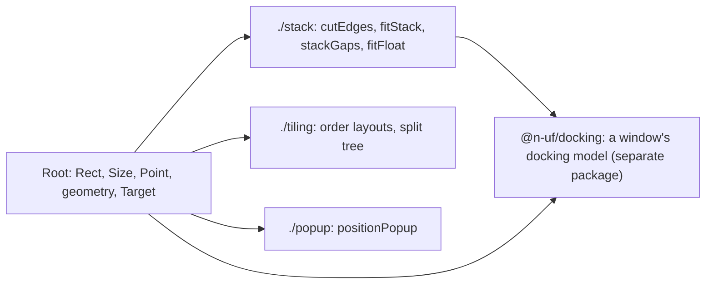

# @n-uf/placement: design

**What this page is.** The architecture of `@n-uf/placement` as it is built: what the library is for, the rules a consumer can rely on, and the public SDK entry by entry. The API contract is the package's exported TypeScript types (the files its `exports` map names); where this page and those types disagree, the types win. Code comments cite this page's sections by heading, for example "docs/placement.md, Entry: stack". The detailed behavior, with examples, is on [placement-reference.md](./placement-reference.md), which covers behavior; the exported types are the contract.

## In one paragraph

Placement answers *where things fit*, one edge or one area at a time. `cutEdges` cuts a stage into bands along its sides; `fitStack` fits the items along one band, each with forms that step down a ladder as room runs out; `stackGaps` gives one band's drop places for an item, each with the fit its drop makes; `fitFloat` keeps a float inside the stage and clear of what is docked; `./tiling` divides an area among panes; `./popup` positions a popup. All of it is pure: geometry in, rects out. A whole window's docking model (edges, rails, floats, targets, lanes, storage) is built on this layer in `@n-uf/docking`; *how* things move belongs to `@n-uf/motion`. Placement imports neither.

## Rules a consumer relies on

Each rule names the test that pins it. `pnpm check` in the repo root runs them all, with the type checks, the build check and the dependency rules.

| Rule | Guarded by |
| --- | --- |
| **The cut tiles the stage.** The reserved bands and the leftover lie inside the stage and overlap nothing; each corner belongs to the band cut first along either side of it. | `test/stack-cut.test.ts` |
| **Giving way is reversible in exact order.** Room coming back brings items up the form ladder in the reverse of the order they gave way; at every length the way back holds what the way down held. | `test/stack-previous.test.ts` |
| **A press reshapes nothing.** Under `previous`, a change of ages alone changes no form. | `test/stack-previous.test.ts` |
| **A gap's fit is its drop.** Each gap `stackGaps` gives is the solve of the stack with the item inserted there, and a gap takes the item exactly when that fit passes the fit-only rule. | `test/stack-gaps.test.ts`, `test/stack-gaps-fits.test.ts` (a sweep) |
| **Form flags default from the kind**, and a flag the host sets wins. | `test/stack-form-flags.test.ts` |
| **Older inputs fit as they did.** An input with none of the later options gives the fit of the earlier solvers. | `test/stack-compat.test.ts` |
| **Panes divide the area exactly**, and a side drop means the same on any pane. | `test/tiling.test.ts` |
| **Placement is pure and imports nothing from motion or docking.** No DOM, no timer, no global clock, no framework, no dependency. | `test/guard.test.ts`; `pnpm check` (the `placement-not-motion` and `placement-not-docking` dependency rules, `scripts/check-dist.mjs` on the built package) |

## How the parts fit

- The root holds the shapes and the geometry every entry shares, and the drop-target shape.
- `./stack` is **one edge**: the cut of a stage into bands, the fit of the items along one band, one band's drop places, and the float fit. It never imports a window model: it stands on the root alone (the `stack-root-only` rule), and placement never imports docking (`placement-not-docking`).
- `./tiling` divides an **area between panes**; it stands on the root alone.
- `./popup` places a **popup** inside its bounds; it stands on the root alone.
- `@n-uf/docking` lays out a whole window with `./stack` and owns everything above one edge. Placement never imports it.

## The edge cut

`cutEdges(stage, bands)` lays bands along the stage's sides in list order; the order decides the corners. A `reserve` band shortens what is left, an `over` band lies over it. The result is each band's rect and the leftover (`rest`).

## The edge fit

`fitStack(input, { previous })` fits the items along one edge, a column or a row. Each item declares its forms, largest first; the solver picks one per item and places them.

- **The form ladder.** Every item starts in its largest form (or at `from`). While the length runs short, one item at a time steps to its next form that shortens the stack: the lowest `rank` of the form it would step into, then unkept before `kept`, then the item used longest ago. A `menu` form takes no room of its own: the » entry does.
- **Fixed items** (`fixed`: a title, window controls) never give way; a growing title holds its natural length until the others have taken their same-kind steps, then shrinks toward its minimum.
- **Asked lengths and dividers.** An item may carry the length a person asked for, per axis (`StackItem.length`). The solver reads it in place of the natural of a growing form; the least stays the form's `main.min` and there is no new formula, so spare length is shared in proportion to the lengths and a short stack interpolates toward the least. `dividers`, `resizeBetween`, `resetBetween` and `resetLengths` trade length between the nearest open growing items; a collapsed item between two open ones gives one divider, on its far edge. A stack that declares no length is laid out exactly as before.
- **Spare length** goes to the forms that `grows`; the cross size is the widest form that sets it (`setsCross`, by default a form with `body`).
- **Under `previous`**, a change of ages alone reshapes nothing, and room coming back undoes the give-way steps (`StackFit.steps`) in exact reverse.
- **Coded notes** say why: `form-down`, `to-menu`, `too-wide`, `no-forms`, `overflow`. A note's `code` is the contract.

A form's `kind` is the host's label, with three exceptions where the solver reads it as a word: `menu` (the » entry's form takes no room of its own, in the fit, in `stackGaps` and in the dividers), the group kinds `row`, `stacked`, `wrap`, `icons` and `fold` (with `ownCross`, a group form is drawn at its own size across), and kind equality (under `previous` a form is kept only while its kind is the same as before, and a step to a form of the same kind, a compact variant, is the one a growing title's hold covers). What the solver and a window model otherwise read is said by fields that default from the kind: `body` (an open panel; sets the cross size), `folded` (only its bar shows), `compact` (icons only), `setsCross`, `wrap`, `grip`, `hides`, `title`, `rank`.

## One edge's drop places

`stackGaps(input, item, { previous, allows })` gives every gap of the stack, the item lifted out first, in order. A gap that takes the item carries the stack after the drop, its fit and the item's slot: the preview is the result. A gap that doesn't carries a reason: `no-forms`, `fixed`, `not-accepted`, `not-allowed`, `to-menu`, `overflow`, `too-wide`, `squeezes-fixed`. The item counts as just used, so the others give way before it; a fixed item may shrink to its minimum to make room, never further.

`stackGaps` has no hit zones and no time. Where the pointer is, and how a flicker between two gaps is calmed, is the host's (`@n-uf/motion/drag`). The root's `Target` shape does carry a drag's own fields as plain data (`arm`, `armedHit`, `opensRoom`, `roomHold` in ms, `roomHit`): the docking model sets them, and `stackGaps` and the tiling targets set none.

## Principles

| Principle | Enforced by |
| --- | --- |
| **Pure.** Geometry in, rects out; no DOM, timer, global clock or framework in any entry. | `test/guard.test.ts` scans every source file and every entry in `exports`; `scripts/check-dist.mjs` checks the built package for host globals and DOM types |
| **No dependencies, and apart from motion and docking.** Placement and motion compose through the shared target shape, in neither direction by import; docking stands on placement, never the reverse. | `test/guard.test.ts`; dependency rules `placement-not-motion`, `motion-not-placement`, `placement-not-docking` |
| **Entries layer downward.** `./stack`, `./tiling` and `./popup` stand on the root; folders reach each other only through an `index.ts`; apps use public entries only. | dependency rules `stack-root-only`, `tiling-root-only`, `popup-root-only`, `cross-folder-via-index`, `apps-public-entries-only`, `no-circular` |
| **Few words.** Ids and labels are the host's, and so are kinds, but for the three reads named under The edge fit (`menu`, the group kinds for `ownCross`, kind equality under `previous`); everything else the solver reads is sizes and flags. | review; `src/stack` reads `kind` only as `menu` (`layout.ts`, `gaps.ts`, `divide.ts`, `model.ts`), as the group kinds and kind equality (`layout.ts`), and in the flag defaults (`model.ts`: `formBody`, `formFolded`, `formCompact`) |

## The SDK by entry point

Four entry points ship, each a file the `exports` map names (`./index.ts` for the root). All are pure and ES modules; all share the root's shapes.

| Entry | Role |
| --- | --- |
| `@n-uf/placement/stack` | One edge: the cut into bands, the fit of its items, its drop places, and the float fit. |
| `@n-uf/placement/tiling` | Panes that divide an area: order layouts and the split tree, with their drop targets. |
| `@n-uf/placement/popup` | A popup positioned as Wayland's xdg-positioner does. |
| `@n-uf/placement` (root) | The shapes and geometry every entry shares, and the `Target` shape. |

### Entry: stack

`import { cutEdges, fitStack, stackGaps, fitFloat, type StackForm } from "@n-uf/placement/stack"`.

| Export | What it gives | The rule a consumer relies on |
| --- | --- | --- |
| `cutEdges`, `EdgeBand`, `EdgeCut`, `BandSide` | The stage cut into bands along its sides, in list order: each band's rect by id, and the leftover. | The order decides the corners; `reserve` bands and the leftover tile the stage; an `over` band lies over the leftover. |
| `fitStack`, `StackInput`, `StackItem`, `StackFit`, `PlacedStackItem`, `StackMenu`, `StackStep`, `StackNote`, `StackNoteCode`, `FitOptions`, `StackAxis` | One form and rect per item for a length, giving way by rank, kept and age, spare room to the forms that grow; the » entry; coded notes. | Pure; same input, same fit; growing back is the exact reverse of giving way (`previous`, `steps`). |
| `dividers`, `resizeBetween`, `resetBetween`, `resetLengths`, `StackDivider`, `StackLengths` | Asked lengths (`StackItem.length`, per axis) and the verbs on them: one divider per pair of nearest open growing items, a move that trades length between the two, a reset to the natural split, and a reset of every length. | Additive: a stack that declares no length is laid out exactly as before; a resize clamps to each item's least, moves only the two and returns the same object when nothing changes. |
| `StackForm`, `StackFormKind`, `PanelFormKind`, `GroupFormKind`, `MainSize`, `CrossLimits`, `WrapSpec` | The form vocabulary: kind, size along (`main`) and across (`cross`), `rank`, the flags `body`, `folded`, `compact`, `setsCross`, and `wrap`, `grip`, `hides`, `title`. | A flag the host sets wins over its kind's default. |
| `formBody`, `formFolded`, `formCompact`, `formSetsCross` | A form's flags, each defaulting from the kind (`open`; `header` and `fold`; `icons`; `body`). | The one reading of a form a window model asks. |
| `controlLadder`, `ControlLadderSpec`, `LadderControl`, `ControlLadder` | A group's forms generated from its controls (lengths per tier, gap, grip, its own » cell): tier steps one control at a time, partial folds at the last tier, then `fold` and `menu`, with `rank` and `hides` set. | Additive: no solver rule; a fixed shape (`n * T + 2` forms), so form indexes stay valid when a length changes. Hosts that hand-write forms are unchanged. |
| `formMain`, `formCrossMin`, `formFitsCross`, `wrapCross`, `wrapLines`, `wrapRows`, `withItem` | A form's length and least cross size, whether a wrap form fits a cross size, its rows, and an input with an item inserted. | A wrap form that fits a cross size fits every wider one. |
| `DEFAULT_MENU`, `DEFAULT_RAIL` | The » entry's length and an empty stack's width. | Used when the input leaves them out. |
| `stackGaps`, `StackGap`, `StackGapOptions`, `StackGapRefusal` | Every gap of one edge for an item: the fit its drop makes and the item's slot, or a refusal with its reason. | A gap's fit is the drop's solve; fit only, no hit zones. |
| `fitFloat`, `FloatFit` | The rect a float gets: moved inside the stage and clear of docked content. | Moves, never resizes; finds a clear place whenever one exists, unless the safety net on the search is hit (`FloatFit.searchCapped`, normally false). |

### Entry: tiling

`import { layoutSplit, paneTargets, … } from "@n-uf/placement/tiling"`. Panes that divide an area with no overlap and no hole. Stands on the root alone. Targets are root `Target`s.

| Export | What it gives | The rule a consumer relies on |
| --- | --- | --- |
| `masterStack`, `columns`, `grid`, `OrderLayout`, `TileOptions` | Order layouts: a rect per pane, in order, for an area (`gap`, `ratio`). | Panes divide the area exactly. |
| `orderTargets`, `OrderTarget` | One target per index (`at:<index>`): its slot is the dragged pane's rect there, `layout` every pane's rect with it there. | A drop reorders. |
| `Split`, `layoutSplit`, `splitFromOrder`, `splitPane`, `removePane`, `swapPanes`, `panesOf`, `dropOnPane` | The split tree: each node is a pane or a split of its rect in two along an axis at a ratio; layout, dwindle from an order, and the changes. | The ratio is clamped to 0..1 and no size is negative; the tree keeps its set of panes (plus the dragged one when missing). |
| `paneRegion`, `paneCenter`, `PaneRegion`, `PaneCenter`, `PaneRegionOptions`, `PaneSide`, `PANE_SIDES`, `PANE_REGION_DEFAULTS` | Which of a pane's five drop regions a point is in: the center, or one of four side trapezoids; the previous region holds a few px past its boundary. | A center drop swaps; a side drop splits on that side, so a side means the same on any pane. |
| `paneTargets`, `PaneTarget`, `PaneTargetsOptions` | One target per pane (`pane:<key>`), its place the pane's region. | Keys must be unique: a drag intent follows targets by id. |
| `giveWay` | Floats the newest pane while any pane is laid out below its minimum. | Stops when every pane keeps its minimum or one pane is left. |

### Entry: popup

`import { positionPopup, BELOW_LEFT } from "@n-uf/placement/popup"`.

| Export | What it gives | The rule a consumer relies on |
| --- | --- | --- |
| `positionPopup`, `PositionerRule`, `Positioned`, `Align`, `BELOW_LEFT` | Place a popup (a drop label, a menu, a tooltip) as Wayland's xdg-positioner does: an anchor point, a gravity, an offset, then flip, slide and resize, each only when the rule allows. | Adjustments are tried in that order per axis; `Positioned` says which happened. |

### Entry: root

`import { clampInto, type Rect } from "@n-uf/placement"`. What every entry shares.

| Export | What it gives | The rule a consumer relies on |
| --- | --- | --- |
| `Rect`, `Size`, `Point` | The shapes: a rect is a top-left corner and a size, in whatever px the consumer lays out in. | The same shape as `@n-uf/motion`'s, so the two compose without either importing the other. |
| `rect`, `overlap`, `overlaps`, `contains`, `clamp`, `clampInto`, `center`, `area`, `subtract`, `EPS`, `PLANE` | The geometry: build a rect, the area two rects share, whether they share more than a tolerance (touching edges do not overlap), whether a rect holds a point (its edges included), clamping a number or moving a rect inside an area, a rect's center, a rect's area, a rect less another as disjoint rects, the comparison tolerance, a rect covering any point. | Pure; `clampInto` moves, never resizes, and a rect larger than the area keeps its top-left corner on the area's. |
| `Target`, `pickRank`, `REFUSAL_RANK` | The drop-target shape `@n-uf/motion/drag` takes (`id`, `priority`, `hit`, `hits`, `slot`, `label`, `free`), the fields the docking model sets for refusals, rails and rooms that open (`refuse`, `bounds`, `arm`, `armedHit`, `opensRoom`, `roomHold`, `roomHit`; of these the root reads only `refuse`, in `pickRank`), and the rank a pick orders by. | A refusal ranks after every priority 1 and 2 target and before priority 3; lower wins. |

## Glossary

The repo's glossary page (`apps/lab/src/pages/glossary.html`) fixes the words; this page uses them.

| Term | Meaning |
| --- | --- |
| **stage** | The rectangle in px everything is laid out in. |
| **band** | A strip cut along one side of the stage (`cutEdges`): a bar's or a column's room. |
| **edge**, **stack** | The items along one band: a row (a bar) or a column. |
| **item**, **form**, **form ladder** | Something placed on an edge; one size and shape it can take; its forms, largest first. As room runs out it steps down one rung at a time, and climbs back in the exact reverse order. |
| **give way** | To yield space in a fixed order when the edge is too short. |
| **kept** | An item marked to give way after every unkept one. |
| **gap**, **slot** | A place between two items where a drop inserts; the rect the dropped item will occupy. |
| **refusal** | A gap that cannot take the item, with its reason. |
| **float** | An item that is not docked: drawn above the content at its own rect. |
| **pane** | One item of a tiling. Not a "tile", which is a rail's icon form. |

## Considered, not part of the design

- **Window-level models in this package.** A whole window's edges, rails, floats, targets, lanes and storage are `@n-uf/docking`; this package keeps only what one edge or one area needs, so a host with a single toolbar or a tiling takes no window model.
- **Building a window model's drop targets on `stackGaps`.** A window weighs a drop on the whole window (its other edges, the floats, the content's least size), which one edge's fit does not see; `@n-uf/docking` keeps its own targets, and `stackGaps` is the one-edge answer.
- **Importing motion for the pick rule.** The code and the build forbid it (`test/guard.test.ts`, the `placement-not-motion` rule); the two compose through the shared target shape.
