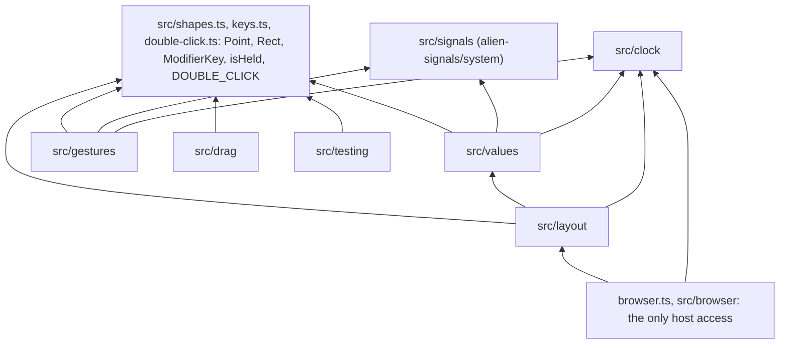
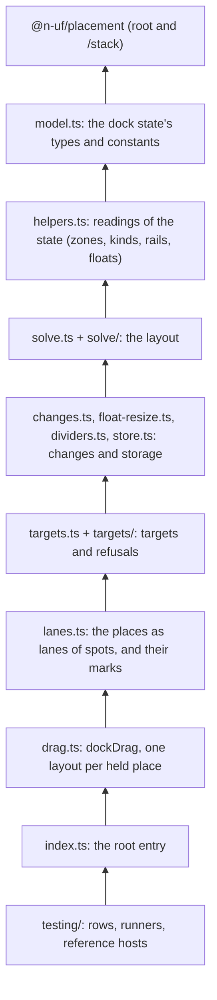
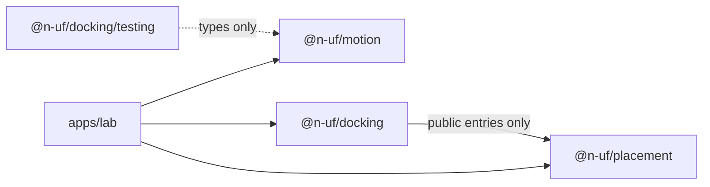

# Project structure

**What this page is.** How the repository is laid out: the packages and their entries, the layers inside each package
folder by folder, the direction every import may take, where the tests, the conformance suites, the old-vs-new
recorders and the lab live, and how a release is cut. The concept is [concept.md](./concept.md); every public type and
signature is in [sdk.md](./sdk.md).

## The workspace

A pnpm workspace (`pnpm-workspace.yaml`: `packages/*` and `apps/*`), Node 22 or later.

| Folder | What it is | Published |
| --- | --- | --- |
| `packages/motion` | `@n-uf/motion`: how things move. One runtime dependency, `alien-signals`. | npmjs and GitHub Packages |
| `packages/placement` | `@n-uf/placement`: where things fit. No dependency. | npmjs and GitHub Packages |
| `packages/docking` | `@n-uf/docking`: where panels and toolbars dock. Depends on `@n-uf/placement`; `@n-uf/motion` is an optional peer, for the types its testing entry checks. | npmjs and GitHub Packages |
| `apps/lab` | The lab (`motion-lab`, Vite, on port 3060): working pages and the checks that play them. | no |
| `docs/` | The concept, the design and reference pages, the SDK listing, this page, [decisions](./decisions/) and [proposals](./proposals/). | no |
| `scripts/` | The repository checks and the release helpers (below). | no |
| `record/` | The shared part of the old-vs-new recorders (`canon.ts`, `config.ts`). | no |
| `.changes-expect/` | Old-vs-new expect files: the outputs a change means to move. | no |

## Packages and entries

Each entry is a file the package's `exports` map names; a published package points the same entries at `dist/`.

| Entry | File | Purpose |
| --- | --- | --- |
| `@n-uf/motion` | `packages/motion/index.ts` | Everything host-free: re-exports the six folders below, the shapes and `shapeEquals`. |
| `@n-uf/motion/clock` | `src/clock/index.ts` | The clock port, the fake clock, the frame loop, the coalescer. |
| `@n-uf/motion/signals` | `src/signals/index.ts` | `signal`, `computed`, `effect`, `batch`. |
| `@n-uf/motion/values` | `src/values/index.ts` | Animators, the settle curve, easing, `motionValue`. |
| `@n-uf/motion/gestures` | `src/gestures/index.ts` | The recognizer, modifier keys, wheel rules, the timed machines. |
| `@n-uf/motion/drag` | `src/drag/index.ts` | The drag intent, the pick, lift and grip, preview plans, guide rects, the landing model. |
| `@n-uf/motion/layout` | `src/layout/index.ts` | Layout motion, the held item, `anchoredMorph`. |
| `@n-uf/motion/testing` | `src/testing/index.ts` | Frame-sampled checks of the motion rules. |
| `@n-uf/motion/browser` | `packages/motion/browser.ts` | The browser clock, the reduced-motion query, the DOM writers. Not in the root. |
| `@n-uf/placement` | `packages/placement/index.ts` | Shapes, geometry, `Side`, `Axis`, `Target`. |
| `@n-uf/placement/stack` | `src/stack/index.ts` | One edge: cut, fit, ladders, dividers, drop places, float fit. |
| `@n-uf/placement/tiling` | `src/tiling/index.ts` | Panes dividing an area, the drop rules, `tilingDrag` and its conformance run. |
| `@n-uf/placement/popup` | `src/popup/index.ts` | The popup positioner. |
| `@n-uf/docking` | `packages/docking/src/index.ts` | One model of a whole window. |
| `@n-uf/docking/testing` | `src/testing/index.ts` | Conformance rows, landing rows, runners, reference hosts, type checks. |

## Layers inside each package

Within a package a folder reaches another folder only through its `index.ts` (`cross-folder-via-index`), and nothing
imports in a circle (`no-circular`). The layers below are read from the imports.

### `@n-uf/motion`

- `src/clock`: the port (`port.ts`), the fake clock, the frame loop, the coalescer.
- `src/signals`: the one signal graph, on `alien-signals/system`.
- `src/values`: the animator interface, spring, tween, settle, the scalar step, easing, `reveal`/`popIn`,
  `motionValue`.
- `src/gestures`: the recognizer, modifiers, wheel rules, the machine runner, the dwell, touch-press and paged-swipe
  machines (with its own `__tests__`).
- `src/layout`: layout motion (`motion.ts`), the held item (`held.ts`), `anchoredMorph`.
- `src/drag`: the intent (`intent.ts`), grip and lift (`grip.ts`), preview plans, guide rects, the landing model
  (`landing.ts`, with its regions and the hand's speed, `hand-speed.ts`, which is internal).
- `src/testing`: the frame checks.
- `src/browser` and `browser.ts`: the browser clock, the DOM writers, `flip`.

`src/drag` and `src/testing` import no other folder: a host calls the drag models with a point and a time.

### `@n-uf/placement`

- The root: `src/geometry.ts` (the shapes and their geometry), `src/side.ts` (`Side`, `Axis`), `src/target.ts`
  (`Target`), re-exported by `index.ts`.
- `src/stack`: the edge cut (`cut.ts`), the form model and its flags (`model.ts`), `controlLadder` (`ladder.ts`), the
  fit (`layout.ts`), asked lengths and dividers (`divide.ts`), one edge's drop places (`gaps.ts`), the float fit
  (`float-fit.ts`).
- `src/tiling`: order layouts (`order.ts`), the split tree and its changes (`split.ts`), its layout (`layout.ts`), the
  drop rules (`drop.ts`), pane regions (`regions.ts`), targets (`targets.ts`), `giveWay`, `neighbor`, and the tiling
  drag: `drag.ts` (`tilingDrag`, `TilingTree`), `reference.ts` (`splitTreeOps`), `conformance.ts`
  (`tilingConformance`).
- `src/popup`: the positioner.

Each of `stack`, `tiling` and `popup` stands on the root alone, never on another (`stack-root-only`, `tiling-root-only`,
`popup-root-only`).

### `@n-uf/docking`

- `solve/`: the cut and the edges (`edge.ts`, `bars.ts`, `columns.ts`, `sides.ts`, `rails.ts`, `order.ts`), give-way by
  height (`bar-giveway.ts`), insets, the keep-clear resolver (`keep-clear.ts`), floats, notes, and the draft solve.
- `targets/`: the edges a drop can take (`edges.ts`, `virtual.ts`, `anchor.ts`, `rail-strip.ts`), kinds, the tiles,
  space ownership, the filter, the least hit, and the ids (`ids.ts`).
- `testing/`: the conformance rows (`rows-*.ts`), the landing rows (`landing.ts`), the runner and the reference hosts
  (`run.ts`, `host.ts`), the reference windows (`windows.ts`, `world.ts`) and `AssertLanding`/`AssertGeometry`
  (`landing-check.ts`). It reads the root, `drag.ts`, `lanes.ts` and `solve.ts`, and `@n-uf/motion/drag`'s types only.

## Dependency direction

The rules, in `.dependency-cruiser.cjs`, run by `pnpm dirt` against a ceiling of zero:

| Rule | Forbids |
| --- | --- |
| `placement-not-motion`, `motion-not-placement` | Either of the two importing the other. |
| `motion-not-docking`, `placement-not-docking` | Motion or placement importing docking. |
| `docking-not-motion` | Docking's model importing motion. |
| `docking-testing-motion-types-only` | Docking's testing entry importing motion's code (types are allowed). |
| `docking-placement-entries-only` | Docking importing placement past its public entries. |
| `packages-not-apps`, `apps-public-entries-only` | A package importing an app; an app importing past a package's entries. |
| `cross-folder-via-index`, `no-circular` | A folder reaching into another's files; an import cycle. |
| `stack-root-only`, `tiling-root-only`, `popup-root-only` | A placement entry folder importing another. |

Each package's `scripts/check-dist.mjs` (run by its `build`) checks the built files the same way: no host globals or DOM
types outside motion's browser entry, imports only of its own chunks and its declared dependencies, and one signal
graph in motion's build.

## Tests and checks

| What | Where | Run by |
| --- | --- | --- |
| Unit and property tests | `packages/<pkg>/test/*.test.ts` (vitest); motion's gesture tests also in `src/gestures/__tests__` | `pnpm --filter <pkg> test` |
| Docking's sweeps (the heaviest files, listed in its `vitest.config.ts`) | `packages/docking/test` | `pnpm --filter @n-uf/docking test:sweep` (its `test` skips them) |
| The purity guards | `test/guard.test.ts` in motion and placement; each package's `scripts/check-dist.mjs` | `pnpm check` |
| Benchmarks | `packages/motion/bench` (signals, with `RESULTS.md`), `packages/placement/bench` | `pnpm bench` |
| Repository checks | `scripts/`: `dirt.mjs` (dependency rules, duplicate code by jscpd, unused code by knip, against `dirt-baseline.json`, which only goes down), `public-words.mjs`, `terminology.mjs`, `changelog.mjs` | `pnpm dirt`, `pnpm public-words`, `pnpm terminology`, `pnpm changes` |

`pnpm check` runs the type checks, the tests, the builds with their dist checks, the lab's type check and the repository
checks; `pnpm check:quick` is the same without docking's sweeps. CI runs the two as parallel jobs on a pull request that
is not a draft.

### Conformance suites

A conformance suite is shipped in a public entry, so a host runs it on its own implementation with no test runner:

- **`@n-uf/docking/testing`**: the conformance rows (`CASES`, played with `runCase` on a `CaseHost`), the landing rows
  (`LANDING_CASES`, played with `runLandingCases` on a `LandingCaseHost`), the reference hosts (`createReferenceHost`,
  `createLandingHost`), the hand rule's bound (`handBound`), and the type checks `AssertLanding` and `AssertGeometry`.
- **`@n-uf/placement/tiling`'s `tilingConformance`**: the tiling drag's properties (`TILING_PROPERTIES`) over every
  subject of a host's trees and every held place, on the host's own `TilingTree` adapter.

The library's own tests run both on the reference implementations.

### Old vs new

`pnpm old-vs-new <base>` records the public outputs of the three packages at a base commit and at the head over a fixed
corpus and prints, per package and per output kind, how many cases are the same and how many changed. The recorders are
`packages/<pkg>/record/<pkg>.record.ts` (each with its own vitest config) on the shared `record/canon.ts` and
`record/config.ts`; a change that means to move outputs lists them in `.changes-expect/<slug>.json`. The full contract
is [old-vs-new.md](./old-vs-new.md).

## The lab

`apps/lab` (`pnpm lab`, on `http://localhost:3060`) is a Vite app, never published, that imports the packages through
their public entries only.

| Page | Source | What it holds |
| --- | --- | --- |
| Overview, Glossary | `src/pages/overview.html`, `glossary.html` | The tour, and the words every page and doc uses. |
| Settle and tiling | `src/pages/tiling.html`, `src/main.ts` | A tiling stage whose windows are the items of one layout motion (master, dwindle, columns, grid), with the drop previews. |
| Drag intent and previews | `src/shell/pages.ts`, `src/docwin/` | The drag intent's cases on the Document window. |
| Tiling drag | `src/pages/tiling-drag.html`, `src/tiling-drag/` | A host of `tilingDrag` over the reference adapter, with presets (a held swap reopening the old place); which place the pointer holds is the page's own pick until the hit half is built. Headless: `window.__tilingDrag`. |
| Document window | `src/pages/docwin.html`, `src/docwin/` | The reference host of `@n-uf/docking`: panels, toolbars and floats in a window; every conformance row plays on it, and its presets (one per rule: one layout, one preview, keep-clear, growers, the side strip, ...) are tried by a real mouse. |
| Checks | `src/pages/checks.html`, `src/shell/checks.ts` | Runs the pages' scenarios; `window.__motionLab.runAll()` returns the results for a headless run. |

The shell (`src/shell`) holds the page list and the check runner; `src/shared` the helpers the pages share. How presets,
the headless run and the pre-render work is [lab-checks.md](./lab-checks.md).

## Releases

- **One version for the three packages,** a calendar version `YY.M.R` (the release of the month), not a semantic
  version: any release may break. `release.yml` refuses to publish when the three `package.json` versions differ.
- **Changelog fragments.** A change adds `packages/<pkg>/changes/<yyyy-mm-dd>-<slug>.md` per package it changes, the
  markdown that would go under Unreleased, and never edits a CHANGELOG's `## Unreleased`. `pnpm changes` checks them.
- **The bump.** `pnpm release:next-version` names the next version; `pnpm version:bump` bumps motion's version,
  copies it to the other two (`scripts/sync-versions.mjs`) and joins every package's fragments under the new version
  heading (`scripts/changelog.mjs join`), deleting them.
- **`release.yml`.** A push to `main` that changes more than docs runs `verify` (one version, then `pnpm check`) and
  then `publish`, once per package and one at a time (`@n-uf/motion` tagged `v<version>`, `@n-uf/placement`
  `placement-v<version>`, `@n-uf/docking` `docking-v<version>`, docking after placement). Each packs one tarball and
  publishes it to npmjs first, by trusted publishing (no stored token, with provenance), then to GitHub Packages, tags
  it, and may notify a downstream repository. A version already on a registry is skipped, so a re-run is safe.
- **Branches.** Work lands on `live/motion`, the integration branch the labs and hosts run from source; a release is a
  pull request to `main` that carries the bump.
